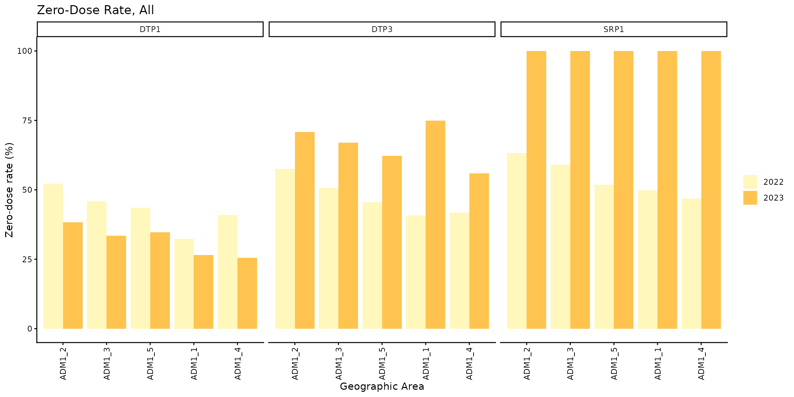
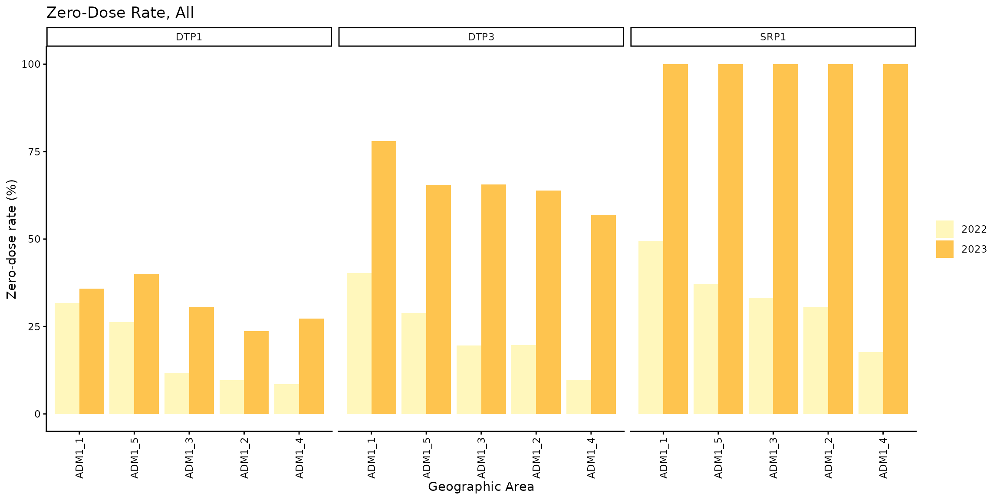
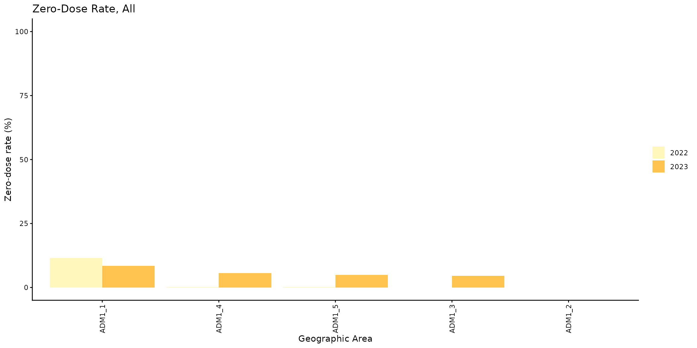
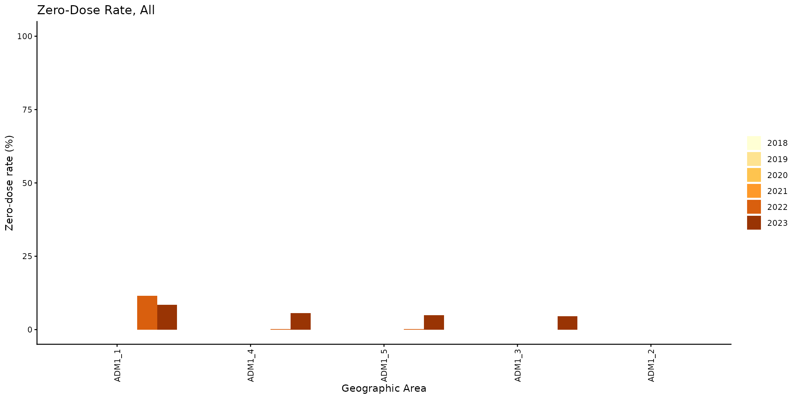

# Zero-Dose Rate

[🌐 Lea esto en
español](https://im-data-paho.github.io/immunabc/articles/es/zero_dose_es.md)
[📖 Read the PAHO
manual](https://iris.paho.org/server/api/core/bitstreams/21114cb1-8b3e-4ac5-afcf-016635313c14/content#page=54)

## Rationale

The objective of this indicator is to identify the people who have no
record of receiving a given set of vaccines, known as zero-dose people.
They are the most exposed to vaccine-preventable diseases and usually
belong to communities that the immunization program is not reaching.
Knowing how many there are, where they live and, when individual records
are available, who they are, allows the program to plan targeted
strategies to reach them.

The zero-dose rate is the complement of coverage for a specific birth
cohort:

``` math
\begin{aligned}
&\text{Zero-dose rate (\%)} = \\
&100 - \text{Coverage (\%)} = \\
&100 - \frac{\text{# of people with a record of the vaccine in a specific birth cohort}}{\text{Total people in the specific birth cohort}} \times 100
\end{aligned}
```

The total people in the birth cohort (the denominator) is taken from the
most detailed source provided:

1.  Individual population records (`data.pop_ids`), if given. These take
    priority over any other source.
2.  Otherwise, a population table (`data.pop`), if given.
3.  Otherwise, the people found in the EIR itself.

> **Note**
>
> All functions used for zero-dose analyses within immunABC begin with
> the `zd_` prefix.

## Glossary

### Zero-Dose

A zero-dose person is someone with no record of receiving a given
vaccine. When the analysis covers several vaccines at once, a zero-dose
person is someone with no record of any of them.

### Birth Cohort

A birth cohort is the group of all individuals born within the same
period of time, typically a single calendar year. For example, the 2022
birth cohort comprises everyone born during the year 2022.

### Political Geographic Boundaries

Throughout this vignette, we will make reference to different levels of
political geographic boundaries. These levels are defined by the
country/territory and can have different names from country to country.
immunABC is agnostic to these names and requires the user to recode
their variable names to fit the immunABC structure.

Namely, immunABC can distinguish three administrative levels, which
listed from top to bottom level are: ADM0, ADM1 and ADM2.

1.  ADM0: The country. This is the top-most administrative level.
2.  ADM1: The first geographic subdivision in the country. ADM0 contains
    several ADM1 subdivisions.
3.  ADM2: The second geographic subdivision in the country. Each ADM1
    contains several ADM2 subdivisions.

### Vaccine Names

Our example datasets use a specific naming convention for the vaccine
doses. This might not match your own naming schemes, but it will not
affect the usage of the package as long as you make sure to be
consistent when naming vaccine doses.

For example, the vaccine names used in the immunABC package are:

| Abbreviation | Full Name                                             |
|--------------|-------------------------------------------------------|
| SRP1         | Measles, Rubella, and Mumps Vaccine (1st dose)        |
| DTP1         | Diphtheria, Tetanus, and Pertussis Vaccine (1st dose) |
| DTP2         | Diphtheria, Tetanus, and Pertussis Vaccine (2nd dose) |
| DTP3         | Diphtheria, Tetanus, and Pertussis Vaccine (3rd dose) |
| BCG RN       | Bacillus Calmette–Guérin Vaccine (at birth)           |
| YFV1         | Yellow Fever Vaccine (1st dose)                       |

## Usage

### Install Package

The first step to run the zero-dose analyses is to install the immunABC
package available on GitHub.

``` r

devtools::install_github("IM-Data-PAHO/immunabc")
```

### Load Data

The functions in this module work with up to three datasets in a
specific format.

1.  Your EIR.
2.  Optionally, a table with population denominators at the same
    geographic level of disaggregation as your analysis.
3.  Optionally, a table of individual population records, such as a
    civil registry, that can be cross-referenced with the EIR.

To make it easy for you to test out immunABC’s functionality and
understand the structure we require for your datasets, we will now
explore the example datasets provided by immunABC that are used by this
module.

#### EIR

The
[`immunabc::immunABC.EIR`](https://im-data-paho.github.io/immunabc/reference/immunABC.EIR.md)
data frame provides a simulated, nominal-level table representing
individual vaccination events from an Electronic Immunization Registry
(EIR). Each row corresponds to a single vaccination act for a person,
including information on their residence, where they were vaccinated
(occurrence), their date of birth, and the vaccine dose received.

``` r

immunABC.EIR %>% head() %>% kable(caption = "Example Electronic Immunization Registry")
```

| ID | date_birth | date_vax | ADM1_residence | ADM2_residence | ADM1_occurrence | ADM2_occurrence | dose |
|---:|:---|:---|:---|:---|:---|:---|:---|
| 191997 | 2023-08-08 | 2023-12-26 | ADM1_4 | ADM2_4_35 | ADM1_4 | ADM2_4_35 | DTP2 |
| 212189 | 2023-12-20 | 2023-12-26 | ADM1_5 | ADM2_5_61 | ADM1_5 | ADM2_5_61 | BCG RN |
| 118063 | 2022-09-15 | 2023-12-26 | ADM1_2 | ADM2_2_5 | ADM1_2 | ADM2_2_5 | DTP1 |
| 118063 | 2022-09-15 | 2023-12-26 | ADM1_2 | ADM2_2_5 | ADM1_2 | ADM2_2_5 | YFV1 |
| 130751 | 2022-10-27 | 2023-12-12 | ADM1_5 | ADM2_5_55 | ADM1_5 | ADM2_5_55 | YFV1 |
| 136532 | 2021-09-21 | 2023-12-26 | ADM1_3 | ADM2_3_12 | ADM1_3 | ADM2_3_12 | SRP1 |

Example Electronic Immunization Registry {.table style="width:100%;"}

- `ID`: Unique person identification number.
- `date_birth`: Date of birth of person.
- `date_vax`: Date of vaccination event.
- ADM1: Refers to the first geographic administrative level of the
  country.
- ADM2: Refers to the second geographic administrative level of the
  country.
- Residence: Refers to the place where the person lives.  
- Occurrence: Refers to the place where the vaccination event
  occurred.  
- `dose`: A combined variable representing the vaccine type and its
  corresponding dose number. For example, DTP1 refers to the first dose
  of a vaccine containing diphtheria, tetanus, and pertussis components.

#### Population Denominators

While not mandatory, this module lets you provide a population table to
use as denominator. The geographic level of this table will be directly
dependent on the geographic level of your analysis. For example, if you
were to perform an analysis at ADM1 level, the required population
denominator table must contain the following.

``` r

immunABC.pop.ADM1 %>% head() %>% kable(caption = "Example Population at ADM1")
```

| ADM1   | year | age | population |
|:-------|-----:|----:|-----------:|
| ADM1_1 | 2022 |   0 |   1718.189 |
| ADM1_1 | 2022 |   1 |   1808.964 |
| ADM1_1 | 2023 |   0 |   1703.145 |
| ADM1_1 | 2023 |   1 |   1792.443 |
| ADM1_2 | 2022 |   0 |   6575.261 |
| ADM1_2 | 2022 |   1 |   6922.644 |

Example Population at ADM1 {.table}

Note that this table is in long format and contains the `population` of
children of a specific `age` during a given `year` for a certain `ADM1`
level.

> **Note**
>
> Please take into account that since this analysis is performed with
> birth cohorts, only the rows with `age`=0 are of interest in the
> population table, since these represent the number of children that
> belong to that specific birth cohort (year).

#### Individual Population Records

Also optional, this module lets you provide a table of individual
population records. Since each row is a person, it allows the module to
count the people missing from the EIR and to list each of them. The
[`immunabc::immunABC.pop_ids_expanded_to_pop`](https://im-data-paho.github.io/immunabc/reference/immunABC.pop_ids_expanded_to_pop.md)
data frame contains every person in `immunABC.EIR`, plus simulated
people with no vaccination records, so that each birth cohort matches
the population in `immunABC.pop.ADM2`.

``` r

immunABC.pop_ids_expanded_to_pop %>% head() %>% kable(caption = "Example Individual Population Records")
```

|  ID | date_birth | ADM1_residence | ADM2_residence | name                            |
|----:|:-----------|:---------------|:---------------|:--------------------------------|
|   1 | 2013-12-14 | ADM1_2         | ADM2_2_5       | Dion Rodriguez Romo             |
|   2 | 1998-12-21 | ADM1_3         | ADM2_3_8       | Henry Hernandez Contreras       |
|   3 | 1986-12-02 | ADM1_3         | ADM2_3_16      | Moses Torres Martinez           |
|   4 | 1986-06-07 | ADM1_3         | ADM2_3_17      | Keylian Saldana Wilson          |
|   5 | 1958-09-10 | ADM1_3         | ADM2_3_13      | Berenise Salazar Bautista Rubio |
|   6 | 2017-09-18 | ADM1_2         | ADM2_2_5       | Rocela Cazares Medina           |

Example Individual Population Records {.table}

- `ID`: Unique person identification number. It must match the `ID` used
  in the EIR.
- `name`: Name of the person.
- `date_birth`: Date of birth of person.
- `ADM1_residence` / `ADM2_residence`: First and second geographic
  administrative levels of the person’s residence.

> **Note**
>
> The simulated people with no vaccination records were only added to
> the 2022 and 2023 birth cohorts. This dataset was built to match
> `immunABC.pop.ADM2`, and the example population tables only hold the
> population of those two birth cohorts. People born in any other year
> come only from the EIR, so all of them have at least one vaccination
> record.

### Zero-dose analysis

This module lets users estimate the zero-dose rate by birth cohort for
any vaccine, or for a set of vaccines at once. It represents the
percentage of people of a specific year of birth with no record of the
vaccine, regardless of when they would have been vaccinated. Results can
be aggregated at the national level or subnational levels (`ADM1` or
`ADM2`).

When individual records are available (the EIR alone, or
`data.pop_ids`), the module can also produce an operative output: one
row per person, with the date of each vaccine and a `Category` column.
Filtering this table for `ZERO_DOSE` gives the list of zero-dose people
to follow up.

#### Expected Workflow

The
[`zd_rate()`](https://im-data-paho.github.io/immunabc/reference/zd_rate.md),
[`zd_barplot()`](https://im-data-paho.github.io/immunabc/reference/zd_barplot.md)
and
[`zd_list()`](https://im-data-paho.github.io/immunabc/reference/zd_list.md)
functions provide a way of analyzing, visualizing and acting on the
zero-dose rate. Their relationships are shown in Figure 1.


Figure 1. Expected workflow for the zero-dose analysis.

  

- [`zd_rate()`](https://im-data-paho.github.io/immunabc/reference/zd_rate.md)
  computes the zero-dose rate for each vaccine, birth cohort and
  geographic area. When no `vaccines` are specified, it also includes
  the rows with `dose` “All”, which count as vaccinated the people with
  at least one vaccine.
- [`zd_barplot()`](https://im-data-paho.github.io/immunabc/reference/zd_barplot.md)
  takes the output of
  [`zd_rate()`](https://im-data-paho.github.io/immunabc/reference/zd_rate.md)
  and plots one panel per vaccine. When
  [`zd_rate()`](https://im-data-paho.github.io/immunabc/reference/zd_rate.md)
  was run without `vaccines`, it plots the combined “All” rate instead.
  If a group has more vaccinated people than population, its rate is
  negative; the bar shows its absolute value with a red outline.
- [`zd_list()`](https://im-data-paho.github.io/immunabc/reference/zd_list.md)
  produces the operative output: one row per person, taken from
  `data.pop_ids` and the EIR if `data.pop_ids` is provided, or from the
  EIR otherwise, with the date of each vaccine and a `Category` column:
  `COMPLETE` if the person has all the vaccines analyzed, `PARTIAL` if
  they have some, and `ZERO_DOSE` if they have none. Since it lists
  people, it does not use population tables.

#### Example 1: EIR only

Here we compute the zero-dose rate for the first and third doses of DTP
and the first dose of the measles-containing vaccine, for the 2022 and
2023 birth cohorts, using only the EIR. The denominator is therefore the
people found in the EIR.

``` r

# compute zero-dose rate
zd_eir <- zd_rate(
  data.EIR = immunABC.EIR,
  geo_level = "ADM1",
  vaccines = c("DTP1", "DTP3", "SRP1"), # this can be a single vaccine
  birth_cohorts = c(2022, 2023) # this can be a single year
)

# show rate in table
zd_eir %>%
  kable(digits = 2, caption = "Zero-dose rate by ADM1 level")
```

| dose | birth_cohort | ADM1   | numerator | population | coverage | zd_rate |
|:-----|-------------:|:-------|----------:|-----------:|---------:|--------:|
| DTP1 |         2022 | ADM1_1 |      1173 |       1733 |    67.69 |   32.31 |
| DTP1 |         2022 | ADM1_2 |      5939 |      12428 |    47.79 |   52.21 |
| DTP1 |         2022 | ADM1_3 |     27168 |      50238 |    54.08 |   45.92 |
| DTP1 |         2022 | ADM1_4 |      3768 |       6382 |    59.04 |   40.96 |
| DTP1 |         2022 | ADM1_5 |      1969 |       3488 |    56.45 |   43.55 |
| DTP1 |         2023 | ADM1_1 |      1093 |       1488 |    73.45 |   26.55 |
| DTP1 |         2023 | ADM1_2 |      4979 |       8066 |    61.73 |   38.27 |
| DTP1 |         2023 | ADM1_3 |     21154 |      31819 |    66.48 |   33.52 |
| DTP1 |         2023 | ADM1_4 |      2968 |       3984 |    74.50 |   25.50 |
| DTP1 |         2023 | ADM1_5 |      1585 |       2426 |    65.33 |   34.67 |
| DTP3 |         2022 | ADM1_1 |      1025 |       1733 |    59.15 |   40.85 |
| DTP3 |         2022 | ADM1_2 |      5279 |      12428 |    42.48 |   57.52 |
| DTP3 |         2022 | ADM1_3 |     24746 |      50238 |    49.26 |   50.74 |
| DTP3 |         2022 | ADM1_4 |      3716 |       6382 |    58.23 |   41.77 |
| DTP3 |         2022 | ADM1_5 |      1900 |       3488 |    54.47 |   45.53 |
| DTP3 |         2023 | ADM1_1 |       374 |       1488 |    25.13 |   74.87 |
| DTP3 |         2023 | ADM1_2 |      2353 |       8066 |    29.17 |   70.83 |
| DTP3 |         2023 | ADM1_3 |     10498 |      31819 |    32.99 |   67.01 |
| DTP3 |         2023 | ADM1_4 |      1756 |       3984 |    44.08 |   55.92 |
| DTP3 |         2023 | ADM1_5 |       914 |       2426 |    37.68 |   62.32 |
| SRP1 |         2022 | ADM1_1 |       869 |       1733 |    50.14 |   49.86 |
| SRP1 |         2022 | ADM1_2 |      4564 |      12428 |    36.72 |   63.28 |
| SRP1 |         2022 | ADM1_3 |     20552 |      50238 |    40.91 |   59.09 |
| SRP1 |         2022 | ADM1_4 |      3388 |       6382 |    53.09 |   46.91 |
| SRP1 |         2022 | ADM1_5 |      1679 |       3488 |    48.14 |   51.86 |
| SRP1 |         2023 | ADM1_1 |         0 |       1488 |     0.00 |  100.00 |
| SRP1 |         2023 | ADM1_2 |         2 |       8066 |     0.02 |   99.98 |
| SRP1 |         2023 | ADM1_3 |         5 |      31819 |     0.02 |   99.98 |
| SRP1 |         2023 | ADM1_4 |         0 |       3984 |     0.00 |  100.00 |
| SRP1 |         2023 | ADM1_5 |         1 |       2426 |     0.04 |   99.96 |

Zero-dose rate by ADM1 level {.table}

##### Parameters accepted by `zd_rate()`

- `data.EIR`: EIR data frame in immunABC format.
- `geo_level`: `"ADM0"` (default), `"ADM1"`, or `"ADM2"`.
- `vaccines`: Character vector of doses to include, one rate per `dose`.
  Default `NULL` includes all doses in `data.EIR` and adds the combined
  “All” rows.
- `birth_cohorts`: Numeric vector of birth cohort year(s) to include.
  Default `NULL` includes every person, regardless of birth year.
- `data.pop`: Population denominators at the same geographic level as
  `geo_level`. Default `NULL`. See Example 2.
- `data.pop_ids`: Individual population records, used as denominators
  instead of `data.pop` or the EIR. Their residence is never modified:
  when `geo_level` is `"ADM1"` or `"ADM2"`, a warning reports the people
  whose residence differs from the EIR, which should be corrected before
  running the analysis. Default `NULL`. See Example 3.
- `fix_residence`: When `geo_level` is `"ADM1"` or `"ADM2"`, each person
  in the EIR must have a single residence so they are counted in a
  single area. `TRUE` (default) assigns people with more than one
  residence the residence of their most recent vaccination, with a
  warning; `FALSE` stops with an error.

We can visually observe these results by calling the
[`zd_barplot()`](https://im-data-paho.github.io/immunabc/reference/zd_barplot.md)
function as shown below.

``` r

# visualize output from zd_rate()
zd_eir_plot <- zd_barplot(data = zd_eir)

# show
zd_eir_plot
```



##### Parameters accepted by `zd_barplot()`

- `data`: Output of
  [`zd_rate()`](https://im-data-paho.github.io/immunabc/reference/zd_rate.md).
- `vaccine`: Character vector of doses to plot, one panel per `dose`.
  Default `NULL` plots the combined “All” rate if present in `data`, or
  every dose otherwise.
- `birth_cohorts`: Numeric vector of birth cohort year(s) to plot, up
  to 9. Default `NULL` plots the latest 9 cohorts in `data`.
- `within_ADM1`: Character vector to filter specific ADM1 units when
  `data` is at the ADM2 level. Default: `NULL`.
- `palette`: RColorBrewer palette for the birth cohort colors. Default:
  `"YlOrBr"`.

Since everyone in the EIR has at least one vaccination record, the rates
show who is missing each specific vaccine, not who has no vaccines at
all. Comparing panels shows which vaccines leave more people behind in
each area.

The operative output, produced by
[`zd_list()`](https://im-data-paho.github.io/immunabc/reference/zd_list.md),
lists every person in the EIR with the date of each vaccine analyzed.

``` r

# list each person and their vaccines
zd_eir_list <- zd_list(
  data.EIR = immunABC.EIR,
  vaccines = c("DTP1", "DTP3", "SRP1"),
  birth_cohorts = c(2022, 2023)
)

# show the first rows
zd_eir_list %>% head(10) %>% kable(caption = "Operative output")
```

| ID | date_birth | ADM1_residence | ADM2_residence | DTP1 | DTP3 | SRP1 | Category |
|---:|:---|:---|:---|:---|:---|:---|:---|
| 569 | 2022-07-28 | ADM1_2 | ADM2_2_5 | 2022-10-25 | 2023-11-17 | 2023-11-17 | COMPLETE |
| 1843 | 2022-06-21 | ADM1_3 | ADM2_3_15 | NA | 2022-02-08 | 2022-12-06 | PARTIAL |
| 2399 | 2022-03-05 | ADM1_3 | ADM2_3_16 | NA | NA | 2023-03-10 | PARTIAL |
| 2736 | 2022-02-07 | ADM1_2 | ADM2_2_5 | 2022-04-11 | 2022-08-23 | 2023-02-22 | COMPLETE |
| 3074 | 2022-03-30 | ADM1_2 | ADM2_2_5 | NA | 2022-11-14 | 2023-05-24 | PARTIAL |
| 3520 | 2022-07-04 | ADM1_2 | ADM2_2_5 | 2022-09-04 | 2023-03-05 | NA | PARTIAL |
| 3717 | 2022-03-30 | ADM1_3 | ADM2_3_13 | 2022-06-18 | 2022-10-04 | 2023-05-19 | COMPLETE |
| 4022 | 2022-01-14 | ADM1_3 | ADM2_3_14 | 2022-03-21 | NA | NA | PARTIAL |
| 4121 | 2022-04-18 | ADM1_2 | ADM2_2_5 | 2022-06-18 | NA | NA | PARTIAL |
| 5102 | 2022-06-26 | ADM1_3 | ADM2_3_20 | 2022-09-05 | 2023-01-03 | NA | PARTIAL |

Operative output {.table}

##### Parameters accepted by `zd_list()`

- `data.EIR`: EIR data frame in immunABC format.
- `vaccines`: Character vector of doses to include, one date column per
  `dose`. Default `NULL` includes all doses in `data.EIR`.
- `birth_cohorts`: Numeric vector of birth cohort year(s) of the people
  to list. Default `NULL` lists every person, regardless of birth year.
- `data.pop_ids`: Individual population records. If provided, every
  person in it is listed, plus the people in the EIR who are missing
  from it, and the output includes `name` and `Source` columns. Default
  `NULL` lists the people in the EIR. See Example 3. Their residence is
  never modified; a warning reports the people whose residence differs
  from the EIR, which should be corrected before running the analysis.
- `fix_residence`: Each person in the EIR must have a single residence.
  `TRUE` (default) assigns people with more than one residence the
  residence of their most recent vaccination, with a warning; `FALSE`
  stops with an error.

> **Note**
>
> The population table (`data.pop`) or the individual population records
> (`data.pop_ids`) may cover fewer people than the EIR, for example if
> they are missing some birth cohorts, some geographic areas, or some of
> the people registered in the EIR. Each function handles this as
> follows:
>
> - [`zd_rate()`](https://im-data-paho.github.io/immunabc/reference/zd_rate.md)
>   always counts the vaccinated people from the EIR, whether or not
>   they are in the denominators. Birth cohorts or areas found in the
>   EIR but missing from the denominators are kept, with `NA`
>   population, coverage and zero-dose rate. If a group has more
>   vaccinated people in the EIR than in its denominator, its coverage
>   goes above 100%, its zero-dose rate becomes negative, and a warning
>   is shown.
> - [`zd_barplot()`](https://im-data-paho.github.io/immunabc/reference/zd_barplot.md)
>   leaves out the rows with `NA` zero-dose rate, and draws negative
>   rates as their absolute value with a red outline, adding a caption
>   to the plot.
> - [`zd_list()`](https://im-data-paho.github.io/immunabc/reference/zd_list.md)
>   lists every person in `data.pop_ids`, plus the people in the EIR who
>   are missing from it. Those people have no `name`, their date of
>   birth is taken from their earliest EIR record and their residence
>   from their most recent vaccination, and their `Source` column is
>   `EIR_ONLY` instead of `POP_IDS`. A warning reports how many of them
>   there are. Without `data.pop_ids` it lists everyone in the EIR, and
>   it never uses `data.pop`.

#### Example 2: EIR and population denominators

Here we compute the rates for the same vaccines and birth cohorts, but
take the denominators from the population table at ADM1 level. Since it
has no individual records, there is no operative output.

``` r

# compute zero-dose rate
zd_pop <- zd_rate(
  data.EIR = immunABC.EIR,
  geo_level = "ADM1",
  vaccines = c("DTP1", "DTP3", "SRP1"),
  birth_cohorts = c(2022, 2023),
  data.pop = immunABC.pop.ADM1
)

# show rate in table
zd_pop %>%
  kable(digits = 2, caption = "Zero-dose rate by ADM1 level, using population denominators")
```

| dose | birth_cohort | ADM1   | numerator | population | coverage | zd_rate |
|:-----|-------------:|:-------|----------:|-----------:|---------:|--------:|
| DTP1 |         2022 | ADM1_1 |      1173 |    1718.19 |    68.27 |   31.73 |
| DTP1 |         2022 | ADM1_2 |      5939 |    6575.26 |    90.32 |    9.68 |
| DTP1 |         2022 | ADM1_3 |     27168 |   30766.52 |    88.30 |   11.70 |
| DTP1 |         2022 | ADM1_4 |      3768 |    4117.38 |    91.51 |    8.49 |
| DTP1 |         2022 | ADM1_5 |      1969 |    2669.37 |    73.76 |   26.24 |
| DTP1 |         2023 | ADM1_1 |      1093 |    1703.14 |    64.18 |   35.82 |
| DTP1 |         2023 | ADM1_2 |      4979 |    6517.69 |    76.39 |   23.61 |
| DTP1 |         2023 | ADM1_3 |     21154 |   30497.13 |    69.36 |   30.64 |
| DTP1 |         2023 | ADM1_4 |      2968 |    4081.33 |    72.72 |   27.28 |
| DTP1 |         2023 | ADM1_5 |      1585 |    2645.99 |    59.90 |   40.10 |
| DTP3 |         2022 | ADM1_1 |      1025 |    1718.19 |    59.66 |   40.34 |
| DTP3 |         2022 | ADM1_2 |      5279 |    6575.26 |    80.29 |   19.71 |
| DTP3 |         2022 | ADM1_3 |     24746 |   30766.52 |    80.43 |   19.57 |
| DTP3 |         2022 | ADM1_4 |      3716 |    4117.38 |    90.25 |    9.75 |
| DTP3 |         2022 | ADM1_5 |      1900 |    2669.37 |    71.18 |   28.82 |
| DTP3 |         2023 | ADM1_1 |       374 |    1703.14 |    21.96 |   78.04 |
| DTP3 |         2023 | ADM1_2 |      2353 |    6517.69 |    36.10 |   63.90 |
| DTP3 |         2023 | ADM1_3 |     10498 |   30497.13 |    34.42 |   65.58 |
| DTP3 |         2023 | ADM1_4 |      1756 |    4081.33 |    43.03 |   56.97 |
| DTP3 |         2023 | ADM1_5 |       914 |    2645.99 |    34.54 |   65.46 |
| SRP1 |         2022 | ADM1_1 |       869 |    1718.19 |    50.58 |   49.42 |
| SRP1 |         2022 | ADM1_2 |      4564 |    6575.26 |    69.41 |   30.59 |
| SRP1 |         2022 | ADM1_3 |     20552 |   30766.52 |    66.80 |   33.20 |
| SRP1 |         2022 | ADM1_4 |      3388 |    4117.38 |    82.29 |   17.71 |
| SRP1 |         2022 | ADM1_5 |      1679 |    2669.37 |    62.90 |   37.10 |
| SRP1 |         2023 | ADM1_1 |         0 |    1703.14 |     0.00 |  100.00 |
| SRP1 |         2023 | ADM1_2 |         2 |    6517.69 |     0.03 |   99.97 |
| SRP1 |         2023 | ADM1_3 |         5 |   30497.13 |     0.02 |   99.98 |
| SRP1 |         2023 | ADM1_4 |         0 |    4081.33 |     0.00 |  100.00 |
| SRP1 |         2023 | ADM1_5 |         1 |    2645.99 |     0.04 |   99.96 |

Zero-dose rate by ADM1 level, using population denominators {.table}

##### Parameters accepted by `zd_rate()`

The same as in Example 1. Here, `data.pop` provides the denominators:

- `data.pop`: Population denominators in long format, at the same
  geographic level as `geo_level`. Only the rows with `age` 0 are used,
  as the population of each birth cohort.

``` r

# visualize output from zd_rate()
zd_pop_plot <- zd_barplot(data = zd_pop)

# show
zd_pop_plot
```



##### Parameters accepted by `zd_barplot()`

The same as in Example 1.

Unlike Example 1, the rates now include the children who are in the
population but missing from the EIR, so they are a better estimate of
how many people the program is not reaching.

#### Example 3: EIR and individual population records

Next, we use the individual population records as denominators, without
specifying any vaccines. The rate then includes the combined “All” rows,
and the operative output lists each person in the population records.

``` r

# compute zero-dose rate
zd_ids <- zd_rate(
  data.EIR = immunABC.EIR,
  geo_level = "ADM1",
  birth_cohorts = c(2022, 2023),
  data.pop_ids = immunABC.pop_ids_expanded_to_pop
)

# show combined rate in table
zd_ids %>%
  filter(dose == "All") %>%
  kable(digits = 2, caption = "Zero-dose rate for all vaccines by ADM1 level, using individual population records")
```

| dose | birth_cohort | ADM1   | numerator | population | coverage | zd_rate |
|:-----|-------------:|:-------|----------:|-----------:|---------:|--------:|
| All  |         2022 | ADM1_1 |      1733 |       1960 |    88.42 |   11.58 |
| All  |         2022 | ADM1_2 |     12428 |      12428 |   100.00 |    0.00 |
| All  |         2022 | ADM1_3 |     50238 |      50238 |   100.00 |    0.00 |
| All  |         2022 | ADM1_4 |      6382 |       6392 |    99.84 |    0.16 |
| All  |         2022 | ADM1_5 |      3488 |       3496 |    99.77 |    0.23 |
| All  |         2023 | ADM1_1 |      1488 |       1626 |    91.51 |    8.49 |
| All  |         2023 | ADM1_2 |      8066 |       8066 |   100.00 |    0.00 |
| All  |         2023 | ADM1_3 |     31819 |      33334 |    95.46 |    4.54 |
| All  |         2023 | ADM1_4 |      3984 |       4221 |    94.39 |    5.61 |
| All  |         2023 | ADM1_5 |      2426 |       2552 |    95.06 |    4.94 |

Zero-dose rate for all vaccines by ADM1 level, using individual
population records {.table}

##### Parameters accepted by `zd_rate()`

The same as in Example 1. Here, `data.pop_ids` provides the
denominators, and `vaccines` is not specified:

- `data.pop_ids`: Individual population records in immunABC format, with
  one row per person. They take priority over `data.pop` and over the
  EIR as denominators.
- `vaccines`: With the default `NULL`, every dose in `data.EIR` is
  included, and the combined “All” rows are added.

``` r

# visualize output from zd_rate()
zd_ids_plot <- zd_barplot(data = zd_ids)

# show
zd_ids_plot
```



##### Parameters accepted by `zd_barplot()`

The same as in Example 1. Since `vaccine` is not specified and `zd_ids`
contains the “All” rows, the plot shows the combined rate.

The operative output now includes the name of each person, the people
with no vaccination records at all, and a `Source` column showing
whether each person was found in the population records (`POP_IDS`) or
only in the EIR (`EIR_ONLY`). Every person in the example EIR is also in
`immunABC.pop_ids_expanded_to_pop`, so all rows here are `POP_IDS`.

``` r

# list each person and their vaccines
zd_ids_list <- zd_list(
  data.EIR = immunABC.EIR,
  birth_cohorts = c(2022, 2023),
  data.pop_ids = immunABC.pop_ids_expanded_to_pop
)

# show the first rows
zd_ids_list %>% head(10) %>% kable(caption = "Operative output")
```

| ID | name | date_birth | ADM1_residence | ADM2_residence | DTP2 | BCG RN | DTP1 | YFV1 | DTP3 | SRP1 | Category | Source |
|---:|:---|:---|:---|:---|:---|:---|:---|:---|:---|:---|:---|:---|
| 569 | Estibali Buenrostro Juarez Subia | 2022-07-28 | ADM1_2 | ADM2_2_5 | 2023-01-25 | NA | 2022-10-25 | 2023-11-17 | 2023-11-17 | 2023-11-17 | PARTIAL | POP_IDS |
| 1843 | Trevaughn Andrade Jr Colon | 2022-06-21 | ADM1_3 | ADM2_3_15 | NA | NA | NA | 2022-12-06 | 2022-02-08 | 2022-12-06 | PARTIAL | POP_IDS |
| 2399 | Yolanda Vera Reyes | 2022-03-05 | ADM1_3 | ADM2_3_16 | 2022-07-08 | NA | NA | 2023-03-10 | NA | 2023-03-10 | PARTIAL | POP_IDS |
| 2736 | Graciela Salcido Spurr Zayas | 2022-02-07 | ADM1_2 | ADM2_2_5 | 2022-06-07 | 2022-02-21 | 2022-04-11 | 2023-02-22 | 2022-08-23 | 2023-02-22 | COMPLETE | POP_IDS |
| 3074 | Arnoldo Grijalva Kutcher | 2022-03-30 | ADM1_2 | ADM2_2_5 | NA | NA | NA | 2023-07-06 | 2022-11-14 | 2023-05-24 | PARTIAL | POP_IDS |
| 3520 | Brenda Padilla Medina | 2022-07-04 | ADM1_2 | ADM2_2_5 | 2023-01-08 | NA | 2022-09-04 | NA | 2023-03-05 | NA | PARTIAL | POP_IDS |
| 3717 | Sol Nallely Sabino Sanchez | 2022-03-30 | ADM1_3 | ADM2_3_13 | NA | NA | 2022-06-18 | 2023-05-19 | 2022-10-04 | 2023-05-19 | PARTIAL | POP_IDS |
| 4022 | James Garibay Cline | 2022-01-14 | ADM1_3 | ADM2_3_14 | NA | NA | 2022-03-21 | NA | NA | NA | PARTIAL | POP_IDS |
| 4121 | Anthony Reyes Rodriguez | 2022-04-18 | ADM1_2 | ADM2_2_5 | 2022-08-19 | NA | 2022-06-18 | NA | NA | NA | PARTIAL | POP_IDS |
| 5102 | Andrea Salazar Garcia | 2022-06-26 | ADM1_3 | ADM2_3_20 | 2022-11-07 | NA | 2022-09-05 | NA | 2023-01-03 | NA | PARTIAL | POP_IDS |

Operative output {.table style="width:100%;"}

##### Parameters accepted by `zd_list()`

The same as in Example 1. Here, `data.pop_ids` provides the people to
list:

- `data.pop_ids`: Individual population records in immunABC format.
  Every person in it is listed, including those with no records in the
  EIR, and the output includes their `name`. People in the EIR who are
  missing from it are also listed, with no `name` and `Source` set to
  `EIR_ONLY`.

Filtering it for `Category == "ZERO_DOSE"` gives the list of zero-dose
people to follow up.

``` r

zd_ids_list %>%
  filter(Category == "ZERO_DOSE") %>%
  head(10) %>%
  kable(caption = "Operative output: zero-dose people")
```

| ID | name | date_birth | ADM1_residence | ADM2_residence | DTP2 | BCG RN | DTP1 | YFV1 | DTP3 | SRP1 | Category | Source |
|---:|:---|:---|:---|:---|:---|:---|:---|:---|:---|:---|:---|:---|
| 214031 | Mayra Flores Montoya | 2022-04-06 | ADM1_1 | ADM2_1_1 | NA | NA | NA | NA | NA | NA | ZERO_DOSE | POP_IDS |
| 214032 | Kevin Lucero Lovato | 2022-04-06 | ADM1_1 | ADM2_1_1 | NA | NA | NA | NA | NA | NA | ZERO_DOSE | POP_IDS |
| 214033 | Celeste Sierra Hagler | 2022-05-01 | ADM1_1 | ADM2_1_1 | NA | NA | NA | NA | NA | NA | ZERO_DOSE | POP_IDS |
| 214034 | Lisbeth Gamma Myers | 2022-10-11 | ADM1_1 | ADM2_1_1 | NA | NA | NA | NA | NA | NA | ZERO_DOSE | POP_IDS |
| 214035 | Fatima Caraveo Borrego | 2022-05-17 | ADM1_1 | ADM2_1_1 | NA | NA | NA | NA | NA | NA | ZERO_DOSE | POP_IDS |
| 214036 | Monique Marvin Saiz | 2022-01-05 | ADM1_1 | ADM2_1_1 | NA | NA | NA | NA | NA | NA | ZERO_DOSE | POP_IDS |
| 214037 | Joe Castillo Haro | 2022-09-28 | ADM1_1 | ADM2_1_1 | NA | NA | NA | NA | NA | NA | ZERO_DOSE | POP_IDS |
| 214038 | Melissa Accaira Archuleta | 2022-03-10 | ADM1_1 | ADM2_1_1 | NA | NA | NA | NA | NA | NA | ZERO_DOSE | POP_IDS |
| 214039 | Samuel Barron Lovato | 2022-04-08 | ADM1_1 | ADM2_1_1 | NA | NA | NA | NA | NA | NA | ZERO_DOSE | POP_IDS |
| 214040 | Pilar Razo Munoz Camacho Gutierrez | 2022-11-14 | ADM1_1 | ADM2_1_1 | NA | NA | NA | NA | NA | NA | ZERO_DOSE | POP_IDS |

Operative output: zero-dose people {.table}

#### Example 4: Individual population records without selecting birth cohorts

`birth_cohorts` is optional. When it is not specified, every person is
included regardless of when they were born. Here we repeat Example 3
without it.

``` r

# compute zero-dose rate and list for every birth cohort
zd_all <- zd_rate(
  data.EIR = immunABC.EIR,
  geo_level = "ADM1",
  data.pop_ids = immunABC.pop_ids_expanded_to_pop
)

zd_all_list <- zd_list(
  data.EIR = immunABC.EIR,
  data.pop_ids = immunABC.pop_ids_expanded_to_pop
)
```

The tables with the results of this run are not shown. For the 2022 and
2023 birth cohorts they hold the same results as Example 3, and adding
every other birth cohort makes them too large to show in this article.

##### Parameters accepted by `zd_rate()` and `zd_list()`

The same as in Example 3, except for `birth_cohorts`:

- `birth_cohorts`: Not specified, so with the default `NULL` both
  functions include every person in `data.pop_ids`, regardless of birth
  year.

The rate and the operative output now cover every person in the
population records. The number of zero-dose people does not change in
this example, and earlier birth cohorts show a zero-dose rate of 0 in
the plot below, because the example population records only add people
without vaccination records to the 2022 and 2023 birth cohorts (see the
note in [Individual Population
Records](#individual-population-records)).

The list of birth cohorts also includes implausible years, such as years
far in the past or in the future. They come from data entry errors in
the birth dates of the example EIR, which can be detected with the [Date
Consistency
Comparison](https://im-data-paho.github.io/immunabc/articles/en/date_consistency_comparison_en.md)
module.

[`zd_barplot()`](https://im-data-paho.github.io/immunabc/reference/zd_barplot.md)
shows at most 9 birth cohorts and, by default, keeps the latest ones,
which here would include some of those implausible years. Its
`birth_cohorts` argument selects which ones to plot.

``` r

# visualize a selection of birth cohorts from zd_rate()
zd_all_plot <- zd_barplot(data = zd_all, birth_cohorts = 2018:2023)

# show
zd_all_plot
```



##### Parameters accepted by `zd_barplot()`

The same as in Example 1. Here, `birth_cohorts` selects the cohorts to
plot:

- `birth_cohorts`: Numeric vector of up to 9 birth cohort years to plot.
  It only filters the plot: `zd_all` still contains every birth cohort.

## Summary

By measuring the zero-dose rate, immunABC helps public health officials
identify where the immunization program is not reaching people and how
many of them there are. When individual population records are
available, it also tells them who those people are, turning the
indicator into a list for action: follow-up visits, vaccination
campaigns and strategies to reach communities that have been left
behind.
