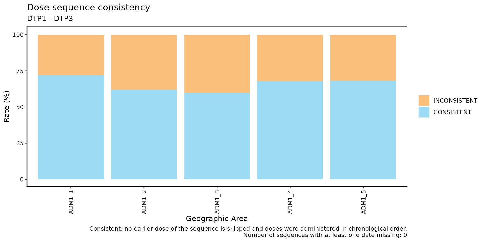
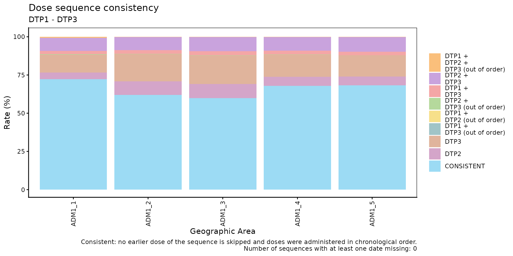
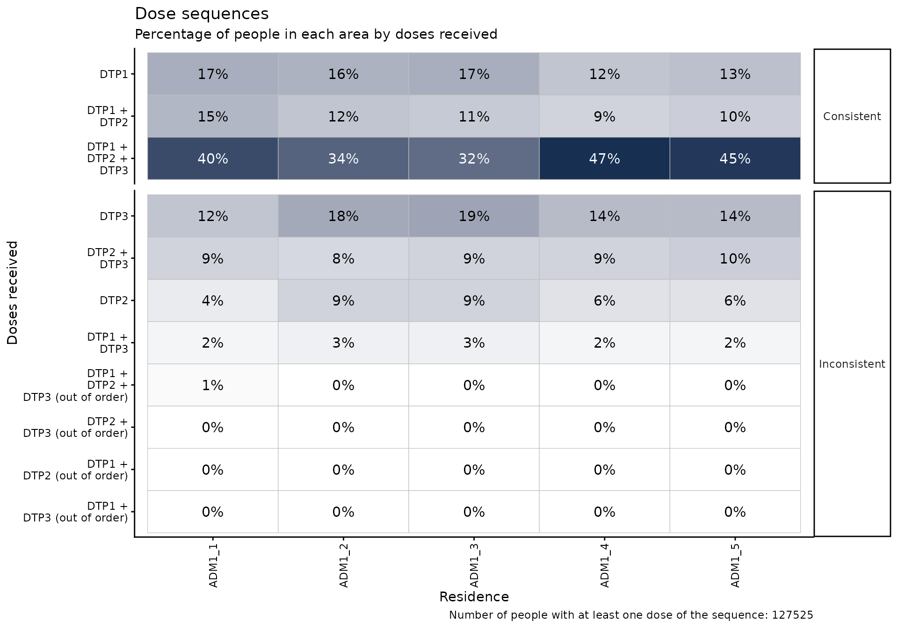
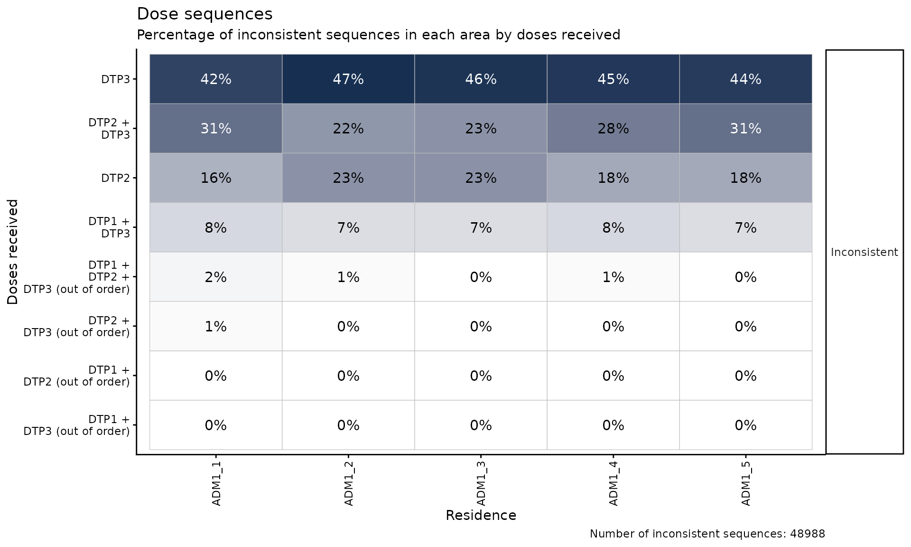

# Comparación de secuencia de dosis

[🌐 Read this in
English](https://im-data-paho.github.io/immunabc/articles/en/dose_sequence_comparison_en.md)

## Fundamento

Muchas vacunas de un esquema nacional de vacunación se administran como
una serie ordenada de dosis (p. ej., DTP1, DTP2 y DTP3). Cada dosis se
construye sobre la anterior, por lo que una persona no debería tener
registrada una dosis posterior sin las dosis previas, y cada dosis
debería administrarse después de la anterior.

Cuando un Registro Nominal de Vacunación electrónico (RNVe) contiene
personas con una dosis saltada (p. ej., DTP1 y DTP3 sin DTP2), o con
dosis administradas fuera de orden cronológico (p. ej., DTP2
administrada antes que DTP1), esto suele indicar problemas de calidad de
datos: dosis registradas con un número de dosis equivocado, dosis
administradas pero nunca registradas, o registros que no fueron
vinculados correctamente a la misma persona. Estos problemas sesgan
cualquier análisis posterior que dependa del número de dosis, como los
análisis de cobertura, abandono o esquema completo.

El módulo de comparación de secuencia de dosis permite evaluar, persona
por persona, si las dosis de una secuencia ordenada fueron registradas
de forma consistente. Una secuencia solo se considera consistente cuando
cumple ambas verificaciones:

1.  **Sin dosis saltadas**: no falta ninguna dosis anterior de la
    secuencia.
2.  **Orden cronológico**: las dosis recibidas fueron administradas en
    el orden de la secuencia.

Dado que se trata de un indicador nominal (evaluado persona por
persona), cada persona se asigna a un único lugar de residencia, por lo
que todos los resultados pueden desagregarse por nivel geográfico.

> **Nota**
>
> Todas las funciones utilizadas para los análisis de comparación de
> secuencia de dosis dentro de immunABC comienzan con el prefijo `sc_`.

## Glosario

### Divisiones político-geográficas

A lo largo de esta viñeta se hace referencia a distintos niveles de
división político-geográfica. Estos niveles son definidos por cada país
o territorio y pueden recibir nombres diferentes. immunABC no depende de
esos nombres locales; por eso, el usuario debe recodificar sus variables
para ajustarlas a la estructura que utiliza el paquete.

En concreto, immunABC puede distinguir tres niveles administrativos que,
listados del nivel superior al inferior, son: ADM0, ADM1 y ADM2.

1.  ADM0: El país. Este es el nivel administrativo más alto.
2.  ADM1: La primera subdivisión geográfica del país. ADM0 contiene
    varias subdivisiones ADM1.
3.  ADM2: La segunda subdivisión geográfica del país. Cada ADM1 contiene
    varias subdivisiones ADM2.

### Secuencia de dosis

Un vector ordenado de dosis a evaluar, que se entrega a todas las
funciones `sc_` a través del parámetro `vaccines`, p. ej.
`c("DTP1", "DTP2", "DTP3")`. El orden del vector es el orden en que las
dosis deberían administrarse. Solo se evalúan las personas con al menos
una dosis de la secuencia.

### Categorías de consistencia de la secuencia

Una secuencia es **consistente** cuando:

1.  No se salta ninguna dosis anterior, es decir, las dosis recibidas
    son las primeras dosis de la secuencia. Una persona que aún no
    termina la secuencia (p. ej., solo DTP1, o DTP1 y DTP2) puede ser
    consistente: puede que simplemente no haya alcanzado la edad para la
    siguiente dosis, o que haya abandonado el esquema (vea el módulo de
    [Tasa de abandono
    nominal](https://im-data-paho.github.io/immunabc/articles/es/nominal_dropout_es.md)).
2.  Cada dosis recibida fue administrada después de la dosis anterior
    recibida en la secuencia. De forma predeterminada, dos dosis
    administradas el mismo día también se consideran fuera de orden (vea
    `allow_same_day`).

Una secuencia es **inconsistente** cuando falla alguna de las
verificaciones: falta una dosis antes de la última dosis recibida y/o
las dosis fueron administradas fuera de orden cronológico. Cuando una
persona tiene al menos dos dosis de la secuencia y una de ellas no tiene
fecha de vacunación (`date_vax`), el orden cronológico no puede
evaluarse por completo; si no se encuentra ningún otro problema, la
secuencia se clasifica como `DATE_MISSING`.

Para una secuencia `DTP1`, `DTP2`, `DTP3`:

| Dosis recibidas | Fechas | Categoría | Dosis saltadas | Fuera de orden |
|----|----|----|----|----|
| `DTP1` |  | `CONSISTENT` |  |  |
| `DTP1 + DTP2` | DTP1 antes que DTP2 | `CONSISTENT` |  |  |
| `DTP1 + DTP2 + DTP3` | DTP1 antes que DTP2 antes que DTP3 | `CONSISTENT` |  |  |
| `DTP1 + DTP2` | DTP2 antes que DTP1 | `INCONSISTENT` |  | ✔ |
| `DTP1 + DTP2` | DTP2 sin `date_vax` | `DATE_MISSING` |  |  |
| `DTP2` |  | `INCONSISTENT` | `DTP1` |  |
| `DTP3` |  | `INCONSISTENT` | `DTP1 + DTP2` |  |
| `DTP1 + DTP3` | DTP1 antes que DTP3 | `INCONSISTENT` | `DTP2` |  |
| `DTP2 + DTP3` | DTP3 antes que DTP2 | `INCONSISTENT` | `DTP1` | ✔ |

## Uso

### Instalar el paquete

``` r

devtools::install_github("IM-Data-PAHO/immunabc")
```

### Cargar los datos

Las funciones de este módulo requieren que proporcione su **RNVe** en el
formato estándar de immunABC.

#### RNVe

El conjunto de datos
[`immunabc::immunABC.EIR`](https://im-data-paho.github.io/immunabc/reference/immunABC.EIR.md)
proporciona una tabla nominal simulada con eventos individuales de
vacunación de un Registro Nominal de Vacunación electrónico (RNVe). Cada
fila corresponde a una vacunación de una persona.

``` r

immunABC.EIR %>% head() %>% kable(caption = "Ejemplo de Registro Nominal de Vacunación electrónico")
```

| ID | date_birth | date_vax | ADM1_residence | ADM2_residence | ADM1_occurrence | ADM2_occurrence | dose |
|---:|:---|:---|:---|:---|:---|:---|:---|
| 191997 | 2023-08-08 | 2023-12-26 | ADM1_4 | ADM2_4_35 | ADM1_4 | ADM2_4_35 | DTP2 |
| 212189 | 2023-12-20 | 2023-12-26 | ADM1_5 | ADM2_5_61 | ADM1_5 | ADM2_5_61 | BCG RN |
| 118063 | 2022-09-15 | 2023-12-26 | ADM1_2 | ADM2_2_5 | ADM1_2 | ADM2_2_5 | DTP1 |
| 118063 | 2022-09-15 | 2023-12-26 | ADM1_2 | ADM2_2_5 | ADM1_2 | ADM2_2_5 | YFV1 |
| 130751 | 2022-10-27 | 2023-12-12 | ADM1_5 | ADM2_5_55 | ADM1_5 | ADM2_5_55 | YFV1 |
| 136532 | 2021-09-21 | 2023-12-26 | ADM1_3 | ADM2_3_12 | ADM1_3 | ADM2_3_12 | SRP1 |

Ejemplo de Registro Nominal de Vacunación electrónico {.table
style="width:100%;"}

- `ID`: Número único de identificación de la persona.
- Fecha de nacimiento (`date_birth`): Fecha de nacimiento de la persona.
- Fecha de vacunación (`date_vax`): Fecha del evento de vacunación.
- `ADM1_residence` / `ADM2_residence`: Primer y segundo nivel
  administrativo geográfico de residencia.
- `ADM1_occurrence` / `ADM2_occurrence`: Primer y segundo nivel
  administrativo geográfico donde ocurrió la vacunación.
- Dosis (`dose`): Variable combinada que representa el tipo de vacuna y
  su número de dosis correspondiente (p. ej., DTP1).

### Análisis de comparación de secuencia de dosis

#### Flujo de trabajo esperado

El conjunto de funciones `sc_` contiene cuatro funciones que trabajan en
conjunto:

1.  [`sc_rate()`](https://im-data-paho.github.io/immunabc/reference/sc_rate.md)
    — calcula el porcentaje de secuencias consistentes e inconsistentes,
    agregado por nivel geográfico.
2.  [`sc_barplot()`](https://im-data-paho.github.io/immunabc/reference/sc_barplot.md)
    — visualiza el resultado de
    [`sc_rate()`](https://im-data-paho.github.io/immunabc/reference/sc_rate.md)
    como un gráfico de barras apiladas.
3.  [`sc_heatmap()`](https://im-data-paho.github.io/immunabc/reference/sc_heatmap.md)
    — visualiza cómo se distribuyen las personas entre todas las
    combinaciones de dosis recibidas, consistentes e inconsistentes,
    como un mapa de calor.
4.  [`sc_inconsistent()`](https://im-data-paho.github.io/immunabc/reference/sc_inconsistent.md)
    — lista cada persona con una secuencia inconsistente, con la fecha
    de cada dosis en una tabla con formato de esquema.

La figura a continuación muestra el flujo de trabajo esperado.


Figura 1. Flujo de trabajo esperado para el análisis de comparación de
secuencia de dosis.

  

A lo largo de esta viñeta evaluaremos la secuencia `DTP1`, `DTP2`,
`DTP3`.

``` r

dtp_sequence <- c("DTP1", "DTP2", "DTP3")
```

#### Paso 1 — Calcular la consistencia de la secuencia con `sc_rate()`

[`sc_rate()`](https://im-data-paho.github.io/immunabc/reference/sc_rate.md)
evalúa la secuencia de cada persona y devuelve, para cada unidad
geográfica, el conteo y el porcentaje de personas en cada categoría. El
parámetro `aggregated` controla cómo se muestran las secuencias
inconsistentes:

- `aggregated = TRUE` (predeterminado): clasifica cada secuencia como
  `CONSISTENT`, `INCONSISTENT` o `DATE_MISSING`.
- `aggregated = FALSE`: mantiene `CONSISTENT` y `DATE_MISSING` como
  categorías únicas y desglosa `INCONSISTENT` en cada combinación de
  dosis recibidas (p. ej., `DTP1 + DTP3`). Las combinaciones
  administradas fuera de orden cronológico se marcan con el sufijo
  `(out of order)` (p. ej., `DTP1 + DTP2 (out of order)`).

``` r

rate_aggregated <- sc_rate(
  data.EIR   = immunABC.EIR,
  vaccines   = dtp_sequence,
  geo_level  = "ADM1",
  aggregated = TRUE
)
```

    ## Warning in .validate_duplicates_sequence(prepare_EIR, vaccines): Warning: 1800
    ## ID-dose combination(s) are duplicated in data.EIR. Only the earliest date_vax
    ## of each one is kept. We recommend you verify for duplicates before running the
    ## process to increase accuracy.

``` r

rate_aggregated %>% kable(digits = 2, caption = "Consistencia de la secuencia por ADM1 (agregada)")
```

| ADM1   | sequence     | consistent |     n | total |  rate |
|:-------|:-------------|:-----------|------:|------:|------:|
| ADM1_1 | CONSISTENT   | TRUE       |  2505 |  3468 | 72.23 |
| ADM1_1 | INCONSISTENT | FALSE      |   963 |  3468 | 27.77 |
| ADM1_2 | CONSISTENT   | TRUE       | 11894 | 19187 | 61.99 |
| ADM1_2 | INCONSISTENT | FALSE      |  7293 | 19187 | 38.01 |
| ADM1_3 | CONSISTENT   | TRUE       | 52960 | 88447 | 59.88 |
| ADM1_3 | INCONSISTENT | FALSE      | 35487 | 88447 | 40.12 |
| ADM1_4 | CONSISTENT   | TRUE       |  7273 | 10707 | 67.93 |
| ADM1_4 | INCONSISTENT | FALSE      |  3434 | 10707 | 32.07 |
| ADM1_5 | CONSISTENT   | TRUE       |  3905 |  5716 | 68.32 |
| ADM1_5 | INCONSISTENT | FALSE      |  1811 |  5716 | 31.68 |

Consistencia de la secuencia por ADM1 (agregada) {.table}

Observe la advertencia: cuando una persona tiene la misma dosis
registrada más de una vez, solo se conserva la fecha de vacunación
(`date_vax`) más temprana. Se recomienda verificar los duplicados antes
de ejecutar el análisis.

``` r

rate_disaggregated <- sc_rate(
  data.EIR   = immunABC.EIR,
  vaccines   = dtp_sequence,
  geo_level  = "ADM1",
  aggregated = FALSE
)

rate_disaggregated %>%
  filter(ADM1 == "ADM1_1") %>%
  kable(digits = 2, caption = "Consistencia de la secuencia en ADM1_1 (desagregada)")
```

| ADM1   | sequence                          | consistent |    n | total |  rate |
|:-------|:----------------------------------|:-----------|-----:|------:|------:|
| ADM1_1 | CONSISTENT                        | TRUE       | 2505 |  3468 | 72.23 |
| ADM1_1 | DTP1 + DTP2 (out of order)        | FALSE      |    3 |  3468 |  0.09 |
| ADM1_1 | DTP1 + DTP2 + DTP3 (out of order) | FALSE      |   22 |  3468 |  0.63 |
| ADM1_1 | DTP1 + DTP3                       | FALSE      |   76 |  3468 |  2.19 |
| ADM1_1 | DTP1 + DTP3 (out of order)        | FALSE      |    1 |  3468 |  0.03 |
| ADM1_1 | DTP2                              | FALSE      |  154 |  3468 |  4.44 |
| ADM1_1 | DTP2 + DTP3                       | FALSE      |  298 |  3468 |  8.59 |
| ADM1_1 | DTP2 + DTP3 (out of order)        | FALSE      |    7 |  3468 |  0.20 |
| ADM1_1 | DTP3                              | FALSE      |  402 |  3468 | 11.59 |

Consistencia de la secuencia en ADM1_1 (desagregada) {.table}

##### Parámetros aceptados

- `data.EIR`: Tabla del RNVe en formato immunABC.
- `vaccines`: Vector de caracteres ordenado de al menos dos dosis,
  p. ej. `c("DTP1", "DTP2", "DTP3")`.
- `geo_level`: `"ADM0"` (predeterminado), `"ADM1"` o `"ADM2"`.
- `aggregated`: Lógico, con valor predeterminado `TRUE`. Indica si todas
  las secuencias inconsistentes se agrupan en una sola categoría
  `INCONSISTENT`.
- `birth_cohorts`: Vector numérico con el o los años de cohorte de
  nacimiento a filtrar. El valor predeterminado `NULL` utiliza todas las
  cohortes disponibles.
- `allow_same_day`: Lógico, con valor predeterminado `FALSE`. Indica si
  dos dosis consecutivas administradas el mismo día se consideran en
  orden cronológico. Las dosis de una misma serie de vacunas no deberían
  administrarse el mismo día, pero esta regla puede flexibilizarse para
  secuencias que combinan vacunas distintas.
- `fix_residence`: Lógico, con valor predeterminado `TRUE`. Vea [Manejo
  de inconsistencias de
  residencia](#manejo-de-inconsistencias-de-residencia) más abajo.

El resultado contiene la categoría (`sequence`), una columna
`consistent` (`TRUE`/`FALSE`, `NA` para `DATE_MISSING`), el número de
personas (`n`), el total de personas con al menos una dosis de la
secuencia (`total`) y el porcentaje (`rate`).

#### Manejo de inconsistencias de residencia

Dado que cada persona se evalúa como un todo, debe asignarse a un único
lugar de residencia. Si la residencia registrada de una persona no es la
misma en todos sus registros (por ejemplo, se mudó entre su dosis de
DTP1 y DTP3, y el registro anterior nunca se actualizó), las funciones
`sc_` muestran una advertencia, y el parámetro `fix_residence` controla
cómo se maneja:

- `fix_residence = TRUE` (predeterminado): todos los registros de una
  persona se corrigen para usar el `ADM1_residence`/`ADM2_residence` de
  su **vacunación más reciente**.
- `fix_residence = FALSE`: los valores de residencia se dejan tal como
  fueron registrados, y a cada persona se le asigna la residencia de su
  primer registro.

[`sc_rate()`](https://im-data-paho.github.io/immunabc/reference/sc_rate.md)
y
[`sc_heatmap()`](https://im-data-paho.github.io/immunabc/reference/sc_heatmap.md)
solo verifican la residencia cuando los resultados se desagregan por
debajo de `"ADM0"`.
[`sc_inconsistent()`](https://im-data-paho.github.io/immunabc/reference/sc_inconsistent.md)
siempre la verifica, ya que su resultado incluye la residencia de cada
persona.

#### Paso 2 — Visualizar la consistencia de la secuencia con `sc_barplot()`

El resultado de
[`sc_rate()`](https://im-data-paho.github.io/immunabc/reference/sc_rate.md)
puede pasarse directamente a
[`sc_barplot()`](https://im-data-paho.github.io/immunabc/reference/sc_barplot.md)
para generar un gráfico de barras apiladas por unidad geográfica.

``` r

sc_barplot(
  data          = rate_aggregated,
  sequence_name = "DTP1 - DTP3"
)
```



Con `aggregated = FALSE`, cada combinación inconsistente se muestra con
un color distinto:

``` r

sc_barplot(
  data          = rate_disaggregated,
  sequence_name = "DTP1 - DTP3"
)
```



##### Parámetros aceptados

- `data`: Resultado de
  [`sc_rate()`](https://im-data-paho.github.io/immunabc/reference/sc_rate.md).
- `sequence_name`: Etiqueta de la secuencia de dosis que se muestra en
  el subtítulo del gráfico. Valor predeterminado: `"dose sequence"`.
- `within_ADM1`: Vector de caracteres para filtrar unidades ADM1
  específicas cuando `geo_level = "ADM2"`. Valor predeterminado: `NULL`.
- `plot_missing`: Booleano. Si es `TRUE` (predeterminado), las
  secuencias `DATE_MISSING` se muestran como un segmento separado de la
  barra (gris), de modo que todas las barras sumen 100%.

##### Interpretación

Cada barra representa una unidad geográfica. El segmento `CONSISTENT`
(azul) se muestra en la parte inferior de cada barra, los segmentos
inconsistentes se apilan encima y `DATE_MISSING` (gris) se muestra en la
parte superior. Las áreas con una mayor proporción de secuencias
inconsistentes deben priorizarse para la revisión de la calidad de los
datos. La vista desagregada muestra qué dosis se salta con mayor
frecuencia: por ejemplo, una proporción alta de `DTP2 + DTP3` (se saltó
`DTP1`) puede indicar que las primeras dosis se están registrando con un
número de dosis equivocado, o que las primeras dosis se administran en
lugares que no reportan al RNVe.

Las secuencias marcadas como `(out of order)` suelen ser poco
frecuentes, por lo que incluso porcentajes pequeños merecen atención.
Pueden deberse a errores de digitación en la fecha de vacunación
(`date_vax`), a dosis registradas con un número de dosis equivocado
(p. ej., DTP2 registrada como DTP1 y viceversa), o a registros de dos
personas distintas vinculados al mismo ID. El módulo de [Comparación de
consistencia de
fechas](https://im-data-paho.github.io/immunabc/articles/es/date_consistency_comparison_es.md)
puede ayudar a investigar las fechas involucradas.

#### Paso 3 — Explorar todas las combinaciones de dosis recibidas con `sc_heatmap()`

[`sc_heatmap()`](https://im-data-paho.github.io/immunabc/reference/sc_heatmap.md)
recibe directamente el RNVe y muestra, para cada unidad geográfica de
residencia (columnas), el porcentaje de personas con cada combinación de
dosis recibidas (filas). Las filas se dividen en paneles:

- **Consistent**: la “diagonal” de la secuencia, de menos a más dosis
  (`DTP1`, `DTP1 + DTP2`, `DTP1 + DTP2 + DTP3`).
- **Date missing**: secuencias que no pueden evaluarse por completo
  (solo se muestra si existen).
- **Inconsistent**: cada combinación inconsistente, de la más a la menos
  frecuente.

De forma predeterminada se muestran las secuencias consistentes y los
porcentajes se calculan sobre **todas** las personas con al menos una
dosis de la secuencia en cada área, por lo que cada columna suma 100%.
Mirar solo lo que está mal, sin el contexto de lo que está bien, no
muestra qué tan grande es el problema.

``` r

sc_heatmap(
  data.EIR  = immunABC.EIR,
  vaccines  = dtp_sequence,
  geo_level = "ADM1"
)
```



Una vez claro el tamaño del problema, use `show_consistent = FALSE` para
profundizar en las secuencias inconsistentes. Los porcentajes se
recalculan solo sobre las secuencias inconsistentes, por lo que cada
columna suma el 100% de las secuencias inconsistentes del área:

``` r

sc_heatmap(
  data.EIR        = immunABC.EIR,
  vaccines        = dtp_sequence,
  geo_level       = "ADM1",
  show_consistent = FALSE
)
```



##### Parámetros aceptados

- `data.EIR`: Tabla del RNVe en formato immunABC.
- `vaccines`: Vector de caracteres ordenado de al menos dos dosis.
- `geo_level`: Nivel geográfico de residencia que se muestra en las
  columnas: `"ADM0"` (predeterminado), `"ADM1"` o `"ADM2"`.
- `show_consistent`: Lógico, con valor predeterminado `TRUE`. Indica si
  se muestran las secuencias consistentes y `DATE_MISSING` (porcentajes
  sobre todas las personas), o solo las secuencias inconsistentes
  (porcentajes sobre las secuencias inconsistentes).
- `within_ADM1`: Vector de caracteres para filtrar unidades ADM1
  específicas. Valor predeterminado: `NULL`.
- `birth_cohorts`: Vector numérico con el o los años de cohorte de
  nacimiento a filtrar. El valor predeterminado `NULL` utiliza todas las
  cohortes disponibles.
- `allow_same_day`: Lógico, con valor predeterminado `FALSE`.
- `fix_residence`: Lógico, con valor predeterminado `TRUE`.
- `digits`: Número de decimales en las etiquetas. Valor predeterminado:
  `0`.

##### Interpretación

Compare cada fila inconsistente con el panel de secuencias consistentes:
una combinación inconsistente tan frecuente como una consistente apunta
a un problema sistemático de registro, más que a errores de captura
ocasionales. Cuando una combinación predomina en un área específica (una
celda más oscura que el resto de su fila), sugiere una práctica local de
registro que vale la pena investigar.

#### Paso 4 — Inspeccionar las secuencias inconsistentes individuales con `sc_inconsistent()`

[`sc_inconsistent()`](https://im-data-paho.github.io/immunabc/reference/sc_inconsistent.md)
devuelve una tabla a nivel de persona con todas las secuencias
inconsistentes en formato de esquema: una fila por persona y una columna
por cada dosis de la secuencia, con la fecha en que se administró cada
dosis (`NA` si no fue recibida).

``` r

inconsistent_df <- sc_inconsistent(
  data.EIR = immunABC.EIR,
  vaccines = dtp_sequence
)

inconsistent_df %>% head(10) %>% kable(caption = "Muestra de secuencias inconsistentes")
```

| ID | date_birth | ADM1_residence | ADM2_residence | DTP1 | DTP2 | DTP3 | sequence | skipped_doses | out_of_order |
|---:|:---|:---|:---|:---|:---|:---|:---|:---|:---|
| 94 | 2021-05-05 | ADM1_3 | ADM2_3_10 | NA | NA | 2022-07-09 | DTP3 | DTP1 + DTP2 | FALSE |
| 96 | 2018-09-18 | ADM1_3 | ADM2_3_7 | NA | 2022-08-14 | NA | DTP2 | DTP1 | FALSE |
| 98 | 2020-05-04 | ADM1_2 | ADM2_2_5 | NA | NA | 2023-01-10 | DTP3 | DTP1 + DTP2 | FALSE |
| 99 | 2020-05-04 | ADM1_2 | ADM2_2_5 | NA | NA | 2023-01-10 | DTP3 | DTP1 + DTP2 | FALSE |
| 115 | 2020-01-13 | ADM1_3 | ADM2_3_21 | NA | 2023-11-23 | NA | DTP2 | DTP1 | FALSE |
| 121 | 2020-03-03 | ADM1_2 | ADM2_2_5 | NA | NA | 2023-09-24 | DTP3 | DTP1 + DTP2 | FALSE |
| 132 | 2020-03-14 | ADM1_2 | ADM2_2_5 | NA | NA | 2022-03-29 | DTP3 | DTP1 + DTP2 | FALSE |
| 135 | 2020-04-07 | ADM1_2 | ADM2_2_5 | NA | NA | 2022-04-26 | DTP3 | DTP1 + DTP2 | FALSE |
| 136 | 2019-12-02 | ADM1_3 | ADM2_3_8 | NA | NA | 2022-09-27 | DTP3 | DTP1 + DTP2 | FALSE |
| 142 | 2019-12-31 | ADM1_2 | ADM2_2_5 | NA | NA | 2022-02-18 | DTP3 | DTP1 + DTP2 | FALSE |

Muestra de secuencias inconsistentes {.table}

##### Parámetros aceptados

- `data.EIR`: Tabla del RNVe en formato immunABC.
- `vaccines`: Vector de caracteres ordenado de al menos dos dosis.
- `birth_cohorts`: Vector numérico con el o los años de cohorte de
  nacimiento a filtrar. El valor predeterminado `NULL` utiliza todas las
  cohortes disponibles.
- `allow_same_day`: Lógico, con valor predeterminado `FALSE`.
- `fix_residence`: Lógico, con valor predeterminado `TRUE`.

La columna `sequence` muestra la combinación de dosis recibidas, la
columna `skipped_doses` muestra las dosis que faltan antes de la última
dosis recibida (`NA` si no falta ninguna) y la columna `out_of_order`
indica si las dosis fueron administradas fuera de orden cronológico. Una
persona puede tener ambos problemas a la vez. Las secuencias
`DATE_MISSING` no se incluyen. Esta tabla puede exportarse para flujos
de corrección a nivel de registro, por ejemplo, para buscar las dosis
saltadas bajo otro número de dosis o bajo otro ID.

## Resumen

El módulo `sc_` ofrece un flujo completo para evaluar si las secuencias
ordenadas de dosis están registradas de forma consistente en los datos
del RNVe, donde una secuencia solo es consistente cuando no se salta
ninguna dosis y las dosis fueron administradas en orden cronológico.
[`sc_rate()`](https://im-data-paho.github.io/immunabc/reference/sc_rate.md)
y
[`sc_barplot()`](https://im-data-paho.github.io/immunabc/reference/sc_barplot.md)
entregan una visión geográfica de las secuencias inconsistentes,
[`sc_heatmap()`](https://im-data-paho.github.io/immunabc/reference/sc_heatmap.md)
pone cada combinación inconsistente de dosis en el contexto de las
consistentes, y
[`sc_inconsistent()`](https://im-data-paho.github.io/immunabc/reference/sc_inconsistent.md)
permite la inspección a nivel de registro de las personas con secuencias
inconsistentes. En conjunto, ayudan a los gestores de datos y a los
analistas de salud pública a detectar y priorizar las correcciones de
calidad de datos antes de los análisis que dependen del número de dosis,
como los análisis de cobertura, abandono o esquema completo.
