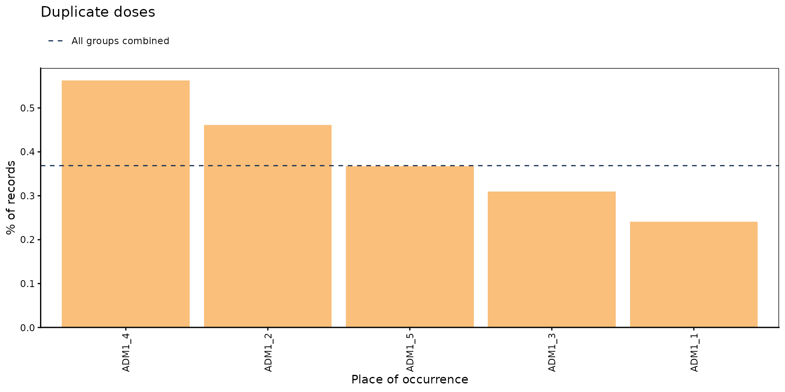
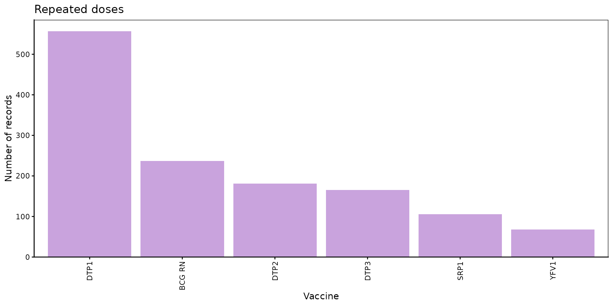
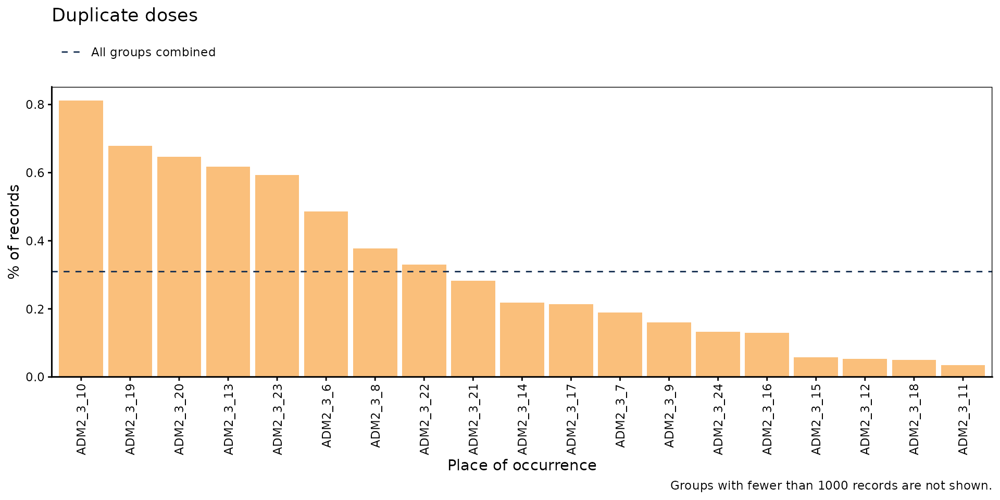
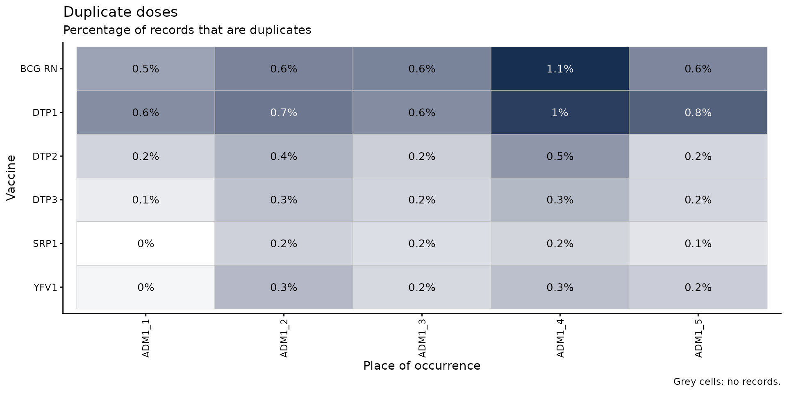
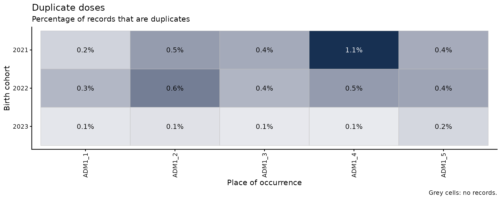
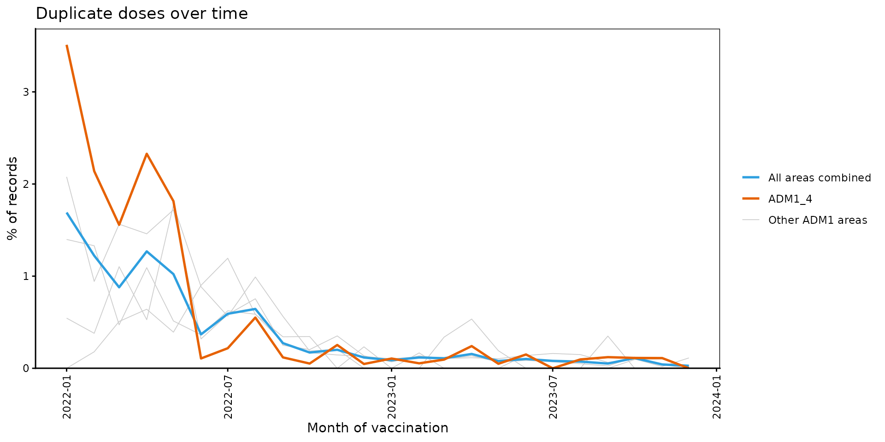
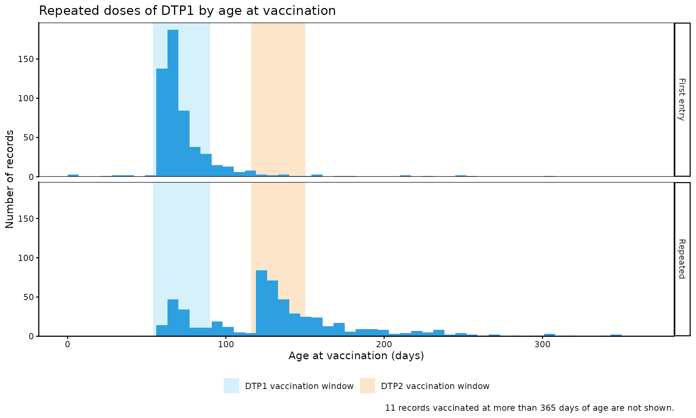
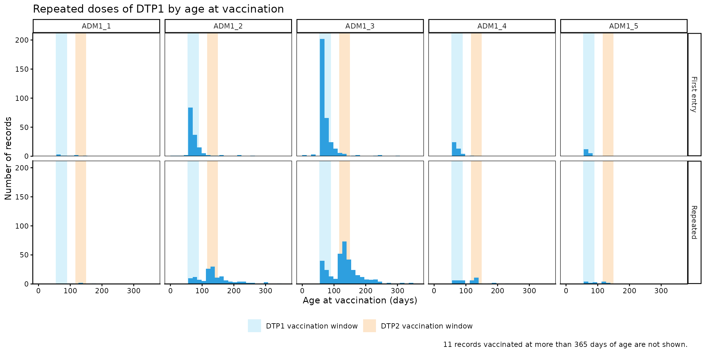

# Dosis duplicadas

[🌐 Read this in
English](https://im-data-paho.github.io/immunabc/articles/en/duplicate_doses_en.md)

## Fundamento

Cada dosis que recibe una persona debería registrarse exactamente una
vez en el Registro Nominal de Vacunación electrónico (RNVe). En la
práctica, es frecuente que una misma dosis se registre más de una vez
para la misma persona. Cada registro adicional aumenta el número de
dosis administradas, por lo que sobreestima las coberturas calculadas a
partir de dosis, y distorsiona cualquier análisis que dependa del número
de dosis, como los análisis de secuencia de dosis o de esquema completo.

El módulo de dosis duplicadas compara todos los registros de una misma
persona y dosis, y clasifica cada registro adicional según cuándo y
dónde fue registrado:

1.  **Duplicado**: el registro adicional tiene la misma fecha y el mismo
    lugar de vacunación que un registro anterior, es decir, el mismo
    evento de vacunación registrado más de una vez.
2.  **Repetido**: el registro adicional tiene una fecha o un lugar de
    vacunación diferente, es decir, la misma dosis registrada en otro
    momento o en otro lugar.

Estas categorías describen cómo coinciden los registros, no por qué la
dosis se registró más de una vez. Ambas pueden deberse a errores de
digitación (p. ej., un registro digitado dos veces, datos cargados dos
veces al migrar desde un sistema anterior, o una dosis registrada con un
número de dosis equivocado) o a errores programáticos (p. ej., una dosis
administrada dos veces porque no se revisó el historial de vacunación de
la persona). Los gráficos y la tabla a nivel de registro de este módulo
ayudan a investigar estas posibles causas.

Dado que los registros duplicados y repetidos son un problema de calidad
de datos de cada evento de vacunación, todos los resultados se refieren
al **lugar de vacunación** (ocurrencia), y no al lugar de residencia.

> **Nota**
>
> Todas las funciones utilizadas para los análisis de dosis duplicadas
> dentro de immunABC comienzan con el prefijo `dd_`.

## Glosario

### Divisiones político-geográficas

A lo largo de esta viñeta se hace referencia a distintos niveles de
división político-geográfica. Estos niveles son definidos por cada país
o territorio y pueden recibir nombres diferentes. immunABC no depende de
esos nombres locales; por eso, el usuario debe recodificar sus variables
para ajustarlas a la estructura que utiliza el paquete.

En concreto, immunABC puede distinguir tres niveles administrativos que,
listados del nivel superior al inferior, son: ADM0, ADM1 y ADM2.

1.  ADM0: El país. Este es el nivel administrativo más alto.
2.  ADM1: La primera subdivisión geográfica del país. ADM0 contiene
    varias subdivisiones ADM1.
3.  ADM2: La segunda subdivisión geográfica del país. Cada ADM1 contiene
    varias subdivisiones ADM2.

### Categorías de duplicación

Todos los registros de una misma persona (`ID`) y dosis (`dose`) se
comparan en orden de fecha de vacunación. El primer registro se
considera el legítimo, y cada registro posterior se clasifica
comparándolo con los anteriores:

- `FIRST_ENTRY`: el primer registro de esa persona y dosis. Nunca se
  cuenta como un problema.
- `DUPLICATE`: mismos `ID`, `dose`, `date_vax`, `ADM1_occurrence` y
  `ADM2_occurrence` que un registro anterior.
- `REPEATED`: mismos `ID` y `dose` que un registro anterior, pero con
  una `date_vax` o un lugar de vacunación diferente.

Solo se cuentan los registros adicionales, por lo que una dosis
registrada tres veces cuenta como dos. Por ejemplo, una persona con DTP1
registrada tres veces:

| `date_vax` | Lugar de vacunación | Categoría | Motivo |
|----|----|----|----|
| 5 de enero | `ADM2_1_1` | `FIRST_ENTRY` | Primer registro de esta persona y dosis. |
| 10 de febrero | `ADM2_1_1` | `REPEATED` | Misma dosis, pero en una fecha diferente. |
| 10 de febrero | `ADM2_1_1` | `DUPLICATE` | Idéntico al registro anterior. |

Tenga en cuenta que un registro con la misma fecha que uno anterior pero
con un lugar de vacunación diferente es `REPEATED` y no `DUPLICATE`, ya
que la misma dosis podría haber sido registrada por dos establecimientos
de vacunación distintos.

### Registros no evaluados

Los registros sin `ID`, `dose`, `date_vax`, `ADM1_occurrence` o
`ADM2_occurrence` no contienen información suficiente para saber si
coinciden con otro registro, por lo que no se evalúan (los valores `NA`
y los textos vacíos o compuestos solo por espacios se consideran
faltantes). Las funciones muestran un mensaje con el número de registros
excluidos.

## Uso

### Instalar el paquete

``` r

devtools::install_github("IM-Data-PAHO/immunabc")
```

### Cargar los datos

Las funciones de este módulo requieren su **conjunto de datos del RNVe**
en el formato estándar de immunABC. De manera opcional,
[`dd_repeat_plot()`](https://im-data-paho.github.io/immunabc/reference/dd_repeat_plot.md)
puede utilizar un **esquema de vacunación** para mostrar la ventana de
vacunación de cada dosis.

#### RNVe

El data frame
[`immunabc::immunABC.EIR`](https://im-data-paho.github.io/immunabc/reference/immunABC.EIR.md)
contiene una tabla simulada a nivel nominal que representa eventos
individuales de vacunación de un Registro Nominal de Vacunación
electrónico (RNVe). Cada fila corresponde a un único acto de vacunación
de una persona.

``` r

immunABC.EIR %>% head() %>% kable(caption = "Ejemplo de Registro Nominal de Vacunación electrónico")
```

| ID | date_birth | date_vax | ADM1_residence | ADM2_residence | ADM1_occurrence | ADM2_occurrence | dose |
|---:|:---|:---|:---|:---|:---|:---|:---|
| 191997 | 2023-08-08 | 2023-12-26 | ADM1_4 | ADM2_4_35 | ADM1_4 | ADM2_4_35 | DTP2 |
| 212189 | 2023-12-20 | 2023-12-26 | ADM1_5 | ADM2_5_61 | ADM1_5 | ADM2_5_61 | BCG RN |
| 118063 | 2022-09-15 | 2023-12-26 | ADM1_2 | ADM2_2_5 | ADM1_2 | ADM2_2_5 | DTP1 |
| 118063 | 2022-09-15 | 2023-12-26 | ADM1_2 | ADM2_2_5 | ADM1_2 | ADM2_2_5 | YFV1 |
| 130751 | 2022-10-27 | 2023-12-12 | ADM1_5 | ADM2_5_55 | ADM1_5 | ADM2_5_55 | YFV1 |
| 136532 | 2021-09-21 | 2023-12-26 | ADM1_3 | ADM2_3_12 | ADM1_3 | ADM2_3_12 | SRP1 |

Ejemplo de Registro Nominal de Vacunación electrónico {.table
style="width:100%;"}

- `ID`: Número único de identificación de la persona.
- `date_birth`: Fecha de nacimiento de la persona.
- `date_vax`: Fecha del evento de vacunación.
- `ADM1_residence` / `ADM2_residence`: Primer y segundo nivel
  administrativo geográfico de residencia.
- `ADM1_occurrence` / `ADM2_occurrence`: Primer y segundo nivel
  administrativo geográfico donde ocurrió la vacunación.
- `dose`: Variable combinada que representa el tipo de vacuna y el
  número de dosis (p. ej., DTP1).

#### Esquema de vacunación

El data frame
[`immunabc::immunABC.schedule`](https://im-data-paho.github.io/immunabc/reference/immunABC.schedule.md)
define la edad, en días, a la que debería administrarse cada dosis.

``` r

immunABC.schedule %>% kable(caption = "Ejemplo de esquema de vacunación")
```

| dose   | age_schedule | age_schedule_low | age_schedule_high |
|:-------|-------------:|-----------------:|------------------:|
| SRP1   |          365 |              360 |               420 |
| DTP1   |           60 |               54 |                90 |
| DTP2   |          120 |              116 |               150 |
| DTP3   |          180 |              176 |               210 |
| BCG RN |            0 |                0 |                28 |
| YFV1   |          365 |              360 |               420 |

Ejemplo de esquema de vacunación {.table}

- `dose`: Variable combinada que representa el tipo de vacuna y el
  número de dosis (p. ej., DTP1).
- `age_schedule`: Edad recomendada de vacunación, en días.
- `age_schedule_low` / `age_schedule_high`: Límites inferior y superior
  de la ventana de vacunación, en días.

### Análisis de dosis duplicadas

#### Flujo de trabajo esperado

El conjunto de funciones `dd_` contiene siete funciones, organizadas en
tres flujos:

1.  [`dd_rate()`](https://im-data-paho.github.io/immunabc/reference/dd_rate.md)
    — calcula el porcentaje de registros duplicados y repetidos, por
    nivel geográfico y, de manera opcional, por dosis o cohorte de
    nacimiento.
    - [`dd_barplot()`](https://im-data-paho.github.io/immunabc/reference/dd_barplot.md)
      — visualiza el resultado de
      [`dd_rate()`](https://im-data-paho.github.io/immunabc/reference/dd_rate.md)
      como un gráfico de barras.
    - [`dd_heatmap()`](https://im-data-paho.github.io/immunabc/reference/dd_heatmap.md)
      — visualiza el resultado de
      [`dd_rate()`](https://im-data-paho.github.io/immunabc/reference/dd_rate.md)
      como un mapa de calor de áreas geográficas frente a dosis o
      cohortes de nacimiento.
2.  [`dd_trend()`](https://im-data-paho.github.io/immunabc/reference/dd_trend.md)
    — calcula el porcentaje de registros duplicados por mes de
    vacunación.
    - [`dd_trend_plot()`](https://im-data-paho.github.io/immunabc/reference/dd_trend_plot.md)
      — visualiza el resultado de
      [`dd_trend()`](https://im-data-paho.github.io/immunabc/reference/dd_trend.md)
      como un gráfico de líneas.
3.  [`dd_duplicates()`](https://im-data-paho.github.io/immunabc/reference/dd_duplicates.md)
    — lista todos los registros de cada dosis registrada más de una vez,
    para su revisión y corrección a nivel de registro.
    - [`dd_repeat_plot()`](https://im-data-paho.github.io/immunabc/reference/dd_repeat_plot.md)
      — compara la edad de vacunación de los primeros registros y de los
      registros repetidos de una dosis.

La figura siguiente muestra el flujo de trabajo esperado.


Figura 1. Flujo de trabajo esperado para el análisis de dosis
duplicadas.

  

#### Paso 1 — Calcular los registros duplicados y repetidos con `dd_rate()`

[`dd_rate()`](https://im-data-paho.github.io/immunabc/reference/dd_rate.md)
clasifica cada registro y devuelve, para cada grupo, el número y el
porcentaje de registros `DUPLICATE` y `REPEATED`. El denominador
(`total`) son todos los registros evaluados del grupo, incluidos los
primeros registros y los de dosis registradas una sola vez.

``` r

dd_rate(data.EIR = immunABC.EIR) %>%
  kable(digits = 2, caption = "Registros duplicados y repetidos a nivel nacional")
```

| duplication |    n |  total | rate |
|:------------|-----:|-------:|-----:|
| DUPLICATE   | 1816 | 492688 | 0.37 |
| REPEATED    | 1314 | 492688 | 0.27 |

Registros duplicados y repetidos a nivel nacional {.table}

Los resultados pueden desagregarse geográficamente con `geo_level`, y
por una variable adicional con `disaggregate_by`: `"dose"` o
`"birth_cohort"` (año de nacimiento).

``` r

rate_adm1 <- dd_rate(
  data.EIR  = immunABC.EIR,
  geo_level = "ADM1"
)

rate_adm1 %>% kable(digits = 2, caption = "Registros duplicados y repetidos por ADM1 de vacunación")
```

| ADM1   | duplication |   n |  total | rate |
|:-------|:------------|----:|-------:|-----:|
| ADM1_1 | DUPLICATE   |  34 |  14099 | 0.24 |
| ADM1_1 | REPEATED    |  33 |  14099 | 0.23 |
| ADM1_2 | DUPLICATE   | 527 | 114336 | 0.46 |
| ADM1_2 | REPEATED    | 290 | 114336 | 0.25 |
| ADM1_3 | DUPLICATE   | 912 | 294763 | 0.31 |
| ADM1_3 | REPEATED    | 815 | 294763 | 0.28 |
| ADM1_4 | DUPLICATE   | 253 |  44965 | 0.56 |
| ADM1_4 | REPEATED    | 131 |  44965 | 0.29 |
| ADM1_5 | DUPLICATE   |  90 |  24525 | 0.37 |
| ADM1_5 | REPEATED    |  45 |  24525 | 0.18 |

Registros duplicados y repetidos por ADM1 de vacunación {.table}

``` r

rate_dose <- dd_rate(
  data.EIR        = immunABC.EIR,
  disaggregate_by = "dose"
)

rate_dose %>%
  filter(duplication == "DUPLICATE") %>%
  kable(digits = 2, caption = "Registros duplicados por dosis")
```

| dose   | duplication |   n | total | rate |
|:-------|:------------|----:|------:|-----:|
| BCG RN | DUPLICATE   | 536 | 82224 | 0.65 |
| DTP1   | DUPLICATE   | 541 | 83356 | 0.65 |
| DTP2   | DUPLICATE   | 230 | 81553 | 0.28 |
| DTP3   | DUPLICATE   | 190 | 82080 | 0.23 |
| SRP1   | DUPLICATE   | 136 | 80504 | 0.17 |
| YFV1   | DUPLICATE   | 183 | 82971 | 0.22 |

Registros duplicados por dosis {.table}

##### Parámetros aceptados

- `data.EIR`: Data frame del RNVe en formato immunABC.
- `geo_level`: Nivel geográfico de vacunación: `"ADM0"` (por defecto),
  `"ADM1"` o `"ADM2"`.
- `disaggregate_by`: Una variable adicional por la cual desagregar:
  `"dose"` o `"birth_cohort"`. Por defecto `NULL` (sin desagregación
  adicional). Con `"birth_cohort"`, los registros sin `date_birth` se
  excluyen, con un mensaje.
- `vaccines`: Vector de caracteres con las dosis a incluir, p. ej.
  `c("DTP1", "DTP2", "DTP3")`. Es solo un filtro: use
  `disaggregate_by = "dose"` para ver los resultados por dosis. Por
  defecto `NULL` utiliza todas las dosis.
- `birth_cohorts`: Vector numérico con el o los años de cohorte de
  nacimiento a filtrar. Es solo un filtro: use
  `disaggregate_by = "birth_cohort"` para ver los resultados por
  cohorte. Por defecto `NULL` utiliza todas las cohortes disponibles.

El resultado contiene una fila por cada categoría de `duplication`
(`DUPLICATE` y `REPEATED`) en cada grupo, con el número de registros en
esa categoría (`n`), el total de registros evaluados en el grupo
(`total`) y el porcentaje (`rate`).

#### Paso 2 — Visualizar los registros duplicados con `dd_barplot()`

El resultado de
[`dd_rate()`](https://im-data-paho.github.io/immunabc/reference/dd_rate.md)
puede entregarse directamente a
[`dd_barplot()`](https://im-data-paho.github.io/immunabc/reference/dd_barplot.md).
Las áreas geográficas se muestran en el eje x si están presentes; de lo
contrario, se muestran las dosis o cohortes de nacimiento. Cuando los
datos tienen ambas desagregaciones, las dosis o cohortes de nacimiento
se muestran en paneles. Al mostrar porcentajes, una línea discontinua
indica el porcentaje de todos los grupos combinados.

``` r

dd_barplot(data = rate_adm1)
```



Por defecto, el gráfico muestra el porcentaje de registros `DUPLICATE`.
Use `duplication = "repeated"` para mostrar los registros `REPEATED`, y
`value = "n"` para mostrar el número de registros en lugar de su
porcentaje:

``` r

dd_barplot(
  data        = rate_dose,
  duplication = "repeated",
  value       = "n"
)
```



A nivel ADM2, `within_ADM1` permite enfocarse en las áreas de uno o
varios ADM1, y `min_total` oculta las barras con pocos registros, ya que
sus porcentajes pueden ser engañosos:

``` r

rate_adm2 <- dd_rate(
  data.EIR  = immunABC.EIR,
  geo_level = "ADM2"
)

dd_barplot(
  data        = rate_adm2,
  within_ADM1 = "ADM1_3",
  min_total   = 1000
)
```



##### Parámetros aceptados

- `data`: Resultado de
  [`dd_rate()`](https://im-data-paho.github.io/immunabc/reference/dd_rate.md).
- `value`: Qué mostrar en el eje y: `"rate"` (por defecto) o `"n"`.
- `duplication`: Qué registros mostrar: `"duplicate"` (por defecto) o
  `"repeated"`.
- `within_ADM1`: Vector de caracteres para filtrar ADM1 específicos
  cuando `geo_level = "ADM2"`. Por defecto: `NULL`.
- `min_total`: Número mínimo de registros para mostrar una barra. Las
  barras ocultas siguen contando para la línea discontinua. Por defecto:
  `NULL` (se muestran todas las barras).

##### Interpretación

Los registros duplicados suelen ser un porcentaje pequeño del total, por
lo que el eje y se ajusta a los datos en lugar de ir de 0 a 100%. Los
porcentajes y los números responden a preguntas distintas:
`value = "rate"` muestra dónde el problema es proporcionalmente mayor,
lo que apunta a prácticas de registro que conviene revisar, mientras que
`value = "n"` muestra dónde se concentra la mayor cantidad de registros
a corregir, que es donde un esfuerzo de limpieza tendrá mayor impacto.
Las barras muy por encima de la línea discontinua son las primeras
candidatas a revisión.

#### Paso 3 — Combinar dos desagregaciones con `dd_heatmap()`

[`dd_heatmap()`](https://im-data-paho.github.io/immunabc/reference/dd_heatmap.md)
muestra el resultado de
[`dd_rate()`](https://im-data-paho.github.io/immunabc/reference/dd_rate.md)
para cada área geográfica (columnas) frente a cada dosis o cohorte de
nacimiento (filas), por lo que `data` debe provenir de
[`dd_rate()`](https://im-data-paho.github.io/immunabc/reference/dd_rate.md)
con `geo_level` en `"ADM1"` o `"ADM2"` y un valor para
`disaggregate_by`.

``` r

rate_adm1_dose <- dd_rate(
  data.EIR        = immunABC.EIR,
  geo_level       = "ADM1",
  disaggregate_by = "dose"
)

dd_heatmap(data = rate_adm1_dose)
```



Por cohorte de nacimiento, filtrando las cohortes más recientes con
`birth_cohorts`:

``` r

rate_adm1_cohort <- dd_rate(
  data.EIR        = immunABC.EIR,
  geo_level       = "ADM1",
  disaggregate_by = "birth_cohort",
  birth_cohorts   = 2021:2023
)

dd_heatmap(data = rate_adm1_cohort)
```



##### Parámetros aceptados

- `data`: Resultado de
  [`dd_rate()`](https://im-data-paho.github.io/immunabc/reference/dd_rate.md)
  con `geo_level` en `"ADM1"` o `"ADM2"` y un valor para
  `disaggregate_by`.
- `value`: Qué mostrar en las celdas: `"rate"` (por defecto) o `"n"`.
- `duplication`: Qué registros mostrar: `"duplicate"` (por defecto) o
  `"repeated"`.
- `within_ADM1`: Vector de caracteres para filtrar ADM1 específicos
  cuando `geo_level = "ADM2"`. Por defecto: `NULL`.
- `min_total`: Número mínimo de registros para rellenar una celda. Las
  demás celdas quedan en gris y vacías. Por defecto: `NULL` (se rellenan
  todas las celdas).
- `digits`: Número de decimales en las celdas cuando `value = "rate"`.
  Por defecto: `1`.
- `show_numbers`: Lógico, por defecto `TRUE`. Indica si se muestra el
  número en cada celda o, en su lugar, una leyenda de colores. Use
  `FALSE` cuando haya demasiadas celdas para leerlas (p. ej., a nivel
  ADM2).

##### Interpretación

Una fila oscura en todas las áreas indica un problema de esa dosis o
cohorte en todo el país, por ejemplo una dosis que el sistema de
información registra dos veces de forma sistemática. Una columna oscura
indica un problema de esa área en todas las dosis, lo que sugiere una
práctica de registro local. Una única celda oscura es un problema
específico de un área y una dosis o cohorte. En el ejemplo, `ADM1_4`
tiene los porcentajes más altos para la mayoría de las dosis, y `BCG RN`
y `DTP1` tienen los porcentajes más altos en todas las áreas.

#### Paso 4 — Seguir los registros duplicados en el tiempo con `dd_trend()` y `dd_trend_plot()`

[`dd_trend()`](https://im-data-paho.github.io/immunabc/reference/dd_trend.md)
realiza el mismo cálculo que
[`dd_rate()`](https://im-data-paho.github.io/immunabc/reference/dd_rate.md),
pero por mes de vacunación (`month_vax`, el primer día de cada mes),
para detectar tendencias en el tiempo. Solo se incluyen los registros
`DUPLICATE`: los registros repetidos se exploran mejor con
[`dd_repeat_plot()`](https://im-data-paho.github.io/immunabc/reference/dd_repeat_plot.md)
(ver el Paso 6).

``` r

trend_adm1 <- dd_trend(
  data.EIR  = immunABC.EIR,
  geo_level = "ADM1"
)

trend_adm1 %>% head() %>% kable(digits = 2, caption = "Registros duplicados por ADM1 y mes de vacunación")
```

| ADM1   | month_vax  | duplication |   n | total | rate |
|:-------|:-----------|:------------|----:|------:|-----:|
| ADM1_1 | 2022-01-01 | DUPLICATE   |   0 |   484 | 0.00 |
| ADM1_1 | 2022-02-01 | DUPLICATE   |   1 |   558 | 0.18 |
| ADM1_1 | 2022-03-01 | DUPLICATE   |   3 |   590 | 0.51 |
| ADM1_1 | 2022-04-01 | DUPLICATE   |   3 |   468 | 0.64 |
| ADM1_1 | 2022-05-01 | DUPLICATE   |   2 |   510 | 0.39 |
| ADM1_1 | 2022-06-01 | DUPLICATE   |   5 |   555 | 0.90 |

Registros duplicados por ADM1 y mes de vacunación {.table}

[`dd_trend_plot()`](https://im-data-paho.github.io/immunabc/reference/dd_trend_plot.md)
dibuja todas las áreas combinadas como una línea destacada, y cada área
geográfica como una línea gris delgada a modo de contexto. Se pueden
destacar en color hasta 5 áreas con `highlight`:

``` r

dd_trend_plot(
  data      = trend_adm1,
  highlight = "ADM1_4"
)
```



##### Parámetros aceptados

[`dd_trend()`](https://im-data-paho.github.io/immunabc/reference/dd_trend.md):

- `data.EIR`: Data frame del RNVe en formato immunABC.
- `geo_level`: Nivel geográfico de vacunación: `"ADM0"` (por defecto),
  `"ADM1"` o `"ADM2"`.
- `vaccines`: Vector de caracteres con las dosis a incluir. Por defecto
  `NULL` utiliza todas las dosis.
- `birth_cohorts`: Vector numérico con el o los años de cohorte de
  nacimiento a filtrar. Por defecto `NULL` utiliza todas las cohortes
  disponibles.

[`dd_trend_plot()`](https://im-data-paho.github.io/immunabc/reference/dd_trend_plot.md):

- `data`: Resultado de
  [`dd_trend()`](https://im-data-paho.github.io/immunabc/reference/dd_trend.md).
- `value`: Qué mostrar en el eje y: `"rate"` (por defecto) o `"n"`. Con
  `"n"`, todas las áreas combinadas corresponden a la suma de todas las
  áreas, por lo que su valor puede ser mucho mayor que el de cualquier
  área individual.
- `highlight`: Hasta 5 áreas geográficas a destacar en color. Solo
  disponible cuando `data` está desagregado por ADM1 o ADM2. Por
  defecto: `NULL`.
- `within_ADM1`: Vector de caracteres para filtrar ADM1 específicos
  cuando `geo_level = "ADM2"`. En ese caso, todas las áreas combinadas
  se refiere solo a esas áreas. Por defecto: `NULL`.
- `min_total`: Número mínimo de registros para mostrar un área en un mes
  determinado; de lo contrario, las líneas quedan con espacios vacíos.
  Es útil porque los porcentajes basados en pocos registros pueden ser
  engañosos y estirar el eje y. Por defecto: `NULL` (se muestran todos
  los meses).

##### Interpretación

Los errores de digitación tienden a distribuirse de forma pareja en el
tiempo, por lo que, cuando los registros duplicados se concentran en
pocos meses, es posible que los registros de esos meses se hayan
ingresado dos veces, por ejemplo al cargar datos históricos de un
sistema anterior en el RNVe, o al digitalizar dos veces un lote de
registros en papel. En el ejemplo, los duplicados se concentran
claramente en el primer semestre de 2022, en particular en `ADM1_4`, y
casi desaparecen después. Por otro lado, un aumento repentino en una
fecha posterior puede indicar un cambio en el sistema de información o
en las prácticas de registro.

#### Paso 5 — Inspeccionar los registros individuales con `dd_duplicates()`

[`dd_duplicates()`](https://im-data-paho.github.io/immunabc/reference/dd_duplicates.md)
devuelve una tabla a nivel de registro con todos los registros de cada
dosis registrada más de una vez para la misma persona, incluido el
`FIRST_ENTRY`, de modo que los registros posteriores puedan compararse
con él. Los grupos con más copias se muestran primero.

``` r

duplicates_df <- dd_duplicates(data.EIR = immunABC.EIR)

duplicates_df %>%
  filter(dose == "DTP1", n_copies == 2) %>%
  head(6) %>%
  kable(caption = "Muestra de dosis DTP1 registradas dos veces")
```

| ID | date_birth | dose | date_vax | ADM1_occurrence | ADM2_occurrence | group | copy | n_copies | days_since_first_entry | duplication |
|---:|:---|:---|:---|:---|:---|---:|---:|---:|---:|:---|
| 11254 | 2021-10-07 | DTP1 | 2022-01-05 | ADM1_2 | ADM2_2_5 | 168 | 1 | 2 | NA | FIRST_ENTRY |
| 11254 | 2021-10-07 | DTP1 | 2022-05-11 | ADM1_3 | ADM2_3_15 | 168 | 2 | 2 | 126 | REPEATED |
| 12223 | 2021-10-18 | DTP1 | 2022-01-10 | ADM1_3 | ADM2_3_6 | 170 | 1 | 2 | NA | FIRST_ENTRY |
| 12223 | 2021-10-18 | DTP1 | 2022-06-14 | ADM1_3 | ADM2_3_6 | 170 | 2 | 2 | 155 | REPEATED |
| 12415 | 2021-10-25 | DTP1 | 2022-01-21 | ADM1_3 | ADM2_3_7 | 171 | 1 | 2 | NA | FIRST_ENTRY |
| 12415 | 2021-10-25 | DTP1 | 2022-03-17 | ADM1_3 | ADM2_3_7 | 171 | 2 | 2 | 55 | REPEATED |

Muestra de dosis DTP1 registradas dos veces {.table style="width:100%;"}

##### Parámetros aceptados

- `data.EIR`: Data frame del RNVe en formato immunABC.
- `vaccines`: Vector de caracteres con las dosis a incluir. Por defecto
  `NULL` utiliza todas las dosis.
- `birth_cohorts`: Vector numérico con el o los años de cohorte de
  nacimiento a filtrar. Por defecto `NULL` utiliza todas las cohortes
  disponibles.

Además de las columnas originales de cada registro, el resultado incluye
`group` (un número que identifica todos los registros de una misma
persona y dosis), `copy` (la posición del registro dentro de su grupo,
en orden de fecha), `n_copies` (el número de registros del grupo),
`days_since_first_entry` (los días entre el registro y el `FIRST_ENTRY`
de su grupo, `NA` para el propio `FIRST_ENTRY`) y `duplication`. Esta
tabla puede exportarse para flujos de revisión y corrección a nivel de
registro. Por ejemplo, `days_since_first_entry` permite distinguir los
registros `REPEATED` registrados el mismo día en dos lugares distintos
(`days_since_first_entry = 0`) de los registrados semanas o meses
después del primer registro.

#### Paso 6 — Explorar las posibles causas de los registros repetidos con `dd_repeat_plot()`

[`dd_repeat_plot()`](https://im-data-paho.github.io/immunabc/reference/dd_repeat_plot.md)
toma el resultado de
[`dd_duplicates()`](https://im-data-paho.github.io/immunabc/reference/dd_duplicates.md)
y, para una sola dosis, compara la edad de vacunación del `FIRST_ENTRY`
de cada grupo con repeticiones (panel superior) con la edad de
vacunación de los registros `REPEATED` (panel inferior). Al entregar
`data.schedule`, se sombrea la ventana de vacunación de las dosis
indicadas en `schedule_vaccines`.

``` r

dd_repeat_plot(
  data              = duplicates_df,
  vaccine           = "DTP1",
  max_age           = 365,
  data.schedule     = immunABC.schedule,
  schedule_vaccines = c("DTP1", "DTP2")
)
```



Use `geo_level` para dividir los paneles por área geográfica de
vacunación, lo que muestra si el patrón es el mismo en todas partes:

``` r

dd_repeat_plot(
  data              = duplicates_df,
  vaccine           = "DTP1",
  geo_level         = "ADM1",
  max_age           = 365,
  binwidth          = 14,
  data.schedule     = immunABC.schedule,
  schedule_vaccines = c("DTP1", "DTP2")
)
```



##### Parámetros aceptados

- `data`: Resultado de
  [`dd_duplicates()`](https://im-data-paho.github.io/immunabc/reference/dd_duplicates.md).
- `vaccine`: La dosis a mostrar, p. ej. `"DTP1"`.
- `geo_level`: Nivel geográfico de vacunación por el cual dividir los
  paneles: `"ADM0"` (por defecto, sin división), `"ADM1"` o `"ADM2"`.
- `within_ADM1`: Vector de caracteres para filtrar ADM1 de vacunación
  específicos. Por defecto: `NULL`.
- `binwidth`: Ancho de cada barra del histograma, en días. Por defecto:
  `7` (una semana).
- `max_age`: Edad máxima de vacunación a mostrar en el eje x, en días.
  El número de registros que la superan se indica en la nota al pie del
  gráfico. Por defecto: `NULL` (se muestran todas las edades).
- `data.schedule`: Data frame del esquema de vacunación en formato
  immunABC, usado para sombrear las ventanas de vacunación. Por defecto:
  `NULL` (no se muestran ventanas).
- `schedule_vaccines`: Hasta 3 dosis cuya ventana de vacunación se
  sombrea. Solo se usa con `data.schedule`. Por defecto `NULL` sombrea
  la ventana de `vaccine`.

Los registros sin `date_birth`, o con una `date_vax` anterior a la
`date_birth`, no tienen una edad de vacunación válida, por lo que se
excluyen, con un mensaje. El módulo de [Comparación de consistencia de
fechas](https://im-data-paho.github.io/immunabc/articles/es/date_consistency_comparison_es.md)
puede ayudar a investigar estos últimos.

##### Interpretación

La forma del panel inferior da pistas sobre la causa de las
repeticiones:

- **Repeticiones a la edad de la siguiente dosis**: si las repeticiones
  de DTP1 se concentran en la ventana de vacunación de DTP2, como en el
  ejemplo, lo más probable es que el segundo registro sea una dosis DTP2
  registrada como DTP1. Estas personas probablemente aparecerán con una
  DTP2 saltada en el módulo de [Comparación de secuencia de
  dosis](https://im-data-paho.github.io/immunabc/articles/es/dose_sequence_comparison_es.md).
- **Repeticiones poco después del primer registro, dentro de la misma
  ventana**: la dosis pudo haberse registrado nuevamente en una visita
  de seguimiento, o haberse administrado dos veces porque no se revisó
  el historial de vacunación de la persona.
- **Repeticiones distribuidas en todas las edades**: los registros
  podrían pertenecer a dos personas distintas vinculadas al mismo ID, lo
  que es un problema de vinculación de registros.

## Resumen

El módulo `dd_` ofrece un flujo completo para detectar dosis registradas
más de una vez en los datos del RNVe, distinguiendo los registros
`DUPLICATE` (el mismo evento de vacunación registrado más de una vez,
con la misma fecha y lugar) de los registros `REPEATED` (la misma dosis
registrada en otra fecha o en otro lugar).
[`dd_rate()`](https://im-data-paho.github.io/immunabc/reference/dd_rate.md),
[`dd_barplot()`](https://im-data-paho.github.io/immunabc/reference/dd_barplot.md)
y
[`dd_heatmap()`](https://im-data-paho.github.io/immunabc/reference/dd_heatmap.md)
ofrecen una visión geográfica por dosis o cohorte de nacimiento,
[`dd_trend()`](https://im-data-paho.github.io/immunabc/reference/dd_trend.md)
y
[`dd_trend_plot()`](https://im-data-paho.github.io/immunabc/reference/dd_trend_plot.md)
muestran cuándo se registraron los duplicados, y
[`dd_duplicates()`](https://im-data-paho.github.io/immunabc/reference/dd_duplicates.md)
y
[`dd_repeat_plot()`](https://im-data-paho.github.io/immunabc/reference/dd_repeat_plot.md)
permiten inspeccionar los registros individuales y ayudan a identificar
las causas de los registros repetidos. Dado que los registros duplicados
y repetidos sesgan la cobertura, el abandono y cualquier análisis que
dependa del número de dosis, recomendamos ejecutar este módulo antes que
los demás módulos de immunABC.
