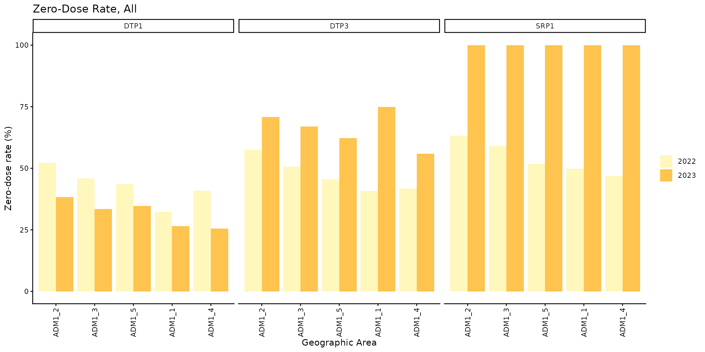
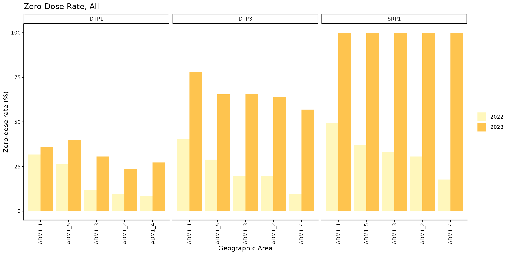
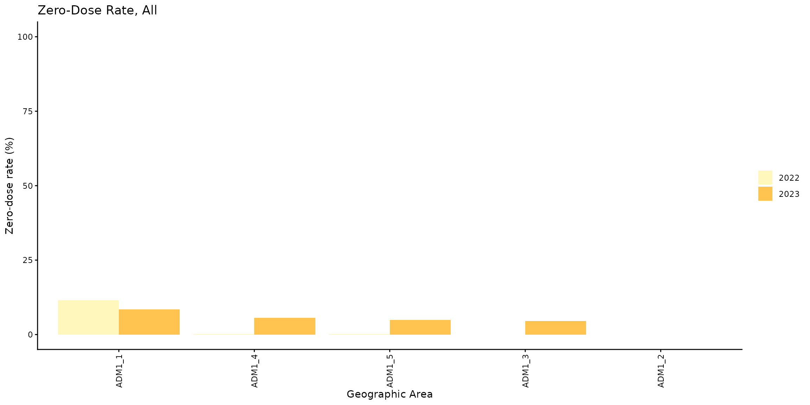
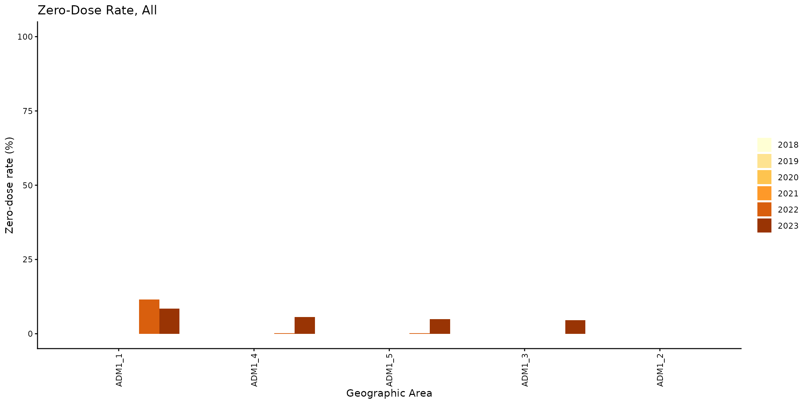

# Tasa de cero dosis

[🌐 Read this in
English](https://im-data-paho.github.io/immunabc/articles/en/zero_dose_en.md)
[📖 Lea el manual de la
OPS](https://iris.paho.org/server/api/core/bitstreams/21114cb1-8b3e-4ac5-afcf-016635313c14/content#page=54)

## Fundamento

El objetivo de este indicador es identificar a las personas que no
tienen registro de haber recibido un conjunto determinado de vacunas,
conocidas como personas cero dosis. Son las más expuestas a las
enfermedades prevenibles por vacunación y suelen pertenecer a
comunidades a las que el programa de inmunización no está llegando.
Saber cuántas son, dónde viven y, cuando se dispone de registros
individuales, quiénes son, permite al programa planificar estrategias
focalizadas para alcanzarlas.

La tasa de cero dosis es el complemento de la cobertura para una cohorte
de nacimiento específica:

``` math
\begin{aligned}
&\text{Tasa de cero dosis (\%)} = \\
&100 - \text{Cobertura (\%)} = \\
&100 - \frac{\text{# de personas con registro de la vacuna en una cohorte de nacimiento específica}}{\text{Total de personas en esa cohorte de nacimiento}} \times 100
\end{aligned}
```

El total de personas en la cohorte de nacimiento (el denominador) se
toma de la fuente más detallada disponible:

1.  Los registros poblacionales individuales (`data.pop_ids`), si se
    proporcionan. Estos tienen prioridad sobre cualquier otra fuente.
2.  En su defecto, una tabla de población (`data.pop`), si se
    proporciona.
3.  En su defecto, las personas que figuran en el propio RNVe.

> **Nota**
>
> Todas las funciones utilizadas para los análisis de cero dosis dentro
> de immunABC comienzan con el prefijo `zd_`.

## Glosario

### Cero dosis

Una persona cero dosis es aquella que no tiene registro de haber
recibido una vacuna determinada. Cuando el análisis abarca varias
vacunas a la vez, una persona cero dosis es aquella que no tiene
registro de ninguna de ellas.

### Cohorte de nacimiento

Una cohorte de nacimiento es el grupo de todas las personas nacidas
dentro de un mismo período de tiempo, normalmente un único año
calendario. Por ejemplo, la cohorte de nacimiento de 2022 comprende a
todas las personas nacidas durante el año 2022.

### Divisiones político-geográficas

A lo largo de esta viñeta se hace referencia a distintos niveles de
división político-geográfica. Estos niveles son definidos por cada país
o territorio y pueden recibir nombres diferentes. immunABC no depende de
esos nombres locales; por eso, el usuario debe recodificar sus variables
para ajustarlas a la estructura que utiliza el paquete.

En concreto, immunABC puede distinguir tres niveles administrativos que,
listados del nivel superior al inferior, son: ADM0, ADM1 y ADM2.

1.  ADM0: El país. Este es el nivel administrativo más alto.
2.  ADM1: La primera subdivisión geográfica del país. ADM0 contiene
    varias subdivisiones ADM1.
3.  ADM2: La segunda subdivisión geográfica del país. Cada ADM1 contiene
    varias subdivisiones ADM2.

### Nombres de vacunas

Los conjuntos de datos de ejemplo utilizan una convención específica
para nombrar las dosis de vacunas. Es posible que esta convención no
coincida con la que usa su país o institución, pero esto no afecta el
uso del paquete si los nombres se aplican de manera consistente.

Por ejemplo, los nombres de las vacunas utilizados en el paquete
immunABC son:

| Abreviatura | Nombre completo                                          |
|-------------|----------------------------------------------------------|
| SRP1        | Vacuna contra sarampión, rubéola y paperas (1.ª dosis)   |
| DTP1        | Vacuna contra difteria, tétanos y tos ferina (1.ª dosis) |
| DTP2        | Vacuna contra difteria, tétanos y tos ferina (2.ª dosis) |
| DTP3        | Vacuna contra difteria, tétanos y tos ferina (3.ª dosis) |
| BCG RN      | Vacuna Bacillus Calmette–Guérin (al nacer)               |
| YFV1        | Vacuna contra la fiebre amarilla (1.ª dosis)             |

## Uso

### Instalar el paquete

El primer paso para ejecutar los análisis de cero dosis es instalar el
paquete immunABC disponible en GitHub.

``` r

devtools::install_github("IM-Data-PAHO/immunabc")
```

### Cargar los datos

Las funciones de este módulo trabajan con hasta tres conjuntos de datos
en un formato específico.

1.  Su RNVe.
2.  Opcionalmente, una tabla con denominadores poblacionales al mismo
    nivel geográfico de desagregación que su análisis.
3.  Opcionalmente, una tabla de registros poblacionales individuales,
    como un registro civil, que pueda cruzarse con el RNVe.

Para facilitar la prueba de immunABC y la comprensión de la estructura
requerida, a continuación se presentan los conjuntos de datos de ejemplo
que utiliza este módulo.

#### RNVe

El conjunto de datos
[`immunabc::immunABC.EIR`](https://im-data-paho.github.io/immunabc/reference/immunABC.EIR.md)
proporciona un ejemplo de Registro Nominal de Vacunación electrónico
(RNVe). Es una tabla nominal simulada con eventos individuales de
vacunación. Cada fila corresponde a una vacunación e incluye información
sobre la residencia de la persona, el lugar donde fue vacunada
(ocurrencia), su fecha de nacimiento y la dosis recibida.

``` r

immunABC.EIR %>% head() %>% kable(caption = "Ejemplo de Registro Nominal de Vacunación electrónico")
```

| ID | date_birth | date_vax | ADM1_residence | ADM2_residence | ADM1_occurrence | ADM2_occurrence | dose |
|---:|:---|:---|:---|:---|:---|:---|:---|
| 191997 | 2023-08-08 | 2023-12-26 | ADM1_4 | ADM2_4_35 | ADM1_4 | ADM2_4_35 | DTP2 |
| 212189 | 2023-12-20 | 2023-12-26 | ADM1_5 | ADM2_5_61 | ADM1_5 | ADM2_5_61 | BCG RN |
| 118063 | 2022-09-15 | 2023-12-26 | ADM1_2 | ADM2_2_5 | ADM1_2 | ADM2_2_5 | DTP1 |
| 118063 | 2022-09-15 | 2023-12-26 | ADM1_2 | ADM2_2_5 | ADM1_2 | ADM2_2_5 | YFV1 |
| 130751 | 2022-10-27 | 2023-12-12 | ADM1_5 | ADM2_5_55 | ADM1_5 | ADM2_5_55 | YFV1 |
| 136532 | 2021-09-21 | 2023-12-26 | ADM1_3 | ADM2_3_12 | ADM1_3 | ADM2_3_12 | SRP1 |

Ejemplo de Registro Nominal de Vacunación electrónico {.table
style="width:100%;"}

- `ID`: Número único de identificación de la persona.
- Fecha de nacimiento (`date_birth`): Fecha de nacimiento de la persona.
- Fecha de vacunación (`date_vax`): Fecha del evento de vacunación.
- ADM1: Primer nivel administrativo geográfico del país.
- ADM2: Segundo nivel administrativo geográfico del país.
- Lugar de residencia (`Residence`): Lugar donde vive la persona.
- Lugar de vacunación (`Occurrence`): Lugar donde ocurrió la vacunación.
- Dosis (`dose`): Variable combinada que representa el tipo de vacuna y
  su número de dosis correspondiente. Por ejemplo, DTP1 se refiere a la
  primera dosis de una vacuna que contiene componentes de difteria,
  tétanos y tos ferina.

#### Denominadores poblacionales

Aunque no es obligatorio, este módulo permite usar una tabla de
población como denominador. El nivel geográfico de esta tabla debe
coincidir con el nivel geográfico del análisis. Por ejemplo, para un
análisis a nivel ADM1, la tabla de denominadores poblacionales debe
tener la siguiente estructura.

``` r

immunABC.pop.ADM1 %>% head() %>% kable(caption = "Ejemplo de población a nivel ADM1")
```

| ADM1   | year | age | population |
|:-------|-----:|----:|-----------:|
| ADM1_1 | 2022 |   0 |   1718.189 |
| ADM1_1 | 2022 |   1 |   1808.964 |
| ADM1_1 | 2023 |   0 |   1703.145 |
| ADM1_1 | 2023 |   1 |   1792.443 |
| ADM1_2 | 2022 |   0 |   6575.261 |
| ADM1_2 | 2022 |   1 |   6922.644 |

Ejemplo de población a nivel ADM1 {.table}

Esta tabla está en formato largo y contiene la población (`population`)
de niños de una edad (`age`) específica durante un año (`year`)
determinado para un nivel `ADM1`.

> **Nota**
>
> Como este análisis se realiza con cohortes de nacimiento, solo se usan
> las filas donde la edad (`age`) es igual a 0 en la tabla de población.
> Estas filas representan el número de niños que pertenecen a esa
> cohorte de nacimiento.

#### Registros poblacionales individuales

También de forma opcional, este módulo permite usar una tabla de
registros poblacionales individuales. Como cada fila es una persona, el
módulo puede contar a las personas que faltan en el RNVe y listar a cada
una de ellas. El conjunto de datos
[`immunabc::immunABC.pop_ids_expanded_to_pop`](https://im-data-paho.github.io/immunabc/reference/immunABC.pop_ids_expanded_to_pop.md)
contiene a todas las personas de `immunABC.EIR`, más personas simuladas
sin registros de vacunación, de modo que cada cohorte de nacimiento
coincide con la población de `immunABC.pop.ADM2`.

``` r

immunABC.pop_ids_expanded_to_pop %>% head() %>% kable(caption = "Ejemplo de registros poblacionales individuales")
```

|  ID | date_birth | ADM1_residence | ADM2_residence | name                            |
|----:|:-----------|:---------------|:---------------|:--------------------------------|
|   1 | 2013-12-14 | ADM1_2         | ADM2_2_5       | Dion Rodriguez Romo             |
|   2 | 1998-12-21 | ADM1_3         | ADM2_3_8       | Henry Hernandez Contreras       |
|   3 | 1986-12-02 | ADM1_3         | ADM2_3_16      | Moses Torres Martinez           |
|   4 | 1986-06-07 | ADM1_3         | ADM2_3_17      | Keylian Saldana Wilson          |
|   5 | 1958-09-10 | ADM1_3         | ADM2_3_13      | Berenise Salazar Bautista Rubio |
|   6 | 2017-09-18 | ADM1_2         | ADM2_2_5       | Rocela Cazares Medina           |

Ejemplo de registros poblacionales individuales {.table}

- `ID`: Número único de identificación de la persona. Debe coincidir con
  el `ID` utilizado en el RNVe.
- Nombre (`name`): Nombre de la persona.
- Fecha de nacimiento (`date_birth`): Fecha de nacimiento de la persona.
- `ADM1_residence` / `ADM2_residence`: Primer y segundo nivel
  administrativo geográfico de residencia de la persona.

> **Nota**
>
> Las personas simuladas sin registros de vacunación solo se agregaron a
> las cohortes de nacimiento de 2022 y 2023. Este conjunto de datos se
> construyó para coincidir con `immunABC.pop.ADM2`, y las tablas de
> población de ejemplo solo contienen la población de esas dos cohortes
> de nacimiento. Las personas nacidas en cualquier otro año provienen
> únicamente del RNVe, por lo que todas tienen al menos un registro de
> vacunación.

### Análisis de cero dosis

Este módulo permite estimar la tasa de cero dosis por cohorte de
nacimiento para cualquier vacuna, o para un conjunto de vacunas a la
vez. El indicador representa el porcentaje de personas nacidas en un año
específico que no tienen registro de la vacuna, independientemente de
cuándo debieron haber sido vacunadas. Los resultados pueden agregarse a
nivel nacional o subnacional (`ADM1` o `ADM2`).

Cuando se dispone de registros individuales (solo el RNVe, o
`data.pop_ids`), el módulo también puede producir una salida operativa:
una fila por persona, con la fecha de cada vacuna y una columna
`Category`. Al filtrar esta tabla por `ZERO_DOSE` se obtiene la lista de
personas cero dosis a las que dar seguimiento.

#### Flujo de trabajo esperado

Las funciones
[`zd_rate()`](https://im-data-paho.github.io/immunabc/reference/zd_rate.md),
[`zd_barplot()`](https://im-data-paho.github.io/immunabc/reference/zd_barplot.md)
y
[`zd_list()`](https://im-data-paho.github.io/immunabc/reference/zd_list.md)
permiten analizar, visualizar y actuar sobre la tasa de cero dosis. Su
relación se muestra en la Figura 1.


Figura 1. Flujo de trabajo esperado para el análisis de cero dosis.

  

- [`zd_rate()`](https://im-data-paho.github.io/immunabc/reference/zd_rate.md)
  calcula la tasa de cero dosis por vacuna, cohorte de nacimiento y área
  geográfica. Cuando no se especifican vacunas (`vaccines`), también
  incluye las filas con `dose` “All”, que cuentan como vacunadas a las
  personas con al menos una vacuna.
- [`zd_barplot()`](https://im-data-paho.github.io/immunabc/reference/zd_barplot.md)
  recibe el resultado de
  [`zd_rate()`](https://im-data-paho.github.io/immunabc/reference/zd_rate.md)
  y muestra un panel por vacuna. Cuando
  [`zd_rate()`](https://im-data-paho.github.io/immunabc/reference/zd_rate.md)
  se ejecutó sin especificar vacunas, muestra en su lugar la tasa
  combinada “All”. Si un grupo tiene más personas vacunadas que
  población, su tasa es negativa; la barra muestra su valor absoluto con
  un contorno rojo.
- [`zd_list()`](https://im-data-paho.github.io/immunabc/reference/zd_list.md)
  produce la salida operativa: una fila por persona, tomada de
  `data.pop_ids` y del RNVe si se proporciona `data.pop_ids`, o del RNVe
  en caso contrario, con la fecha de cada vacuna y una columna
  `Category`: `COMPLETE` si la persona tiene todas las vacunas
  analizadas, `PARTIAL` si tiene algunas y `ZERO_DOSE` si no tiene
  ninguna. Como lista personas, no utiliza tablas de población.

#### Ejemplo 1: Solo el RNVe

A continuación se calcula la tasa de cero dosis para la primera y la
tercera dosis de DTP y la primera dosis de la vacuna que contiene
sarampión, para las cohortes de nacimiento de 2022 y 2023, usando solo
el RNVe. Por lo tanto, el denominador son las personas que figuran en el
RNVe.

``` r

# calcular la tasa de cero dosis
zd_eir <- zd_rate(
  data.EIR = immunABC.EIR,
  geo_level = "ADM1",
  vaccines = c("DTP1", "DTP3", "SRP1"), # esto puede ser una sola vacuna
  birth_cohorts = c(2022, 2023) # esto puede ser un solo año
)

# mostrar la tasa en una tabla
zd_eir %>%
  kable(digits = 2, caption = "Tasa de cero dosis a nivel ADM1")
```

| dose | birth_cohort | ADM1   | numerator | population | coverage | zd_rate |
|:-----|-------------:|:-------|----------:|-----------:|---------:|--------:|
| DTP1 |         2022 | ADM1_1 |      1173 |       1733 |    67.69 |   32.31 |
| DTP1 |         2022 | ADM1_2 |      5939 |      12428 |    47.79 |   52.21 |
| DTP1 |         2022 | ADM1_3 |     27168 |      50238 |    54.08 |   45.92 |
| DTP1 |         2022 | ADM1_4 |      3768 |       6382 |    59.04 |   40.96 |
| DTP1 |         2022 | ADM1_5 |      1969 |       3488 |    56.45 |   43.55 |
| DTP1 |         2023 | ADM1_1 |      1093 |       1488 |    73.45 |   26.55 |
| DTP1 |         2023 | ADM1_2 |      4979 |       8066 |    61.73 |   38.27 |
| DTP1 |         2023 | ADM1_3 |     21154 |      31819 |    66.48 |   33.52 |
| DTP1 |         2023 | ADM1_4 |      2968 |       3984 |    74.50 |   25.50 |
| DTP1 |         2023 | ADM1_5 |      1585 |       2426 |    65.33 |   34.67 |
| DTP3 |         2022 | ADM1_1 |      1025 |       1733 |    59.15 |   40.85 |
| DTP3 |         2022 | ADM1_2 |      5279 |      12428 |    42.48 |   57.52 |
| DTP3 |         2022 | ADM1_3 |     24746 |      50238 |    49.26 |   50.74 |
| DTP3 |         2022 | ADM1_4 |      3716 |       6382 |    58.23 |   41.77 |
| DTP3 |         2022 | ADM1_5 |      1900 |       3488 |    54.47 |   45.53 |
| DTP3 |         2023 | ADM1_1 |       374 |       1488 |    25.13 |   74.87 |
| DTP3 |         2023 | ADM1_2 |      2353 |       8066 |    29.17 |   70.83 |
| DTP3 |         2023 | ADM1_3 |     10498 |      31819 |    32.99 |   67.01 |
| DTP3 |         2023 | ADM1_4 |      1756 |       3984 |    44.08 |   55.92 |
| DTP3 |         2023 | ADM1_5 |       914 |       2426 |    37.68 |   62.32 |
| SRP1 |         2022 | ADM1_1 |       869 |       1733 |    50.14 |   49.86 |
| SRP1 |         2022 | ADM1_2 |      4564 |      12428 |    36.72 |   63.28 |
| SRP1 |         2022 | ADM1_3 |     20552 |      50238 |    40.91 |   59.09 |
| SRP1 |         2022 | ADM1_4 |      3388 |       6382 |    53.09 |   46.91 |
| SRP1 |         2022 | ADM1_5 |      1679 |       3488 |    48.14 |   51.86 |
| SRP1 |         2023 | ADM1_1 |         0 |       1488 |     0.00 |  100.00 |
| SRP1 |         2023 | ADM1_2 |         2 |       8066 |     0.02 |   99.98 |
| SRP1 |         2023 | ADM1_3 |         5 |      31819 |     0.02 |   99.98 |
| SRP1 |         2023 | ADM1_4 |         0 |       3984 |     0.00 |  100.00 |
| SRP1 |         2023 | ADM1_5 |         1 |       2426 |     0.04 |   99.96 |

Tasa de cero dosis a nivel ADM1 {.table}

##### Parámetros aceptados en `zd_rate()`

- `data.EIR`: Data frame del RNVe en formato immunABC.
- `geo_level`: `"ADM0"` (predeterminado), `"ADM1"` o `"ADM2"`.
- `vaccines`: Vector de caracteres con las dosis a incluir, una tasa por
  `dose`. El valor predeterminado `NULL` incluye todas las dosis de
  `data.EIR` y agrega las filas combinadas “All”.
- `birth_cohorts`: Vector numérico con el año o los años de las cohortes
  de nacimiento a incluir. El valor predeterminado `NULL` incluye a
  todas las personas, independientemente de su año de nacimiento.
- `data.pop`: Denominadores poblacionales al mismo nivel geográfico que
  `geo_level`. Predeterminado: `NULL`. Vea el Ejemplo 2.
- `data.pop_ids`: Registros poblacionales individuales, usados como
  denominadores en lugar de `data.pop` o del RNVe. Su residencia nunca
  se modifica: cuando `geo_level` es `"ADM1"` o `"ADM2"`, una
  advertencia indica las personas cuya residencia no coincide con la del
  RNVe, que deben corregirse antes de ejecutar el análisis.
  Predeterminado: `NULL`. Vea el Ejemplo 3.
- `fix_residence`: Cuando `geo_level` es `"ADM1"` o `"ADM2"`, cada
  persona del RNVe debe tener una única residencia para que se cuente en
  una sola área. `TRUE` (predeterminado) asigna a las personas con más
  de una residencia la residencia de su vacunación más reciente, con una
  advertencia; `FALSE` detiene la ejecución con un error.

Estos resultados se pueden visualizar con la función
[`zd_barplot()`](https://im-data-paho.github.io/immunabc/reference/zd_barplot.md),
como se muestra a continuación.

``` r

# visualizar el resultado de zd_rate()
zd_eir_plot <- zd_barplot(data = zd_eir)

# mostrar
zd_eir_plot
```



##### Parámetros aceptados en `zd_barplot()`

- `data`: Resultado de
  [`zd_rate()`](https://im-data-paho.github.io/immunabc/reference/zd_rate.md).
- `vaccine`: Vector de caracteres con las dosis a mostrar, un panel por
  `dose`. El valor predeterminado `NULL` muestra la tasa combinada “All”
  si está presente en `data`, o todas las dosis en caso contrario.
- `birth_cohorts`: Vector numérico con hasta 9 años de cohortes de
  nacimiento a mostrar. El valor predeterminado `NULL` muestra las 9
  cohortes más recientes de `data`.
- `within_ADM1`: Vector de caracteres para filtrar unidades ADM1
  específicas cuando `data` está a nivel ADM2. Predeterminado: `NULL`.
- `palette`: Paleta de RColorBrewer para los colores de las cohortes de
  nacimiento. Predeterminado: `"YlOrBr"`.

Como todas las personas del RNVe tienen al menos un registro de
vacunación, las tasas muestran a quién le falta cada vacuna específica,
no quién no tiene ninguna vacuna. La comparación entre paneles muestra
qué vacunas dejan atrás a más personas en cada área.

La salida operativa, producida por
[`zd_list()`](https://im-data-paho.github.io/immunabc/reference/zd_list.md),
lista a cada persona del RNVe con la fecha de cada vacuna analizada.

``` r

# listar a cada persona y sus vacunas
zd_eir_list <- zd_list(
  data.EIR = immunABC.EIR,
  vaccines = c("DTP1", "DTP3", "SRP1"),
  birth_cohorts = c(2022, 2023)
)

# mostrar las primeras filas
zd_eir_list %>% head(10) %>% kable(caption = "Salida operativa")
```

| ID | date_birth | ADM1_residence | ADM2_residence | DTP1 | DTP3 | SRP1 | Category |
|---:|:---|:---|:---|:---|:---|:---|:---|
| 569 | 2022-07-28 | ADM1_2 | ADM2_2_5 | 2022-10-25 | 2023-11-17 | 2023-11-17 | COMPLETE |
| 1843 | 2022-06-21 | ADM1_3 | ADM2_3_15 | NA | 2022-02-08 | 2022-12-06 | PARTIAL |
| 2399 | 2022-03-05 | ADM1_3 | ADM2_3_16 | NA | NA | 2023-03-10 | PARTIAL |
| 2736 | 2022-02-07 | ADM1_2 | ADM2_2_5 | 2022-04-11 | 2022-08-23 | 2023-02-22 | COMPLETE |
| 3074 | 2022-03-30 | ADM1_2 | ADM2_2_5 | NA | 2022-11-14 | 2023-05-24 | PARTIAL |
| 3520 | 2022-07-04 | ADM1_2 | ADM2_2_5 | 2022-09-04 | 2023-03-05 | NA | PARTIAL |
| 3717 | 2022-03-30 | ADM1_3 | ADM2_3_13 | 2022-06-18 | 2022-10-04 | 2023-05-19 | COMPLETE |
| 4022 | 2022-01-14 | ADM1_3 | ADM2_3_14 | 2022-03-21 | NA | NA | PARTIAL |
| 4121 | 2022-04-18 | ADM1_2 | ADM2_2_5 | 2022-06-18 | NA | NA | PARTIAL |
| 5102 | 2022-06-26 | ADM1_3 | ADM2_3_20 | 2022-09-05 | 2023-01-03 | NA | PARTIAL |

Salida operativa {.table}

##### Parámetros aceptados en `zd_list()`

- `data.EIR`: Data frame del RNVe en formato immunABC.
- `vaccines`: Vector de caracteres con las dosis a incluir, una columna
  de fecha por `dose`. El valor predeterminado `NULL` incluye todas las
  dosis de `data.EIR`.
- `birth_cohorts`: Vector numérico con el año o los años de nacimiento
  de las personas a listar. El valor predeterminado `NULL` lista a todas
  las personas, independientemente de su año de nacimiento.
- `data.pop_ids`: Registros poblacionales individuales. Si se
  proporcionan, se lista a cada persona de ellos, más las personas del
  RNVe que no figuran en ellos, y la salida incluye las columnas `name`
  y `Source`. El valor predeterminado `NULL` lista a las personas del
  RNVe. Vea el Ejemplo 3. Su residencia nunca se modifica; una
  advertencia indica las personas cuya residencia no coincide con la del
  RNVe, que deben corregirse antes de ejecutar el análisis.
- `fix_residence`: Cada persona del RNVe debe tener una única
  residencia. `TRUE` (predeterminado) asigna a las personas con más de
  una residencia la residencia de su vacunación más reciente, con una
  advertencia; `FALSE` detiene la ejecución con un error.

> **Nota**
>
> La tabla de población (`data.pop`) o los registros poblacionales
> individuales (`data.pop_ids`) pueden abarcar menos personas que el
> RNVe, por ejemplo si les faltan algunas cohortes de nacimiento,
> algunas áreas geográficas o algunas de las personas registradas en el
> RNVe. Cada función maneja este caso de la siguiente manera:
>
> - [`zd_rate()`](https://im-data-paho.github.io/immunabc/reference/zd_rate.md)
>   siempre cuenta a las personas vacunadas a partir del RNVe, estén o
>   no en los denominadores. Las cohortes de nacimiento o áreas que
>   figuran en el RNVe pero faltan en los denominadores se conservan,
>   con población, cobertura y tasa de cero dosis `NA`. Si un grupo
>   tiene más personas vacunadas en el RNVe que en su denominador, su
>   cobertura supera el 100%, su tasa de cero dosis se vuelve negativa y
>   se muestra una advertencia.
> - [`zd_barplot()`](https://im-data-paho.github.io/immunabc/reference/zd_barplot.md)
>   excluye las filas con tasa de cero dosis `NA` y muestra las tasas
>   negativas con su valor absoluto y un contorno rojo, agregando una
>   nota al pie del gráfico.
> - [`zd_list()`](https://im-data-paho.github.io/immunabc/reference/zd_list.md)
>   lista a cada persona de `data.pop_ids`, más las personas del RNVe
>   que no figuran en ellos. Estas personas no tienen nombre (`name`),
>   su fecha de nacimiento se toma de su primer registro en el RNVe y su
>   residencia, de su vacunación más reciente, y su columna `Source` es
>   `EIR_ONLY` en lugar de `POP_IDS`. Una advertencia indica cuántas
>   son. Sin `data.pop_ids` lista a todas las personas del RNVe, y nunca
>   utiliza `data.pop`.

#### Ejemplo 2: RNVe y denominadores poblacionales

A continuación se calculan las tasas para las mismas vacunas y cohortes
de nacimiento, pero los denominadores se toman de la tabla de población
a nivel ADM1. Como no tiene registros individuales, no hay salida
operativa.

``` r

# calcular la tasa de cero dosis
zd_pop <- zd_rate(
  data.EIR = immunABC.EIR,
  geo_level = "ADM1",
  vaccines = c("DTP1", "DTP3", "SRP1"),
  birth_cohorts = c(2022, 2023),
  data.pop = immunABC.pop.ADM1
)

# mostrar la tasa en una tabla
zd_pop %>%
  kable(digits = 2, caption = "Tasa de cero dosis a nivel ADM1, con denominadores poblacionales")
```

| dose | birth_cohort | ADM1   | numerator | population | coverage | zd_rate |
|:-----|-------------:|:-------|----------:|-----------:|---------:|--------:|
| DTP1 |         2022 | ADM1_1 |      1173 |    1718.19 |    68.27 |   31.73 |
| DTP1 |         2022 | ADM1_2 |      5939 |    6575.26 |    90.32 |    9.68 |
| DTP1 |         2022 | ADM1_3 |     27168 |   30766.52 |    88.30 |   11.70 |
| DTP1 |         2022 | ADM1_4 |      3768 |    4117.38 |    91.51 |    8.49 |
| DTP1 |         2022 | ADM1_5 |      1969 |    2669.37 |    73.76 |   26.24 |
| DTP1 |         2023 | ADM1_1 |      1093 |    1703.14 |    64.18 |   35.82 |
| DTP1 |         2023 | ADM1_2 |      4979 |    6517.69 |    76.39 |   23.61 |
| DTP1 |         2023 | ADM1_3 |     21154 |   30497.13 |    69.36 |   30.64 |
| DTP1 |         2023 | ADM1_4 |      2968 |    4081.33 |    72.72 |   27.28 |
| DTP1 |         2023 | ADM1_5 |      1585 |    2645.99 |    59.90 |   40.10 |
| DTP3 |         2022 | ADM1_1 |      1025 |    1718.19 |    59.66 |   40.34 |
| DTP3 |         2022 | ADM1_2 |      5279 |    6575.26 |    80.29 |   19.71 |
| DTP3 |         2022 | ADM1_3 |     24746 |   30766.52 |    80.43 |   19.57 |
| DTP3 |         2022 | ADM1_4 |      3716 |    4117.38 |    90.25 |    9.75 |
| DTP3 |         2022 | ADM1_5 |      1900 |    2669.37 |    71.18 |   28.82 |
| DTP3 |         2023 | ADM1_1 |       374 |    1703.14 |    21.96 |   78.04 |
| DTP3 |         2023 | ADM1_2 |      2353 |    6517.69 |    36.10 |   63.90 |
| DTP3 |         2023 | ADM1_3 |     10498 |   30497.13 |    34.42 |   65.58 |
| DTP3 |         2023 | ADM1_4 |      1756 |    4081.33 |    43.03 |   56.97 |
| DTP3 |         2023 | ADM1_5 |       914 |    2645.99 |    34.54 |   65.46 |
| SRP1 |         2022 | ADM1_1 |       869 |    1718.19 |    50.58 |   49.42 |
| SRP1 |         2022 | ADM1_2 |      4564 |    6575.26 |    69.41 |   30.59 |
| SRP1 |         2022 | ADM1_3 |     20552 |   30766.52 |    66.80 |   33.20 |
| SRP1 |         2022 | ADM1_4 |      3388 |    4117.38 |    82.29 |   17.71 |
| SRP1 |         2022 | ADM1_5 |      1679 |    2669.37 |    62.90 |   37.10 |
| SRP1 |         2023 | ADM1_1 |         0 |    1703.14 |     0.00 |  100.00 |
| SRP1 |         2023 | ADM1_2 |         2 |    6517.69 |     0.03 |   99.97 |
| SRP1 |         2023 | ADM1_3 |         5 |   30497.13 |     0.02 |   99.98 |
| SRP1 |         2023 | ADM1_4 |         0 |    4081.33 |     0.00 |  100.00 |
| SRP1 |         2023 | ADM1_5 |         1 |    2645.99 |     0.04 |   99.96 |

Tasa de cero dosis a nivel ADM1, con denominadores poblacionales
{.table}

##### Parámetros aceptados en `zd_rate()`

Los mismos que en el Ejemplo 1. Aquí, `data.pop` proporciona los
denominadores:

- `data.pop`: Denominadores poblacionales en formato largo, al mismo
  nivel geográfico que `geo_level`. Solo se usan las filas con `age`
  igual a 0, como la población de cada cohorte de nacimiento.

``` r

# visualizar el resultado de zd_rate()
zd_pop_plot <- zd_barplot(data = zd_pop)

# mostrar
zd_pop_plot
```



##### Parámetros aceptados en `zd_barplot()`

Los mismos que en el Ejemplo 1.

A diferencia del Ejemplo 1, las tasas ahora incluyen a los niños que
forman parte de la población pero no figuran en el RNVe, por lo que
estiman mejor cuántas personas no está alcanzando el programa.

#### Ejemplo 3: RNVe y registros poblacionales individuales

A continuación, se usan los registros poblacionales individuales como
denominadores, sin especificar vacunas. La tasa incluye entonces las
filas combinadas “All”, y la salida operativa lista a cada persona de
los registros poblacionales.

``` r

# calcular la tasa de cero dosis
zd_ids <- zd_rate(
  data.EIR = immunABC.EIR,
  geo_level = "ADM1",
  birth_cohorts = c(2022, 2023),
  data.pop_ids = immunABC.pop_ids_expanded_to_pop
)

# mostrar la tasa combinada en una tabla
zd_ids %>%
  filter(dose == "All") %>%
  kable(digits = 2, caption = "Tasa de cero dosis para todas las vacunas a nivel ADM1, con registros poblacionales individuales")
```

| dose | birth_cohort | ADM1   | numerator | population | coverage | zd_rate |
|:-----|-------------:|:-------|----------:|-----------:|---------:|--------:|
| All  |         2022 | ADM1_1 |      1733 |       1960 |    88.42 |   11.58 |
| All  |         2022 | ADM1_2 |     12428 |      12428 |   100.00 |    0.00 |
| All  |         2022 | ADM1_3 |     50238 |      50238 |   100.00 |    0.00 |
| All  |         2022 | ADM1_4 |      6382 |       6392 |    99.84 |    0.16 |
| All  |         2022 | ADM1_5 |      3488 |       3496 |    99.77 |    0.23 |
| All  |         2023 | ADM1_1 |      1488 |       1626 |    91.51 |    8.49 |
| All  |         2023 | ADM1_2 |      8066 |       8066 |   100.00 |    0.00 |
| All  |         2023 | ADM1_3 |     31819 |      33334 |    95.46 |    4.54 |
| All  |         2023 | ADM1_4 |      3984 |       4221 |    94.39 |    5.61 |
| All  |         2023 | ADM1_5 |      2426 |       2552 |    95.06 |    4.94 |

Tasa de cero dosis para todas las vacunas a nivel ADM1, con registros
poblacionales individuales {.table}

##### Parámetros aceptados en `zd_rate()`

Los mismos que en el Ejemplo 1. Aquí, `data.pop_ids` proporciona los
denominadores y no se especifica `vaccines`:

- `data.pop_ids`: Registros poblacionales individuales en formato
  immunABC, con una fila por persona. Tienen prioridad sobre `data.pop`
  y sobre el RNVe como denominadores.
- `vaccines`: Con el valor predeterminado `NULL`, se incluyen todas las
  dosis de `data.EIR` y se agregan las filas combinadas “All”.

``` r

# visualizar el resultado de zd_rate()
zd_ids_plot <- zd_barplot(data = zd_ids)

# mostrar
zd_ids_plot
```



##### Parámetros aceptados en `zd_barplot()`

Los mismos que en el Ejemplo 1. Como no se especifica `vaccine` y
`zd_ids` contiene las filas “All”, el gráfico muestra la tasa combinada.

La salida operativa ahora incluye el nombre de cada persona, a las
personas sin ningún registro de vacunación y una columna `Source` que
indica si cada persona se encontró en los registros poblacionales
(`POP_IDS`) o solo en el RNVe (`EIR_ONLY`). Todas las personas del RNVe
de ejemplo también figuran en `immunABC.pop_ids_expanded_to_pop`, por lo
que aquí todas las filas son `POP_IDS`.

``` r

# listar a cada persona y sus vacunas
zd_ids_list <- zd_list(
  data.EIR = immunABC.EIR,
  birth_cohorts = c(2022, 2023),
  data.pop_ids = immunABC.pop_ids_expanded_to_pop
)

# mostrar las primeras filas
zd_ids_list %>% head(10) %>% kable(caption = "Salida operativa")
```

| ID | name | date_birth | ADM1_residence | ADM2_residence | DTP2 | BCG RN | DTP1 | YFV1 | DTP3 | SRP1 | Category | Source |
|---:|:---|:---|:---|:---|:---|:---|:---|:---|:---|:---|:---|:---|
| 569 | Estibali Buenrostro Juarez Subia | 2022-07-28 | ADM1_2 | ADM2_2_5 | 2023-01-25 | NA | 2022-10-25 | 2023-11-17 | 2023-11-17 | 2023-11-17 | PARTIAL | POP_IDS |
| 1843 | Trevaughn Andrade Jr Colon | 2022-06-21 | ADM1_3 | ADM2_3_15 | NA | NA | NA | 2022-12-06 | 2022-02-08 | 2022-12-06 | PARTIAL | POP_IDS |
| 2399 | Yolanda Vera Reyes | 2022-03-05 | ADM1_3 | ADM2_3_16 | 2022-07-08 | NA | NA | 2023-03-10 | NA | 2023-03-10 | PARTIAL | POP_IDS |
| 2736 | Graciela Salcido Spurr Zayas | 2022-02-07 | ADM1_2 | ADM2_2_5 | 2022-06-07 | 2022-02-21 | 2022-04-11 | 2023-02-22 | 2022-08-23 | 2023-02-22 | COMPLETE | POP_IDS |
| 3074 | Arnoldo Grijalva Kutcher | 2022-03-30 | ADM1_2 | ADM2_2_5 | NA | NA | NA | 2023-07-06 | 2022-11-14 | 2023-05-24 | PARTIAL | POP_IDS |
| 3520 | Brenda Padilla Medina | 2022-07-04 | ADM1_2 | ADM2_2_5 | 2023-01-08 | NA | 2022-09-04 | NA | 2023-03-05 | NA | PARTIAL | POP_IDS |
| 3717 | Sol Nallely Sabino Sanchez | 2022-03-30 | ADM1_3 | ADM2_3_13 | NA | NA | 2022-06-18 | 2023-05-19 | 2022-10-04 | 2023-05-19 | PARTIAL | POP_IDS |
| 4022 | James Garibay Cline | 2022-01-14 | ADM1_3 | ADM2_3_14 | NA | NA | 2022-03-21 | NA | NA | NA | PARTIAL | POP_IDS |
| 4121 | Anthony Reyes Rodriguez | 2022-04-18 | ADM1_2 | ADM2_2_5 | 2022-08-19 | NA | 2022-06-18 | NA | NA | NA | PARTIAL | POP_IDS |
| 5102 | Andrea Salazar Garcia | 2022-06-26 | ADM1_3 | ADM2_3_20 | 2022-11-07 | NA | 2022-09-05 | NA | 2023-01-03 | NA | PARTIAL | POP_IDS |

Salida operativa {.table style="width:100%;"}

##### Parámetros aceptados en `zd_list()`

Los mismos que en el Ejemplo 1. Aquí, `data.pop_ids` proporciona las
personas a listar:

- `data.pop_ids`: Registros poblacionales individuales en formato
  immunABC. Se lista a cada persona, incluidas las que no tienen
  registros en el RNVe, y la salida incluye su nombre (`name`). Las
  personas del RNVe que no figuran en ellos también se listan, sin
  nombre y con `Source` igual a `EIR_ONLY`.

Al filtrarla por `Category == "ZERO_DOSE"` se obtiene la lista de
personas cero dosis a las que dar seguimiento.

``` r

zd_ids_list %>%
  filter(Category == "ZERO_DOSE") %>%
  head(10) %>%
  kable(caption = "Salida operativa: personas cero dosis")
```

| ID | name | date_birth | ADM1_residence | ADM2_residence | DTP2 | BCG RN | DTP1 | YFV1 | DTP3 | SRP1 | Category | Source |
|---:|:---|:---|:---|:---|:---|:---|:---|:---|:---|:---|:---|:---|
| 214031 | Mayra Flores Montoya | 2022-04-06 | ADM1_1 | ADM2_1_1 | NA | NA | NA | NA | NA | NA | ZERO_DOSE | POP_IDS |
| 214032 | Kevin Lucero Lovato | 2022-04-06 | ADM1_1 | ADM2_1_1 | NA | NA | NA | NA | NA | NA | ZERO_DOSE | POP_IDS |
| 214033 | Celeste Sierra Hagler | 2022-05-01 | ADM1_1 | ADM2_1_1 | NA | NA | NA | NA | NA | NA | ZERO_DOSE | POP_IDS |
| 214034 | Lisbeth Gamma Myers | 2022-10-11 | ADM1_1 | ADM2_1_1 | NA | NA | NA | NA | NA | NA | ZERO_DOSE | POP_IDS |
| 214035 | Fatima Caraveo Borrego | 2022-05-17 | ADM1_1 | ADM2_1_1 | NA | NA | NA | NA | NA | NA | ZERO_DOSE | POP_IDS |
| 214036 | Monique Marvin Saiz | 2022-01-05 | ADM1_1 | ADM2_1_1 | NA | NA | NA | NA | NA | NA | ZERO_DOSE | POP_IDS |
| 214037 | Joe Castillo Haro | 2022-09-28 | ADM1_1 | ADM2_1_1 | NA | NA | NA | NA | NA | NA | ZERO_DOSE | POP_IDS |
| 214038 | Melissa Accaira Archuleta | 2022-03-10 | ADM1_1 | ADM2_1_1 | NA | NA | NA | NA | NA | NA | ZERO_DOSE | POP_IDS |
| 214039 | Samuel Barron Lovato | 2022-04-08 | ADM1_1 | ADM2_1_1 | NA | NA | NA | NA | NA | NA | ZERO_DOSE | POP_IDS |
| 214040 | Pilar Razo Munoz Camacho Gutierrez | 2022-11-14 | ADM1_1 | ADM2_1_1 | NA | NA | NA | NA | NA | NA | ZERO_DOSE | POP_IDS |

Salida operativa: personas cero dosis {.table}

#### Ejemplo 4: Registros poblacionales individuales sin seleccionar cohortes de nacimiento

`birth_cohorts` es opcional. Cuando no se especifica, se incluye a todas
las personas, independientemente de cuándo nacieron. A continuación se
repite el Ejemplo 3 sin este argumento.

``` r

# calcular la tasa y la lista de cero dosis para todas las cohortes de nacimiento
zd_all <- zd_rate(
  data.EIR = immunABC.EIR,
  geo_level = "ADM1",
  data.pop_ids = immunABC.pop_ids_expanded_to_pop
)

zd_all_list <- zd_list(
  data.EIR = immunABC.EIR,
  data.pop_ids = immunABC.pop_ids_expanded_to_pop
)
```

Las tablas con los resultados de esta ejecución no se muestran. Para las
cohortes de nacimiento de 2022 y 2023 contienen los mismos resultados
que el Ejemplo 3, y al agregar todas las demás cohortes de nacimiento
son demasiado grandes para mostrarlas en este artículo.

##### Parámetros aceptados en `zd_rate()` y `zd_list()`

Los mismos que en el Ejemplo 3, excepto `birth_cohorts`:

- `birth_cohorts`: No se especifica, por lo que con el valor
  predeterminado `NULL` ambas funciones incluyen a todas las personas de
  `data.pop_ids`, independientemente de su año de nacimiento.

La tasa y la salida operativa ahora abarcan a todas las personas de los
registros poblacionales. El número de personas cero dosis no cambia en
este ejemplo, y las cohortes anteriores muestran una tasa de cero dosis
de 0 en el gráfico siguiente, porque los registros poblacionales de
ejemplo solo agregan personas sin registros de vacunación a las cohortes
de nacimiento de 2022 y 2023 (vea la nota en [Registros poblacionales
individuales](#registros-poblacionales-individuales)).

La lista de cohortes de nacimiento también incluye años inverosímiles,
muy lejanos en el pasado o en el futuro. Provienen de errores de
digitación en las fechas de nacimiento del RNVe de ejemplo, que pueden
detectarse con el módulo de [Comparación de consistencia de
fechas](https://im-data-paho.github.io/immunabc/articles/es/date_consistency_comparison_es.md).

[`zd_barplot()`](https://im-data-paho.github.io/immunabc/reference/zd_barplot.md)
muestra como máximo 9 cohortes de nacimiento y, por defecto, conserva
las más recientes, que aquí incluirían algunos de esos años
inverosímiles. Su argumento `birth_cohorts` permite seleccionar cuáles
mostrar.

``` r

# visualizar una selección de cohortes de nacimiento de zd_rate()
zd_all_plot <- zd_barplot(data = zd_all, birth_cohorts = 2018:2023)

# mostrar
zd_all_plot
```



##### Parámetros aceptados en `zd_barplot()`

Los mismos que en el Ejemplo 1. Aquí, `birth_cohorts` selecciona las
cohortes a mostrar:

- `birth_cohorts`: Vector numérico con hasta 9 años de cohortes de
  nacimiento a mostrar. Solo filtra el gráfico: `zd_all` sigue
  conteniendo todas las cohortes de nacimiento.

## Resumen

Al medir la tasa de cero dosis, immunABC ayuda a las autoridades de
salud a identificar dónde el programa de inmunización no está llegando a
las personas y cuántas son. Cuando se dispone de registros poblacionales
individuales, también les indica quiénes son, lo que convierte al
indicador en una lista para la acción: visitas de seguimiento, campañas
de vacunación y estrategias para alcanzar a las comunidades que se han
quedado atrás.
