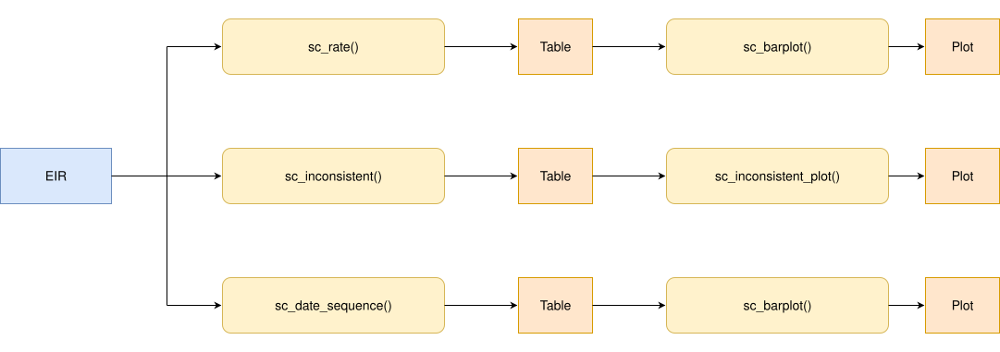

<a href="../es/dose_sequence_comparison_es.html" class="btn btn-outline-primary" role="button">🌐 Lea esto en español</a>

```{r setup, include = FALSE, message = FALSE, warning = FALSE}
library(immunabc)
library(dplyr)
library(knitr)
```

# Rationale

Many vaccines in a national immunization schedule are administered as an ordered series of doses (e.g., DTP1, DTP2 and DTP3). Each dose builds on the previous one, so a person should not have a later dose registered without the earlier doses, and each dose should be administered after the previous one.

When an Electronic Immunization Registry (EIR) contains people with a skipped dose (e.g., DTP1 and DTP3 but no DTP2), or with doses administered out of chronological order (e.g., DTP2 administered before DTP1), it usually points to data quality problems: doses registered with the wrong dose number, doses administered but never registered, or records that were not correctly linked to the same person. These problems bias any downstream analysis that relies on dose numbers, such as coverage, dropout or complete schedule analyses.

The dose sequence comparison module allows users to evaluate, person by person, whether the doses of an ordered sequence were registered consistently, from two complementary angles:

1. **Sequence consistency**: whether any earlier dose of the sequence is skipped.
2. **Chronological consistency**: whether the doses received were administered in chronological order.

Since this is a nominal indicator (evaluated person by person), each person is assigned to a single place of residence, so all results can be disaggregated by geographic level.

> **Note**
>
> All functions used for dose sequence comparison analyses within immunABC begin with the `sc_` prefix.

# Glossary

## Political Geographic Boundaries

Throughout this vignette, we will make reference to different levels of political geographic boundaries. These levels are defined by the country/territory and can have different names from country to country. immunABC is agnostic to these names and requires the user to recode their variable names to fit the immunABC structure.

Namely, immunABC can distinguish three administrative levels, which listed from top to bottom level are: ADM0, ADM1 and ADM2.

1. ADM0: The country. This is the top-most administrative level.
2. ADM1: The first geographic subdivision in the country. ADM0 contains several ADM1 subdivisions.
3. ADM2: The second geographic subdivision in the country. Each ADM1 contains several ADM2 subdivisions.

## Dose Sequence

An ordered vector of doses to evaluate, passed to every `sc_` function through the `vaccines` parameter, e.g. `c("DTP1", "DTP2", "DTP3")`. The order of the vector is the order in which the doses should be administered. Only people with at least one dose of the sequence are evaluated.

## Sequence Consistency Categories

A sequence is **consistent** when no earlier dose is skipped, that is, when the doses received are the first doses of the sequence. A person who has not finished the sequence yet (e.g., only DTP1, or DTP1 and DTP2) is consistent: they may simply not have reached the age for the next dose, or may have dropped out (see the [Nominal Dropout Rate](nominal_dropout_en.html) module). A sequence is **inconsistent** when a dose is missing before the last dose received.

For a `DTP1`, `DTP2`, `DTP3` sequence:

| Doses received | Category | Skipped doses |
|---|---|---|
| `DTP1` | `CONSISTENT` | |
| `DTP1 + DTP2` | `CONSISTENT` | |
| `DTP1 + DTP2 + DTP3` | `CONSISTENT` | |
| `DTP2` | `INCONSISTENT` | `DTP1` |
| `DTP3` | `INCONSISTENT` | `DTP1 + DTP2` |
| `DTP1 + DTP3` | `INCONSISTENT` | `DTP2` |
| `DTP2 + DTP3` | `INCONSISTENT` | `DTP1` |

## Chronological Consistency Categories

Only the doses each person received are compared, in the order of the sequence. People with fewer than two doses of the sequence cannot be evaluated and are excluded.

| Category | Meaning |
|---|---|
| `CONSISTENT` | Every dose received was administered after the previous dose received in the sequence. |
| `INCONSISTENT` | At least one dose was administered before (or, by default, on the same day as) the previous dose received in the sequence. |
| `DATE_MISSING` | At least one dose received has no `date_vax`. |

# Usage

## Install Package

```{r install_package, eval=FALSE}
devtools::install_github("IM-Data-PAHO/immunabc")
```

## Load Data

The functions in this module require your **EIR dataset** in the standard immunABC format.

### EIR

The `immunabc::immunABC.EIR` data frame provides a simulated, nominal-level table representing individual vaccination events from an Electronic Immunization Registry (EIR). Each row corresponds to a single vaccination act for a person.

```{r immunABC-EIR, message=FALSE}
immunABC.EIR %>% head() %>% kable(caption = "Example Electronic Immunization Registry")
```

- `ID`: Unique person identification number.
- `date_birth`: Date of birth of person.
- `date_vax`: Date of vaccination event.
- `ADM1_residence` / `ADM2_residence`: First and second geographic administrative levels of residence.
- `ADM1_occurrence` / `ADM2_occurrence`: First and second geographic administrative levels where the vaccination occurred.
- `dose`: Combined variable representing vaccine type and dose number (e.g., DTP1).

## Dose Sequence Comparison Analysis

### Expected Workflow

The `sc_` suite contains five functions that work together:

1. `sc_rate()` — computes the percentage of consistent and inconsistent sequences, aggregated by geographic level.
2. `sc_barplot()` — visualizes the output of `sc_rate()` or `sc_date_sequence()` as a stacked bar chart.
3. `sc_inconsistent()` — lists each person with an inconsistent sequence, with the date of each dose in a schedule-like table.
4. `sc_inconsistent_plot()` — visualizes how inconsistent sequences are distributed across combinations of doses received, as a heatmap.
5. `sc_date_sequence()` — computes the percentage of sequences with a chronological inconsistency, aggregated by geographic level.

The figure below shows the expected workflow.



<br>

Throughout this vignette, we will evaluate the `DTP1`, `DTP2`, `DTP3` sequence.

```{r sequence, message=FALSE}
dtp_sequence <- c("DTP1", "DTP2", "DTP3")
```

### Step 1 — Compute sequence consistency with `sc_rate()`

`sc_rate()` evaluates each person's sequence and returns, for each geographic unit, the count and percentage of people in each category. It has two modes:

- `mode = "simple"` (default): classifies each sequence as `CONSISTENT` or `INCONSISTENT`.
- `mode = "complex"`: keeps `CONSISTENT` as a single category, and breaks down `INCONSISTENT` into each combination of doses received (e.g., `DTP1 + DTP3`).

```{r sc-rate-simple, message=FALSE}
rate_simple <- sc_rate(
  data.EIR  = immunABC.EIR,
  vaccines  = dtp_sequence,
  geo_level = "ADM1",
  mode      = "simple"
)

rate_simple %>% kable(digits = 2, caption = "Sequence consistency by ADM1 (simple mode)")
```

Notice the warning: when a person has the same dose registered more than once, only the earliest `date_vax` is kept. We recommend checking for duplicates before running the analysis.

```{r sc-rate-complex, message=FALSE, warning=FALSE}
rate_complex <- sc_rate(
  data.EIR  = immunABC.EIR,
  vaccines  = dtp_sequence,
  geo_level = "ADM1",
  mode      = "complex"
)

rate_complex %>%
  filter(ADM1 == "ADM1_1") %>%
  kable(digits = 2, caption = "Sequence consistency in ADM1_1 (complex mode)")
```

#### Parameters accepted

- `data.EIR`: EIR data frame in immunABC format.
- `vaccines`: Ordered character vector of at least two doses, e.g. `c("DTP1", "DTP2", "DTP3")`.
- `geo_level`: `"ADM0"` (default), `"ADM1"`, or `"ADM2"`.
- `mode`: `"simple"` (default) or `"complex"`.
- `birth_cohorts`: Numeric vector of birth cohort year(s) to filter to. Default `NULL` uses all available cohorts.
- `fix_residence`: Logical, defaults to `TRUE`. See [Handling residence inconsistencies] below.

The output contains the `sequence` category, a `consistent` column (`TRUE`/`FALSE`), the number of people (`n`), the total number of people with at least one dose of the sequence (`total`) and the percentage (`rate`).

### Handling residence inconsistencies

Since each person is evaluated as a whole, they must be assigned to a single place of residence. If a person's registered residence is not the same on every record (e.g., they moved between their DTP1 and DTP3 doses, and the older record was never updated), the `sc_` functions warn about it, and the `fix_residence` parameter controls how it is handled:

- `fix_residence = TRUE` (default): all of a person's records are corrected to the `ADM1_residence`/`ADM2_residence` tied to their **most recent vaccination**.
- `fix_residence = FALSE`: residence values are left as recorded, and each person is assigned the residence of their first record.

`sc_rate()` and `sc_date_sequence()` only check residence when `geo_level` is `"ADM1"` or `"ADM2"`. `sc_inconsistent()` always checks it, since its output includes the residence of each person.

### Step 2 — Visualize sequence consistency with `sc_barplot()`

The output of `sc_rate()` can be passed directly to `sc_barplot()` to produce a stacked bar chart per geographic unit.

```{r sc-barplot-simple, message=FALSE, fig.width=10, fig.height=5}
sc_barplot(
  data          = rate_simple,
  sequence_name = "DTP1 - DTP3"
)
```

In complex mode, each inconsistent combination is shown in a different color:

```{r sc-barplot-complex, message=FALSE, fig.width=10, fig.height=5}
sc_barplot(
  data          = rate_complex,
  sequence_name = "DTP1 - DTP3"
)
```

#### Parameters accepted

- `data`: Output of `sc_rate()` or `sc_date_sequence()`.
- `sequence_name`: Display label for the dose sequence in the plot subtitle. Default: `"dose sequence"`.
- `within_ADM1`: Character vector to filter to specific ADM1 units when `geo_level = "ADM2"`. Default: `NULL`.
- `plot_missing`: Boolean. Only used with the output of `sc_date_sequence()`. If `TRUE` (default), `DATE_MISSING` sequences are shown as a separate bar segment so all bars sum to 100%.

#### Interpretation

Each bar represents a geographic unit. The `CONSISTENT` segment (blue) is shown at the bottom of each bar, and the inconsistent segments stack on top of it. Areas with a larger share of inconsistent sequences should be prioritized for data quality review. The complex mode shows which dose is usually skipped: for example, a large share of `DTP2 + DTP3` (skipped `DTP1`) may indicate that first doses are being registered with the wrong dose number, or that first doses are administered somewhere that does not report to the EIR.

### Step 3 — Inspect individual inconsistent sequences with `sc_inconsistent()`

`sc_inconsistent()` returns a person-level table of all inconsistent sequences in a schedule-like format: one row per person and one column per dose of the sequence, containing the date each dose was administered (`NA` if it was not received).

```{r sc-inconsistent, message=FALSE, warning=FALSE}
inconsistent_df <- sc_inconsistent(
  data.EIR = immunABC.EIR,
  vaccines = dtp_sequence
)

inconsistent_df %>% head(10) %>% kable(caption = "Sample of inconsistent sequences")
```

#### Parameters accepted

- `data.EIR`: EIR data frame in immunABC format.
- `vaccines`: Ordered character vector of at least two doses.
- `birth_cohorts`: Numeric vector of birth cohort year(s) to filter to. Default `NULL` uses all available cohorts.
- `fix_residence`: Logical, defaults to `TRUE`.

The `sequence` column shows the combination of doses received, and the `skipped_doses` column shows the doses missing before the last dose received. This table can be exported for record-level correction workflows, for example, to look for the skipped doses under a different dose number or a different ID.

### Step 4 — Visualize the distribution of inconsistent sequences with `sc_inconsistent_plot()`

The output of `sc_inconsistent()` can be passed to `sc_inconsistent_plot()` to produce a heatmap of how inconsistent sequences are distributed across combinations of doses received. Each column represents a geographic unit of residence and adds up to 100% of its inconsistent sequences. Consistent sequences are not shown.

```{r sc-inconsistent-plot-adm0, message=FALSE, fig.width=6, fig.height=5}
sc_inconsistent_plot(inconsistent_df)
```

```{r sc-inconsistent-plot-adm1, message=FALSE, fig.width=10, fig.height=5}
sc_inconsistent_plot(inconsistent_df, geo_level = "ADM1")
```

#### Parameters accepted

- `data`: Output of `sc_inconsistent()`.
- `geo_level`: Geographic level of residence to show as columns: `"ADM0"` (default), `"ADM1"`, or `"ADM2"`.
- `within_ADM1`: Character vector to filter to specific ADM1 units. Default: `NULL`.
- `digits`: Number of decimal digits in the labels. Default: `0`.

#### Interpretation

Rows are sorted with the most frequent combinations at the top. When one combination dominates in a specific area (a darker cell than the rest of its row), it suggests a local registration practice worth investigating, rather than a random data entry error.

### Step 5 — Compute chronological consistency with `sc_date_sequence()`

`sc_date_sequence()` checks, for each person, whether the doses received were administered in the order of the sequence. Unfinished and inconsistent sequences are also evaluated, using only the doses received (e.g., a person with `DTP1 + DTP3` is checked for `DTP1` before `DTP3`).

```{r sc-date-sequence, message=FALSE, warning=FALSE}
date_sequence_df <- sc_date_sequence(
  data.EIR  = immunABC.EIR,
  vaccines  = dtp_sequence,
  geo_level = "ADM1"
)

date_sequence_df %>% kable(digits = 2, caption = "Chronological consistency by ADM1")
```

#### Parameters accepted

- `data.EIR`: EIR data frame in immunABC format.
- `vaccines`: Ordered character vector of at least two doses.
- `geo_level`: `"ADM0"` (default), `"ADM1"`, or `"ADM2"`.
- `birth_cohorts`: Numeric vector of birth cohort year(s) to filter to. Default `NULL` uses all available cohorts.
- `allow_same_day`: Logical, defaults to `FALSE`. Whether two consecutive doses administered on the same day are considered consistent. Doses of the same vaccine series should not be administered on the same day, but this may be relaxed for sequences that combine different vaccines.
- `fix_residence`: Logical, defaults to `TRUE`.

The output may also be passed to `sc_barplot()`:

```{r sc-date-sequence-barplot, message=FALSE, fig.width=10, fig.height=5}
sc_barplot(
  data          = date_sequence_df,
  sequence_name = "DTP1 - DTP3"
)
```

#### Interpretation

Chronological inconsistencies are usually rare, so even small percentages deserve attention. They may be caused by typos in `date_vax`, by doses registered with the wrong dose number (e.g., DTP2 registered as DTP1 and vice versa), or by records from two different people linked to the same ID. The [Date Consistency Comparison](date_consistency_comparison_en.html) module can help investigate the dates involved.

# Summary

The `sc_` module provides a complete pipeline for assessing whether ordered dose sequences are registered consistently in EIR data. `sc_rate()` and `sc_barplot()` give a geographic overview of sequences with skipped doses, `sc_inconsistent()` and `sc_inconsistent_plot()` allow record-level inspection and characterization of which doses are being skipped, and `sc_date_sequence()` quantifies sequences administered out of chronological order. Together, they help data managers and public health analysts detect and prioritize data quality corrections before analyses that rely on dose numbers, such as coverage, dropout or complete schedule analyses.
