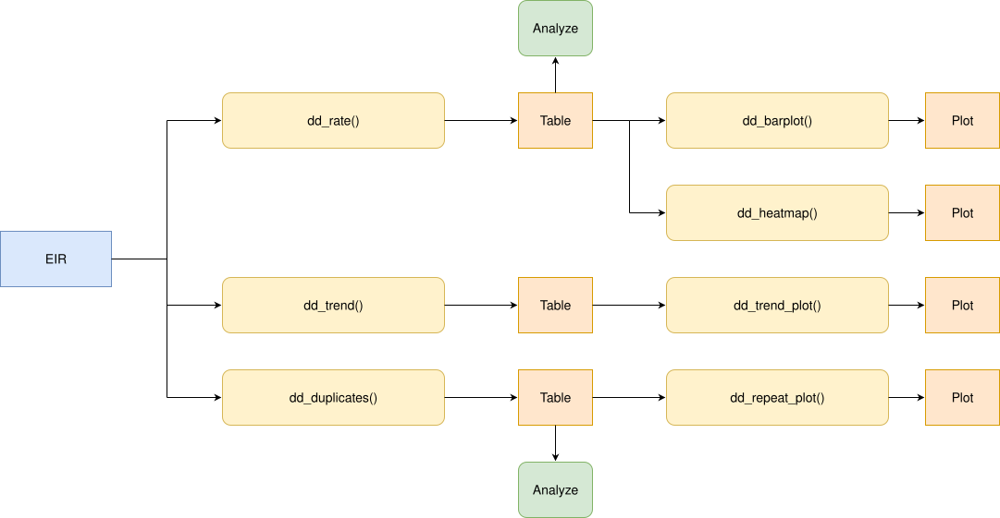

<a href="../es/duplicate_doses_es.html" class="btn btn-outline-primary" role="button">🌐 Lea esto en español</a>

```{r setup, include = FALSE, message = FALSE, warning = FALSE}
library(immunabc)
library(dplyr)
library(knitr)
```

# Rationale

In an Electronic Immunization Registry (EIR), each dose a person receives should be registered exactly once. In practice, the same dose can be registered more than once for the same person. Every extra record inflates the number of doses administered, so it biases traditional coverage indicators that typically rely on the "number of doses administered" as the numerator.

This module lets users analyze duplicate doses in an EIR. It compares all the records that belong to the same person and correspond to the same dose, and classifies each extra record into one of the following categories:

1. **Duplicate**: the extra record has the same vaccination date and place of occurrence as an earlier record, that is, the same vaccination event was registered more than once.
2. **Repeated**: the extra record has a different vaccination date or place of occurrence, that is, the same dose was registered at a different moment in time or in a different place.

These categories help analysts understand the broad possible causes for extra records in their EIR. However, the exact reason for each must be analyzed at the record level and combined with additional information sources if possible. For example, a **Duplicate** record could be caused by the data having been entered twice into the system, or by data being duplicated after migrating from an older system. As for **Repeated** records, a dose may have been truly administered twice (in which case we would call this a programmatic error), or it could have been entered with the wrong dose number (e.g., a DTP2 dose entered as DTP1). The plots and the record-level table of this module help investigate these possible causes.

Finally, since extra records (whatever their cause) are a data quality problem directly related to each vaccination event, this module disaggregates results geographically by the **place of occurrence** of the vaccination event, not by the place of residence of the individual.

> **Note**
>
> All functions used for duplicate dose analyses within immunABC begin with the `dd_` prefix.

# Glossary

## Political Geographic Boundaries

Throughout this vignette, we will make reference to different levels of political geographic boundaries. These levels are defined by the country/territory and can have different names from country to country. immunABC is agnostic to these names and requires the user to recode their variable names to fit the immunABC structure.

Namely, immunABC can distinguish three administrative levels, which listed from top to bottom level are: ADM0, ADM1 and ADM2.

1. ADM0: The country. This is the top-most administrative level.
2. ADM1: The first geographic subdivision in the country. ADM0 contains several ADM1 subdivisions.
3. ADM2: The second geographic subdivision in the country. Each ADM1 contains several ADM2 subdivisions.

## Duplication Categories

When analyzing extra records, the following categorization applies: all the records that belong to the same person and contain the same dose are compared in order of vaccination date. The first record is considered the legitimate one, and each later record is classified by comparing it with the earlier ones:

- `FIRST_ENTRY`: the first record of that person and dose. It is never counted as a problem.
- `DUPLICATE`: same person, dose, vaccination date and place of occurrence as an earlier record.
- `REPEATED`: same person and dose as an earlier record, but a different vaccination date or place of occurrence.

The following is an example of such classifications for a person with two extra records:

| `date_vax` | Place of occurrence | Category | Why |
|---|---|---|---|
| January 5 | `ADM2_1_1` | `FIRST_ENTRY` | First record of this person and dose. Not counted as extra. |
| February 10 | `ADM2_1_1` | `REPEATED` | Same dose, but on a different date. |
| February 10 | `ADM2_1_1` | `DUPLICATE` | Identical to the previous record. |

## Records Not Evaluated

Records missing `ID`, `dose`, `date_vax`, `ADM1_occurrence` or `ADM2_occurrence` do not contain enough information to tell whether they match another record, so they are not evaluated. All the functions in this module will show a message with the number of records that were excluded.

# Usage

## Install Package

```{r install_package, eval=FALSE}
devtools::install_github("IM-Data-PAHO/immunabc")
```

## Load Data

The functions in this module require your **EIR dataset** in the standard immunABC format. `dd_repeat_plot()` can optionally use a **vaccination schedule** to show the vaccination window of each dose. The expected format for these datasets is described below.

### EIR

The `immunabc::immunABC.EIR` data frame provides a simulated, nominal-level table representing individual vaccination events from an Electronic Immunization Registry (EIR). Each row corresponds to a single vaccination act for a person.

```{r immunABC-EIR, message=FALSE}
immunABC.EIR %>% head() %>% kable(caption = "Example Electronic Immunization Registry")
```

- `ID`: Unique person identification number.
- `date_birth`: Date of birth of person.
- `date_vax`: Date of vaccination event.
- `ADM1_residence` / `ADM2_residence`: First and second geographic administrative levels of residence.
- `ADM1_occurrence` / `ADM2_occurrence`: First and second geographic administrative levels where the vaccination occurred.
- `dose`: Combined variable representing vaccine type and dose number (e.g., DTP1).

### Vaccination schedule

The `immunabc::immunABC.schedule` data frame defines the age at which each dose should be administered, in days.

```{r immunABC-schedule, message=FALSE}
immunABC.schedule %>% kable(caption = "Example vaccination schedule")
```

- `dose`: Combined variable representing vaccine type and dose number (e.g., DTP1).
- `age_schedule`: Recommended age of vaccination, in days.
- `age_schedule_low` / `age_schedule_high`: Lower and upper limits of the vaccination window, in days.

## Duplicate Doses Analysis

### Expected Workflow

The `dd_` suite contains seven functions organized in three pipelines:

1. `dd_rate()` — computes the percentage of duplicate and repeated records, permitting disaggregation by geographic level and optionally by dose or birth cohort.
    - `dd_barplot()` — visualizes the output of `dd_rate()` as a bar chart.
    - `dd_heatmap()` — visualizes the output of `dd_rate()` as a heatmap of geographic areas against doses or birth cohorts.
2. `dd_trend()` — computes the percentage of duplicate records by month of vaccination.
    - `dd_trend_plot()` — visualizes the output of `dd_trend()` as a line plot.
3. `dd_duplicates()` — lists every record of each dose registered more than once, for record-level review and correction.
    - `dd_repeat_plot()` — for **Repeated** records of a dose, this function compares the age at vaccination of the repeats with that of the first entries of the same dose. This helps spot doses registered in the EIR with the wrong dose number (e.g., DTP1 repeats clustering at the age DTP2 is due may point towards DTP2 doses being registered as DTP1).


The figure below shows the expected workflow.



<br>

### Step 1 — Compute duplicate and repeated records with `dd_rate()`

`dd_rate()` classifies every record and returns, for each group, the number and percentage of `DUPLICATE` and `REPEATED` records. The denominator (`total`) includes every evaluated record in the group. Below we show the result at the national level.

```{r dd-rate-adm0, message=FALSE}
dd_rate(data.EIR = immunABC.EIR) %>%
  kable(digits = 2, caption = "Duplicate and repeated records at the national level")
```

Results can be disaggregated geographically with `geo_level` and by one additional variable with the `disaggregate_by` argument (either `dose` or `birth_cohort`). For example, if we disaggregate by the first subnational level (ADM1), we obtain the following table:

```{r dd-rate-adm1, message=FALSE}
rate_adm1 <- dd_rate(
  data.EIR  = immunABC.EIR,
  geo_level = "ADM1"
)

rate_adm1 %>% kable(digits = 2, caption = "Duplicate and repeated records by ADM1 of occurrence")
```

And disaggregating only by `dose` produces a table at the national level where each dose is analyzed separately:

```{r dd-rate-dose, message=FALSE}
rate_dose <- dd_rate(
  data.EIR        = immunABC.EIR,
  disaggregate_by = "dose"
)

rate_dose %>%
  filter(duplication == "DUPLICATE") %>%
  kable(digits = 2, caption = "Duplicate records by dose")
```

<details>
<summary><strong>Parameters accepted</strong></summary>

- `data.EIR`: EIR data frame in immunABC format.
- `geo_level`: Geographic level of occurrence: `"ADM0"` (default), `"ADM1"`, or `"ADM2"`.
- `disaggregate_by`: One additional variable to disaggregate by: `"dose"` or `"birth_cohort"`. Default `NULL` (no additional disaggregation). With `"birth_cohort"`, records with no `date_birth` are excluded, with a message.
- `vaccines`: Character vector of doses to include, e.g. `c("DTP1", "DTP2", "DTP3")`. This is only a filter: use `disaggregate_by = "dose"` to see results by dose. Default `NULL` uses all doses.
- `birth_cohorts`: Numeric vector of birth cohort year(s) to filter to. This is only a filter: use `disaggregate_by = "birth_cohort"` to see results by cohort. Default `NULL` uses all available cohorts.

</details>

### Step 2 — Visualize duplicate records with `dd_barplot()`

The output of `dd_rate()` can be passed directly to `dd_barplot()`. Geographic areas are shown on the x-axis if present, otherwise this axis will show doses or birth cohorts. When the data has both, doses or birth cohorts become panels. When showing rates, a dashed line shows the rate of all groups combined.

```{r dd-barplot-adm1, message=FALSE, fig.width=10, fig.height=5}
dd_barplot(data = rate_adm1)
```

By default, the plot shows the percentage of `DUPLICATE` records. Use `duplication = "repeated"` to show `REPEATED` records instead, and `value = "n"` to show the number of records instead of their percentage:

```{r dd-barplot-dose, message=FALSE, fig.width=10, fig.height=5}
dd_barplot(
  data        = rate_dose,
  duplication = "repeated",
  value       = "n"
)
```

At the ADM2 level, `within_ADM1` focuses on the areas of one or several ADM1, and `min_total` hides the bars with few records, since their rates can be misleading due to the small denominators involved:

```{r dd-barplot-adm2, message=FALSE, fig.width=10, fig.height=5}
rate_adm2 <- dd_rate(
  data.EIR  = immunABC.EIR,
  geo_level = "ADM2"
)

dd_barplot(
  data        = rate_adm2,
  within_ADM1 = "ADM1_3",
  min_total   = 1000
)
```

<details>
<summary><strong>Parameters accepted</strong></summary>

- `data`: Output of `dd_rate()`.
- `value`: What to show on the y-axis: `"rate"` (default) or `"n"`.
- `duplication`: Which records to show: `"duplicate"` (default) or `"repeated"`.
- `within_ADM1`: Character vector to filter to specific ADM1 units when `geo_level = "ADM2"`. Default: `NULL`.
- `min_total`: Minimum number of records for a bar to be shown. Hidden bars still count towards the dashed line. Default: `NULL` (all bars shown).

</details>

#### Interpretation

Rates and raw numbers are both useful but answer different questions. With `value = "rate"`, the plots show where the problem is proportionally worst, pointing to registration practices worth reviewing. With `value = "n"`, they show where the most records need correcting, which is where a cleanup effort will have the largest impact. When showing rates, a dashed line marks the rate of all groups combined and any bars well above it should be the first candidates for review.

### Step 3 — Combine two disaggregations with `dd_heatmap()`

`dd_heatmap()` helps combine two disaggregations into a single plot. For example, we can visualize the percentage of duplicate records for each geographic area and dose:

```{r dd-heatmap-dose, message=FALSE, fig.width=10, fig.height=5}
rate_adm1_dose <- dd_rate(
  data.EIR        = immunABC.EIR,
  geo_level       = "ADM1",
  disaggregate_by = "dose"
)

dd_heatmap(data = rate_adm1_dose)
```

We could visualize the same, but by birth cohort instead of dose, and additionally filter only for the most recent cohorts:

```{r dd-heatmap-cohort, message=FALSE, fig.width=10, fig.height=4}
rate_adm1_cohort <- dd_rate(
  data.EIR        = immunABC.EIR,
  geo_level       = "ADM1",
  disaggregate_by = "birth_cohort",
  birth_cohorts   = 2021:2023
)

dd_heatmap(data = rate_adm1_cohort)
```

<details>
<summary><strong>Parameters accepted</strong></summary>

- `data`: Output of `dd_rate()` with `geo_level` at `"ADM1"` or `"ADM2"` and a value for `disaggregate_by`.
- `value`: What to show in the cells: `"rate"` (default) or `"n"`.
- `duplication`: Which records to show: `"duplicate"` (default) or `"repeated"`.
- `within_ADM1`: Character vector to filter to specific ADM1 units when `geo_level = "ADM2"`. Default: `NULL`.
- `min_total`: Minimum number of records for a cell to be filled. Other cells are grey and blank. Default: `NULL` (all cells filled).
- `digits`: Number of decimal digits in the cells when `value = "rate"`. Default: `1`.
- `show_numbers`: Logical, defaults to `TRUE`. Whether to show the number in each cell, or a color legend instead. Set it to `FALSE` when there are too many cells to read (e.g., at the ADM2 level).

</details>

#### Interpretation

A dark row across all areas points to a problem of that dose or cohort everywhere, for example a dose that is systematically registered twice by the information system. A dark column points to a problem in a specific area, which suggests a local registration practice. A single dark cell is a problem specific to one area and one dose or cohort. In the example, `ADM1_4` has the highest rates for most doses, and `BCG RN` and `DTP1` have the highest rates in every area.

### Step 4 — Follow duplicate records over time with `dd_trend()` and `dd_trend_plot()`

`dd_trend()` performs the same calculation as `dd_rate()`, but disaggregates results by month of vaccination to spot trends over time. Only `DUPLICATE` records are included: repeated records are better explored with `dd_repeat_plot()` (see Step 6).

Below we see the summary of duplicate records by month and ADM1.

```{r dd-trend, message=FALSE}
trend_adm1 <- dd_trend(
  data.EIR  = immunABC.EIR,
  geo_level = "ADM1"
)

trend_adm1 %>% head() %>% kable(digits = 2, caption = "Duplicate records by ADM1 and month of vaccination")
```

When results are disaggregated at a subnational level, `dd_trend_plot()` draws the total for all areas as a highlighted line, and each subnational area as a thin grey line for context. Up to 5 subnational areas can be highlighted in color with the `highlight` parameter. Exploring the data before selecting the areas to highlight is recommended. In this case we are highlighting `ADM1_4` because it is the area with the highest rate of duplicate records.

```{r dd-trend-plot, message=FALSE, fig.width=10, fig.height=5}
dd_trend_plot(
  data      = trend_adm1,
  highlight = "ADM1_4"
)
```

<details>
<summary><strong>Parameters accepted</strong></summary>

`dd_trend()`:

- `data.EIR`: EIR data frame in immunABC format.
- `geo_level`: Geographic level of occurrence: `"ADM0"` (default), `"ADM1"`, or `"ADM2"`.
- `vaccines`: Character vector of doses to include. Default `NULL` uses all doses.
- `birth_cohorts`: Numeric vector of birth cohort year(s) to filter to. Default `NULL` uses all available cohorts.

`dd_trend_plot()`:

- `data`: Output of `dd_trend()`.
- `value`: What to show on the y-axis: `"rate"` (default) or `"n"`. With `"n"`, all areas combined is the sum of all areas, so it may be much larger than any single area.
- `highlight`: Up to 5 geographic areas to highlight in color. Only available when `data` is disaggregated by ADM1 or ADM2. Default: `NULL`.
- `within_ADM1`: Character vector to filter to specific ADM1 units when `geo_level = "ADM2"`. All areas combined then refers to those areas only. Default: `NULL`.
- `min_total`: Minimum number of records for an area to be shown in a given month, leaving gaps in the lines otherwise. Useful because rates based on few records can be misleading and stretch the y-axis. Default: `NULL` (all months shown).

</details>

#### Interpretation

This analysis helps spot trends in duplicate records over time. If a month or set of months has higher duplicate rates than the rest, it may point to a systematic error affecting the records from that period. For example, records may have been written more than once during a batch migration from an older EIR, or a batch of paper records may have been digitized twice. In the example, duplicates are clearly concentrated in the first half of 2022, particularly in the `ADM1_4` area, and almost disappear afterwards.

### Step 5 — Inspect individual records with `dd_duplicates()`

`dd_duplicates()` returns a record-level table with every record of each dose registered more than once for the same person. Below we list all the DTP1 doses registered more than once:

```{r dd-duplicates, message=FALSE}
duplicates_df <- dd_duplicates(data.EIR = immunABC.EIR, vaccines = "DTP1")

duplicates_df %>%
  head() %>%
  kable(caption = "DTP1 doses registered more than once")
```

<details>
<summary><strong>Parameters accepted</strong></summary>

- `data.EIR`: EIR data frame in immunABC format.
- `vaccines`: Character vector of doses to include. Default `NULL` uses all doses.
- `birth_cohorts`: Numeric vector of birth cohort year(s) to filter to. Default `NULL` uses all available cohorts.

</details>

#### Output

Note that besides the original columns of each record, the output includes:

- `group`: a number identifying all the records of the same person and dose.
- `copy`: the position of the record within its group, in date order.
- `n_copies`: the number of records in the group.
- `days_since_first_entry`: days between the record and the `FIRST_ENTRY` of its group.
- `duplication`: the category of the record: `FIRST_ENTRY`, `DUPLICATE` or `REPEATED`.

#### Interpretation

This table can be exported for record-level review and correction workflows. For example, the `days_since_first_entry` column tells apart `REPEATED` records registered on the same day in two different places (`days_since_first_entry = 0`) from those registered weeks or months after the first entry, which may point to different causes (see Step 6).

### Step 6 — Explore the possible causes of repeated records with `dd_repeat_plot()`

For the sake of example, let's consider the following hypothetical case for a person born on January 10, 2022:

| `dose` | `date_vax` | Age at vaccination | `ADM2_occurrence` | `copy` | `days_since_first_entry` | `duplication` |
|---|---|---|---|---|---|---|
| DTP1 | 2022-03-11 | 60 days | `ADM2_1_1` | 1 | `NA` | `FIRST_ENTRY` |
| DTP1 | 2022-05-12 | 122 days | `ADM2_1_1` | 2 | 62 | `REPEATED` |

The first record falls inside the DTP1 vaccination window (54 to 90 days of age, according to `immunABC.schedule`), so it is most likely a legitimate DTP1. The second DTP1 record, however, was registered at 122 days of age, right inside the DTP2 window (116 to 150 days). If we look up the rest of this person's records in the EIR and find a DTP3 at 6 months but no DTP2, the most likely explanation is that the DTP2 dose was registered with the wrong dose number. Rather than an extra dose, this person probably has a mislabeled DTP2 dose.

The example above was a single person, but reviewing every group by hand is not feasible when an EIR has thousands of them. What we really want to know is whether that story is an isolated case or a systematic pattern: are the `REPEATED` DTP1 records of the EIR mostly registered at the age DTP2 is due?

`dd_repeat_plot()` answers this question for the whole table at once. It takes the output of `dd_duplicates()` and, for a single dose, shows the age at vaccination of the `FIRST_ENTRY` records (top panel) and of the `REPEATED` records (bottom panel). One can also pass `data.schedule` and `schedule_vaccines` to shade specific vaccination windows in the plot, and therefore more clearly highlight any DTP2 doses being mislabeled as DTP1.

```{r dd-repeat-plot, message=FALSE, fig.width=10, fig.height=6}
dd_repeat_plot(
  data              = duplicates_df,
  vaccine           = "DTP1",
  max_age           = 365,
  data.schedule     = immunABC.schedule,
  schedule_vaccines = c("DTP1", "DTP2")
)
```

We can also split the results by subnational area using `geo_level`, thereby showing whether the pattern is the same everywhere:

```{r dd-repeat-plot-adm1, message=FALSE, fig.width=12, fig.height=6}
dd_repeat_plot(
  data              = duplicates_df,
  vaccine           = "DTP1",
  geo_level         = "ADM1",
  max_age           = 365,
  binwidth          = 14,
  data.schedule     = immunABC.schedule,
  schedule_vaccines = c("DTP1", "DTP2")
)
```

<details>
<summary><strong>Parameters accepted</strong></summary>

- `data`: Output of `dd_duplicates()`.
- `vaccine`: The single dose to show, e.g. `"DTP1"`.
- `geo_level`: Geographic level of occurrence to split the panels by: `"ADM0"` (default, no split), `"ADM1"`, or `"ADM2"`.
- `within_ADM1`: Character vector to filter to specific ADM1 units of occurrence. Default: `NULL`.
- `binwidth`: Width of each bar of the histogram, in days. Default: `7` (one week).
- `max_age`: Maximum age at vaccination to show on the x-axis, in days. The number of records beyond it is given in the caption. Default: `NULL` (all ages shown).
- `data.schedule`: Vaccination schedule data frame in immunABC format, used to shade vaccination windows. Default: `NULL` (no windows shown).
- `schedule_vaccines`: Up to 3 doses whose vaccination window is shaded. Only used with `data.schedule`. Default `NULL` shades the window of `vaccine`.

</details>

#### Interpretation

The shape of the bottom panel hints at the cause of the repeats:

- **Repeats at the age of the next dose**: if the repeats of DTP1 are concentrated in the DTP2 vaccination window, as in the example, the second record is most likely a DTP2 dose registered as DTP1. These people will probably appear with a skipped DTP2 in the [Dose Sequence Comparison](dose_sequence_comparison_en.html) module.
- **Repeats shortly after the first entry, within the same window**: the dose may have been registered again at a follow-up visit, or administered twice because the person's vaccination history was not checked.
- **Repeats spread over all ages**: the records may belong to two different people linked to the same ID, which is a record linkage problem.

> **Note**
>
> Records with no `date_birth`, or with `date_vax` before `date_birth`, have no valid age at vaccination, so they are excluded from this analysis. The [Date Consistency Comparison](date_consistency_comparison_en.html) module can help investigate the latter.

# Summary

The `dd_` module provides a complete pipeline for detecting doses registered more than once in EIR data, telling apart `DUPLICATE` records (the same vaccination event registered more than once, with the same date and place) from `REPEATED` records (the same dose registered on a different date or in a different place).

- `dd_rate()`, `dd_barplot()` and `dd_heatmap()` give a geographic overview by dose or birth cohort,
- `dd_trend()` and `dd_trend_plot()` analyze possible time trends in duplicate records,
- `dd_duplicates()` allows record-level inspection, and
- `dd_repeat_plot()` helps identify the causes of repeated records.

Since duplicate and repeated records are data quality issues that bias many indicators (such as coverage or dropout), we recommend running this module early to identify any possible issues with your own EIR.
