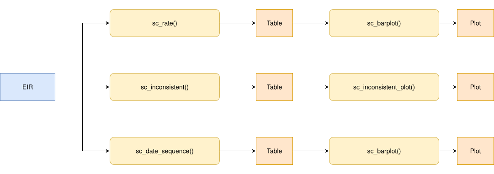

<a href="../en/dose_sequence_comparison_en.html" class="btn btn-outline-primary" role="button">🌐 Read this in English</a>

```{r setup, include = FALSE, message = FALSE, warning = FALSE}
library(immunabc)
library(dplyr)
library(knitr)
```

# Fundamento

Muchas vacunas de un esquema nacional de vacunación se administran como una serie ordenada de dosis (p. ej., DTP1, DTP2 y DTP3). Cada dosis se construye sobre la anterior, por lo que una persona no debería tener registrada una dosis posterior sin las dosis previas, y cada dosis debería administrarse después de la anterior.

Cuando un Registro Nominal de Vacunación electrónico (RNVe) contiene personas con una dosis saltada (p. ej., DTP1 y DTP3 sin DTP2), o con dosis administradas fuera de orden cronológico (p. ej., DTP2 administrada antes que DTP1), esto suele indicar problemas de calidad de datos: dosis registradas con un número de dosis equivocado, dosis administradas pero nunca registradas, o registros que no fueron vinculados correctamente a la misma persona. Estos problemas sesgan cualquier análisis posterior que dependa del número de dosis, como los análisis de cobertura, abandono o esquema completo.

El módulo de comparación de secuencia de dosis permite evaluar, persona por persona, si las dosis de una secuencia ordenada fueron registradas de forma consistente. Una secuencia solo se considera consistente cuando cumple ambas verificaciones:

1. **Sin dosis saltadas**: no falta ninguna dosis anterior de la secuencia.
2. **Orden cronológico**: las dosis recibidas fueron administradas en el orden de la secuencia.

Dado que se trata de un indicador nominal (evaluado persona por persona), cada persona se asigna a un único lugar de residencia, por lo que todos los resultados pueden desagregarse por nivel geográfico.

> **Nota**
>
> Todas las funciones utilizadas para los análisis de comparación de secuencia de dosis dentro de immunABC comienzan con el prefijo `sc_`.

# Glosario

## Divisiones político-geográficas

A lo largo de esta viñeta se hace referencia a distintos niveles de división político-geográfica. Estos niveles son definidos por cada país o territorio y pueden recibir nombres diferentes. immunABC no depende de esos nombres locales; por eso, el usuario debe recodificar sus variables para ajustarlas a la estructura que utiliza el paquete.

En concreto, immunABC puede distinguir tres niveles administrativos que, listados del nivel superior al inferior, son: ADM0, ADM1 y ADM2.

1. ADM0: El país. Este es el nivel administrativo más alto.
2. ADM1: La primera subdivisión geográfica del país. ADM0 contiene varias subdivisiones ADM1.
3. ADM2: La segunda subdivisión geográfica del país. Cada ADM1 contiene varias subdivisiones ADM2.

## Secuencia de dosis

Un vector ordenado de dosis a evaluar, que se entrega a todas las funciones `sc_` a través del parámetro `vaccines`, p. ej. `c("DTP1", "DTP2", "DTP3")`. El orden del vector es el orden en que las dosis deberían administrarse. Solo se evalúan las personas con al menos una dosis de la secuencia.

## Categorías de consistencia de la secuencia

Una secuencia es **consistente** cuando:

1. No se salta ninguna dosis anterior, es decir, las dosis recibidas son las primeras dosis de la secuencia. Una persona que aún no termina la secuencia (p. ej., solo DTP1, o DTP1 y DTP2) puede ser consistente: puede que simplemente no haya alcanzado la edad para la siguiente dosis, o que haya abandonado el esquema (vea el módulo de [Tasa de abandono nominal](nominal_dropout_es.html)).
2. Cada dosis recibida fue administrada después de la dosis anterior recibida en la secuencia. De forma predeterminada, dos dosis administradas el mismo día también se consideran fuera de orden (vea `allow_same_day`).

Una secuencia es **inconsistente** cuando falla alguna de las verificaciones: falta una dosis antes de la última dosis recibida y/o las dosis fueron administradas fuera de orden cronológico. Cuando una persona tiene al menos dos dosis de la secuencia y una de ellas no tiene fecha de vacunación (`date_vax`), el orden cronológico no puede evaluarse por completo; si no se encuentra ningún otro problema, la secuencia se clasifica como `DATE_MISSING`.

Para una secuencia `DTP1`, `DTP2`, `DTP3`:

| Dosis recibidas | Fechas | Categoría | Dosis saltadas | Fuera de orden |
|---|---|---|---|---|
| `DTP1` | | `CONSISTENT` | | |
| `DTP1 + DTP2` | DTP1 antes que DTP2 | `CONSISTENT` | | |
| `DTP1 + DTP2 + DTP3` | DTP1 antes que DTP2 antes que DTP3 | `CONSISTENT` | | |
| `DTP1 + DTP2` | DTP2 antes que DTP1 | `INCONSISTENT` | | ✔ |
| `DTP1 + DTP2` | DTP2 sin `date_vax` | `DATE_MISSING` | | |
| `DTP2` | | `INCONSISTENT` | `DTP1` | |
| `DTP3` | | `INCONSISTENT` | `DTP1 + DTP2` | |
| `DTP1 + DTP3` | DTP1 antes que DTP3 | `INCONSISTENT` | `DTP2` | |
| `DTP2 + DTP3` | DTP3 antes que DTP2 | `INCONSISTENT` | `DTP1` | ✔ |

# Uso

## Instalar el paquete

```{r install_package, eval=FALSE}
devtools::install_github("IM-Data-PAHO/immunabc")
```

## Cargar los datos

Las funciones de este módulo requieren que proporcione su **RNVe** en el formato estándar de immunABC.

### RNVe

El conjunto de datos `immunabc::immunABC.EIR` proporciona una tabla nominal simulada con eventos individuales de vacunación de un Registro Nominal de Vacunación electrónico (RNVe). Cada fila corresponde a una vacunación de una persona.

```{r immunABC-EIR, message=FALSE}
immunABC.EIR %>% head() %>% kable(caption = "Ejemplo de Registro Nominal de Vacunación electrónico")
```

- `ID`: Número único de identificación de la persona.
- Fecha de nacimiento (`date_birth`): Fecha de nacimiento de la persona.
- Fecha de vacunación (`date_vax`): Fecha del evento de vacunación.
- `ADM1_residence` / `ADM2_residence`: Primer y segundo nivel administrativo geográfico de residencia.
- `ADM1_occurrence` / `ADM2_occurrence`: Primer y segundo nivel administrativo geográfico donde ocurrió la vacunación.
- Dosis (`dose`): Variable combinada que representa el tipo de vacuna y su número de dosis correspondiente (p. ej., DTP1).

## Análisis de comparación de secuencia de dosis

### Flujo de trabajo esperado

El conjunto de funciones `sc_` contiene cuatro funciones que trabajan en conjunto:

1. `sc_rate()` — calcula el porcentaje de secuencias consistentes e inconsistentes, agregado por nivel geográfico.
2. `sc_barplot()` — visualiza el resultado de `sc_rate()` como un gráfico de barras apiladas.
3. `sc_inconsistent()` — lista cada persona con una secuencia inconsistente, con la fecha de cada dosis en una tabla con formato de esquema.
4. `sc_inconsistent_plot()` — visualiza cómo se distribuyen las secuencias inconsistentes entre las combinaciones de dosis recibidas, como un mapa de calor.

La figura a continuación muestra el flujo de trabajo esperado.



<br>

A lo largo de esta viñeta evaluaremos la secuencia `DTP1`, `DTP2`, `DTP3`.

```{r sequence, message=FALSE}
dtp_sequence <- c("DTP1", "DTP2", "DTP3")
```

### Paso 1 — Calcular la consistencia de la secuencia con `sc_rate()`

`sc_rate()` evalúa la secuencia de cada persona y devuelve, para cada unidad geográfica, el conteo y el porcentaje de personas en cada categoría. Tiene dos modos:

- `mode = "simple"` (predeterminado): clasifica cada secuencia como `CONSISTENT`, `INCONSISTENT` o `DATE_MISSING`.
- `mode = "complex"`: mantiene `CONSISTENT` y `DATE_MISSING` como categorías únicas y desglosa `INCONSISTENT` en cada combinación de dosis recibidas (p. ej., `DTP1 + DTP3`). Las combinaciones administradas fuera de orden cronológico se marcan con el sufijo `(out of order)` (p. ej., `DTP1 + DTP2 (out of order)`).

```{r sc-rate-simple, message=FALSE}
rate_simple <- sc_rate(
  data.EIR  = immunABC.EIR,
  vaccines  = dtp_sequence,
  geo_level = "ADM1",
  mode      = "simple"
)

rate_simple %>% kable(digits = 2, caption = "Consistencia de la secuencia por ADM1 (modo simple)")
```

Observe la advertencia: cuando una persona tiene la misma dosis registrada más de una vez, solo se conserva la fecha de vacunación (`date_vax`) más temprana. Se recomienda verificar los duplicados antes de ejecutar el análisis.

```{r sc-rate-complex, message=FALSE, warning=FALSE}
rate_complex <- sc_rate(
  data.EIR  = immunABC.EIR,
  vaccines  = dtp_sequence,
  geo_level = "ADM1",
  mode      = "complex"
)

rate_complex %>%
  filter(ADM1 == "ADM1_1") %>%
  kable(digits = 2, caption = "Consistencia de la secuencia en ADM1_1 (modo complejo)")
```

#### Parámetros aceptados

- `data.EIR`: Tabla del RNVe en formato immunABC.
- `vaccines`: Vector de caracteres ordenado de al menos dos dosis, p. ej. `c("DTP1", "DTP2", "DTP3")`.
- `geo_level`: `"ADM0"` (predeterminado), `"ADM1"` o `"ADM2"`.
- `mode`: `"simple"` (predeterminado) o `"complex"`.
- `birth_cohorts`: Vector numérico con el o los años de cohorte de nacimiento a filtrar. El valor predeterminado `NULL` utiliza todas las cohortes disponibles.
- `allow_same_day`: Lógico, con valor predeterminado `FALSE`. Indica si dos dosis consecutivas administradas el mismo día se consideran en orden cronológico. Las dosis de una misma serie de vacunas no deberían administrarse el mismo día, pero esta regla puede flexibilizarse para secuencias que combinan vacunas distintas.
- `fix_residence`: Lógico, con valor predeterminado `TRUE`. Vea [Manejo de inconsistencias de residencia] más abajo.

El resultado contiene la categoría (`sequence`), una columna `consistent` (`TRUE`/`FALSE`, `NA` para `DATE_MISSING`), el número de personas (`n`), el total de personas con al menos una dosis de la secuencia (`total`) y el porcentaje (`rate`).

### Manejo de inconsistencias de residencia

Dado que cada persona se evalúa como un todo, debe asignarse a un único lugar de residencia. Si la residencia registrada de una persona no es la misma en todos sus registros (por ejemplo, se mudó entre su dosis de DTP1 y DTP3, y el registro anterior nunca se actualizó), las funciones `sc_` muestran una advertencia, y el parámetro `fix_residence` controla cómo se maneja:

- `fix_residence = TRUE` (predeterminado): todos los registros de una persona se corrigen para usar el `ADM1_residence`/`ADM2_residence` de su **vacunación más reciente**.
- `fix_residence = FALSE`: los valores de residencia se dejan tal como fueron registrados, y a cada persona se le asigna la residencia de su primer registro.

`sc_rate()` solo verifica la residencia cuando `geo_level` es `"ADM1"` o `"ADM2"`. `sc_inconsistent()` siempre la verifica, ya que su resultado incluye la residencia de cada persona.

### Paso 2 — Visualizar la consistencia de la secuencia con `sc_barplot()`

El resultado de `sc_rate()` puede pasarse directamente a `sc_barplot()` para generar un gráfico de barras apiladas por unidad geográfica.

```{r sc-barplot-simple, message=FALSE, fig.width=10, fig.height=5}
sc_barplot(
  data          = rate_simple,
  sequence_name = "DTP1 - DTP3"
)
```

En el modo complejo, cada combinación inconsistente se muestra con un color distinto:

```{r sc-barplot-complex, message=FALSE, fig.width=10, fig.height=5}
sc_barplot(
  data          = rate_complex,
  sequence_name = "DTP1 - DTP3"
)
```

#### Parámetros aceptados

- `data`: Resultado de `sc_rate()`.
- `sequence_name`: Etiqueta de la secuencia de dosis que se muestra en el subtítulo del gráfico. Valor predeterminado: `"dose sequence"`.
- `within_ADM1`: Vector de caracteres para filtrar unidades ADM1 específicas cuando `geo_level = "ADM2"`. Valor predeterminado: `NULL`.
- `plot_missing`: Booleano. Si es `TRUE` (predeterminado), las secuencias `DATE_MISSING` se muestran como un segmento separado de la barra (gris), de modo que todas las barras sumen 100%.

#### Interpretación

Cada barra representa una unidad geográfica. El segmento `CONSISTENT` (azul) se muestra en la parte inferior de cada barra, los segmentos inconsistentes se apilan encima y `DATE_MISSING` (gris) se muestra en la parte superior. Las áreas con una mayor proporción de secuencias inconsistentes deben priorizarse para la revisión de la calidad de los datos. El modo complejo muestra qué dosis se salta con mayor frecuencia: por ejemplo, una proporción alta de `DTP2 + DTP3` (se saltó `DTP1`) puede indicar que las primeras dosis se están registrando con un número de dosis equivocado, o que las primeras dosis se administran en lugares que no reportan al RNVe.

Las secuencias marcadas como `(out of order)` suelen ser poco frecuentes, por lo que incluso porcentajes pequeños merecen atención. Pueden deberse a errores de digitación en la fecha de vacunación (`date_vax`), a dosis registradas con un número de dosis equivocado (p. ej., DTP2 registrada como DTP1 y viceversa), o a registros de dos personas distintas vinculados al mismo ID. El módulo de [Comparación de consistencia de fechas](date_consistency_comparison_es.html) puede ayudar a investigar las fechas involucradas.

### Paso 3 — Inspeccionar las secuencias inconsistentes individuales con `sc_inconsistent()`

`sc_inconsistent()` devuelve una tabla a nivel de persona con todas las secuencias inconsistentes en formato de esquema: una fila por persona y una columna por cada dosis de la secuencia, con la fecha en que se administró cada dosis (`NA` si no fue recibida).

```{r sc-inconsistent, message=FALSE, warning=FALSE}
inconsistent_df <- sc_inconsistent(
  data.EIR = immunABC.EIR,
  vaccines = dtp_sequence
)

inconsistent_df %>% head(10) %>% kable(caption = "Muestra de secuencias inconsistentes")
```

#### Parámetros aceptados

- `data.EIR`: Tabla del RNVe en formato immunABC.
- `vaccines`: Vector de caracteres ordenado de al menos dos dosis.
- `birth_cohorts`: Vector numérico con el o los años de cohorte de nacimiento a filtrar. El valor predeterminado `NULL` utiliza todas las cohortes disponibles.
- `allow_same_day`: Lógico, con valor predeterminado `FALSE`.
- `fix_residence`: Lógico, con valor predeterminado `TRUE`.

La columna `sequence` muestra la combinación de dosis recibidas, la columna `skipped_doses` muestra las dosis que faltan antes de la última dosis recibida (`NA` si no falta ninguna) y la columna `out_of_order` indica si las dosis fueron administradas fuera de orden cronológico. Una persona puede tener ambos problemas a la vez. Las secuencias `DATE_MISSING` no se incluyen. Esta tabla puede exportarse para flujos de corrección a nivel de registro, por ejemplo, para buscar las dosis saltadas bajo otro número de dosis o bajo otro ID.

### Paso 4 — Visualizar la distribución de las secuencias inconsistentes con `sc_inconsistent_plot()`

El resultado de `sc_inconsistent()` puede pasarse a `sc_inconsistent_plot()` para generar un mapa de calor de cómo se distribuyen las secuencias inconsistentes entre las combinaciones de dosis recibidas. Cada columna representa una unidad geográfica de residencia y suma el 100% de sus secuencias inconsistentes. Las secuencias consistentes no se muestran.

```{r sc-inconsistent-plot-adm0, message=FALSE, fig.width=6, fig.height=5}
sc_inconsistent_plot(inconsistent_df)
```

```{r sc-inconsistent-plot-adm1, message=FALSE, fig.width=10, fig.height=5}
sc_inconsistent_plot(inconsistent_df, geo_level = "ADM1")
```

#### Parámetros aceptados

- `data`: Resultado de `sc_inconsistent()`.
- `geo_level`: Nivel geográfico de residencia que se muestra en las columnas: `"ADM0"` (predeterminado), `"ADM1"` o `"ADM2"`.
- `within_ADM1`: Vector de caracteres para filtrar unidades ADM1 específicas. Valor predeterminado: `NULL`.
- `digits`: Número de decimales en las etiquetas. Valor predeterminado: `0`.

#### Interpretación

Las filas se ordenan con las combinaciones más frecuentes en la parte superior, y las combinaciones administradas fuera de orden cronológico se marcan con el sufijo `(out of order)`. Cuando una combinación predomina en un área específica (una celda más oscura que el resto de su fila), sugiere una práctica local de registro que vale la pena investigar, más que un error de captura aleatorio.

# Resumen

El módulo `sc_` ofrece un flujo completo para evaluar si las secuencias ordenadas de dosis están registradas de forma consistente en los datos del RNVe, donde una secuencia solo es consistente cuando no se salta ninguna dosis y las dosis fueron administradas en orden cronológico. `sc_rate()` y `sc_barplot()` entregan una visión geográfica de las secuencias inconsistentes, y `sc_inconsistent()` y `sc_inconsistent_plot()` permiten la inspección a nivel de registro y caracterizar qué dosis se están saltando o se administraron fuera de orden. En conjunto, ayudan a los gestores de datos y a los analistas de salud pública a detectar y priorizar las correcciones de calidad de datos antes de los análisis que dependen del número de dosis, como los análisis de cobertura, abandono o esquema completo.
