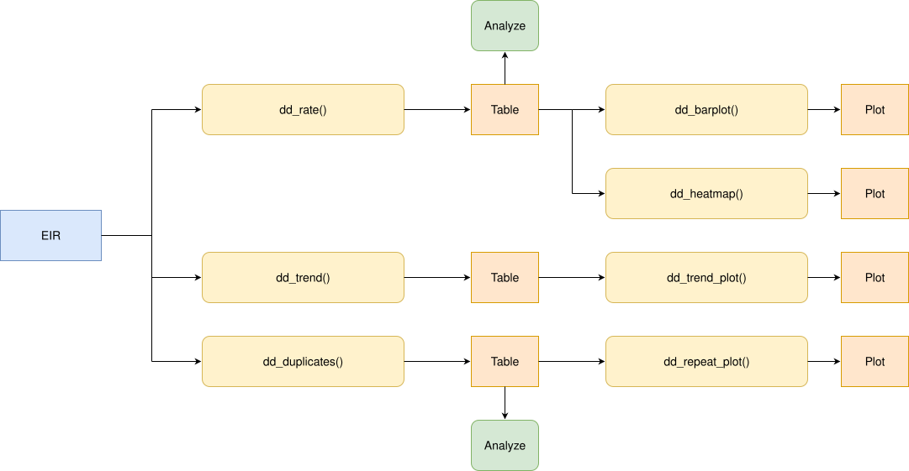

<a href="../en/duplicate_doses_en.html" class="btn btn-outline-primary" role="button">🌐 Read this in English</a>

```{r setup, include = FALSE, message = FALSE, warning = FALSE}
library(immunabc)
library(dplyr)
library(knitr)
```

# Fundamento

En un Registro Nominal de Vacunación electrónico (RNVe), cada dosis que recibe una persona debería registrarse exactamente una vez. En la práctica, una misma dosis puede quedar registrada más de una vez para la misma persona. Cada registro adicional aumenta el número de dosis administradas, por lo que sesga los indicadores tradicionales de cobertura que suelen utilizar el "número de dosis administradas" como numerador.

Este módulo permite analizar las dosis duplicadas en un RNVe. Compara todos los registros que pertenecen a una misma persona y que corresponden a una misma dosis, y clasifica cada registro adicional en una de las siguientes categorías:

1. **Duplicado**: el registro adicional tiene la misma fecha y el mismo lugar de vacunación que un registro anterior; es decir, el mismo evento de vacunación se registró más de una vez.
2. **Repetido**: el registro adicional tiene una fecha o un lugar de vacunación diferente; es decir, la misma dosis se registró en otro momento u otro lugar.

Estas categorías ayudan a los analistas a entender, a grandes rasgos, las posibles causas de los registros adicionales en su RNVe. Sin embargo, el motivo exacto de cada uno debe analizarse a nivel de registro y, si es posible, complementarse con otras fuentes de información. Por ejemplo, un registro **Duplicado** puede deberse a que los datos se ingresaron dos veces en el sistema, o a que los datos se duplicaron al migrarlos desde un sistema anterior. En el caso de los registros **Repetidos**, es posible que la dosis realmente se haya administrado dos veces (lo que llamaríamos un error programático), o que se haya ingresado con un número de dosis equivocado (p. ej., una dosis DTP2 ingresada como DTP1). Los gráficos y tablas de este módulo le ayudarán a investigar estas posibles causas.

Por último, dado que los registros adicionales (cualquiera que sea su causa) son un problema de calidad de datos directamente relacionado con cada evento de vacunación, este módulo desagrega los resultados geográficamente según el **lugar de vacunación** (ocurrencia), y no según el lugar de residencia de la persona.

> **Nota**
>
> Todas las funciones utilizadas para los análisis de dosis duplicadas dentro de immunABC comienzan con el prefijo `dd_`.

# Glosario

## Divisiones político-geográficas

A lo largo de esta viñeta se hace referencia a distintos niveles de división político-geográfica. Estos niveles son definidos por cada país o territorio y pueden recibir nombres diferentes. immunABC no depende de esos nombres locales; por eso, el usuario debe recodificar sus variables para ajustarlas a la estructura que utiliza el paquete.

En concreto, immunABC puede distinguir tres niveles administrativos que, listados del nivel superior al inferior, son: ADM0, ADM1 y ADM2.

1. ADM0: El país. Este es el nivel administrativo más alto.
2. ADM1: La primera subdivisión geográfica del país. ADM0 contiene varias subdivisiones ADM1.
3. ADM2: La segunda subdivisión geográfica del país. Cada ADM1 contiene varias subdivisiones ADM2.

## Categorías de duplicación

Al analizar los registros adicionales se aplica la siguiente clasificación: todos los registros que pertenecen a una misma persona y contienen la misma dosis se comparan en orden de fecha de vacunación. El primer registro se considera el legítimo, y cada registro posterior se clasifica comparándolo con los anteriores:

- `FIRST_ENTRY`: el primer registro de esa persona y dosis. Nunca se cuenta como un problema.
- `DUPLICATE`: misma persona, dosis, fecha de vacunación y lugar de vacunación que un registro anterior.
- `REPEATED`: misma persona y dosis que un registro anterior, pero con una fecha o un lugar de vacunación diferente.

A continuación se muestra un ejemplo de esta clasificación para una persona con dos registros adicionales:

| `date_vax` | Lugar de vacunación | Categoría | Motivo |
|---|---|---|---|
| 5 de enero | `ADM2_1_1` | `FIRST_ENTRY` | Primer registro de esta persona y dosis. No se cuenta como adicional. |
| 10 de febrero | `ADM2_1_1` | `REPEATED` | Misma dosis, pero en una fecha diferente. |
| 10 de febrero | `ADM2_1_1` | `DUPLICATE` | Idéntico al registro anterior. |

## Registros no evaluados

Los registros sin `ID`, `dose`, `date_vax`, `ADM1_occurrence` o `ADM2_occurrence` no contienen información suficiente para saber si coinciden con otro registro, por lo que no se evalúan. Todas las funciones de este módulo muestran un mensaje con el número de registros que fueron excluidos.

# Uso

## Instalar el paquete

```{r install_package, eval=FALSE}
devtools::install_github("IM-Data-PAHO/immunabc")
```

## Cargar los datos

Las funciones de este módulo requieren su **RNVe** en el formato estándar de immunABC. De manera opcional, `dd_repeat_plot()` puede utilizar el **esquema de vacunación** para mostrar la ventana de vacunación de cada dosis. A continuación se describe el formato esperado para estos conjuntos de datos.

### RNVe

El data frame `immunabc::immunABC.EIR` contiene una tabla simulada a nivel nominal que representa eventos individuales de vacunación de un Registro Nominal de Vacunación electrónico (RNVe). Cada fila corresponde a un único acto de vacunación de una persona.

```{r immunABC-EIR, message=FALSE}
immunABC.EIR %>% head() %>% kable(caption = "Ejemplo de Registro Nominal de Vacunación electrónico")
```

- `ID`: Número único de identificación de la persona.
- `date_birth`: Fecha de nacimiento de la persona.
- `date_vax`: Fecha del evento de vacunación.
- `ADM1_residence` / `ADM2_residence`: Primer y segundo nivel administrativo geográfico de residencia.
- `ADM1_occurrence` / `ADM2_occurrence`: Primer y segundo nivel administrativo geográfico donde ocurrió la vacunación.
- `dose`: Variable combinada que representa el tipo de vacuna y el número de dosis (p. ej., DTP1).

### Esquema de vacunación

El data frame `immunabc::immunABC.schedule` define la edad, en días, a la que debería administrarse cada dosis.

```{r immunABC-schedule, message=FALSE}
immunABC.schedule %>% kable(caption = "Ejemplo de esquema de vacunación")
```

- `dose`: Variable combinada que representa el tipo de vacuna y el número de dosis (p. ej., DTP1).
- `age_schedule`: Edad recomendada de vacunación, en días.
- `age_schedule_low` / `age_schedule_high`: Límites inferior y superior de la ventana de vacunación, en días.

## Análisis de dosis duplicadas

### Flujo de trabajo esperado

El conjunto de funciones `dd_` contiene siete funciones organizadas en tres flujos:

1. `dd_rate()` — calcula el porcentaje de registros duplicados y repetidos, y permite desagregarlo por nivel geográfico y, de manera opcional, por dosis o cohorte de nacimiento.
    - `dd_barplot()` — visualiza el resultado de `dd_rate()` como un gráfico de barras.
    - `dd_heatmap()` — visualiza el resultado de `dd_rate()` como un mapa de calor de áreas geográficas frente a dosis o cohortes de nacimiento.
2. `dd_trend()` — calcula el porcentaje de registros duplicados por mes de vacunación.
    - `dd_trend_plot()` — visualiza el resultado de `dd_trend()` como un gráfico de líneas.
3. `dd_duplicates()` — lista todos los registros de cada dosis registrada más de una vez, para su revisión y corrección a nivel de registro.
    - `dd_repeat_plot()` — para los registros **Repetidos** de una dosis, esta función compara la edad de vacunación de las repeticiones con la de los primeros registros de esa misma dosis. Esto ayuda a detectar dosis registradas en el RNVe con un número de dosis equivocado (p. ej., si las repeticiones de DTP1 se concentran en la edad en que corresponde la DTP2, podría tratarse de dosis DTP2 registradas como DTP1).


La figura siguiente muestra el flujo de trabajo esperado.



<br>

### Paso 1 — Calcular los registros duplicados y repetidos con `dd_rate()`

`dd_rate()` clasifica cada registro y devuelve, para cada grupo, el número y el porcentaje de registros `DUPLICATE` y `REPEATED`. El denominador (`total`) incluye todos los registros evaluados del grupo. A continuación se muestra el resultado a nivel nacional.

```{r dd-rate-adm0, message=FALSE}
dd_rate(data.EIR = immunABC.EIR) %>%
  kable(digits = 2, caption = "Registros duplicados y repetidos a nivel nacional")
```

Los resultados pueden desagregarse geográficamente con `geo_level` y por una variable adicional con el argumento `disaggregate_by` (ya sea `dose` o `birth_cohort`). Por ejemplo, si desagregamos por el primer nivel subnacional (ADM1), obtenemos la siguiente tabla:

```{r dd-rate-adm1, message=FALSE}
rate_adm1 <- dd_rate(
  data.EIR  = immunABC.EIR,
  geo_level = "ADM1"
)

rate_adm1 %>% kable(digits = 2, caption = "Registros duplicados y repetidos por ADM1 de vacunación")
```

Y si desagregamos solo por `dose`, obtenemos una tabla a nivel nacional en la que cada dosis se analiza por separado:

```{r dd-rate-dose, message=FALSE}
rate_dose <- dd_rate(
  data.EIR        = immunABC.EIR,
  disaggregate_by = "dose"
)

rate_dose %>%
  filter(duplication == "DUPLICATE") %>%
  kable(digits = 2, caption = "Registros duplicados por dosis")
```

<details>
<summary><strong>Parámetros aceptados</strong></summary>

- `data.EIR`: Data frame del RNVe en formato immunABC.
- `geo_level`: Nivel geográfico de vacunación: `"ADM0"` (por defecto), `"ADM1"` o `"ADM2"`.
- `disaggregate_by`: Una variable adicional por la cual desagregar: `"dose"` o `"birth_cohort"`. Por defecto `NULL` (sin desagregación adicional). Con `"birth_cohort"`, los registros sin `date_birth` se excluyen, con un mensaje.
- `vaccines`: Vector de caracteres con las dosis a incluir, p. ej. `c("DTP1", "DTP2", "DTP3")`. Es solo un filtro: use `disaggregate_by = "dose"` para ver los resultados por dosis. Por defecto `NULL` utiliza todas las dosis.
- `birth_cohorts`: Vector numérico con el o los años de cohorte de nacimiento a filtrar. Es solo un filtro: use `disaggregate_by = "birth_cohort"` para ver los resultados por cohorte. Por defecto `NULL` utiliza todas las cohortes disponibles.

</details>

### Paso 2 — Visualizar los registros duplicados con `dd_barplot()`

El resultado de `dd_rate()` puede entregarse directamente a `dd_barplot()`. Si los datos tienen áreas geográficas, estas se muestran en el eje x; de lo contrario, este eje muestra las dosis o cohortes de nacimiento. Cuando los datos tienen ambas desagregaciones, las dosis o cohortes de nacimiento se muestran en paneles. Al mostrar porcentajes, una línea discontinua indica el porcentaje de todos los grupos combinados.

```{r dd-barplot-adm1, message=FALSE, fig.width=10, fig.height=5}
dd_barplot(data = rate_adm1)
```

Por defecto, el gráfico muestra el porcentaje de registros `DUPLICATE`. Use `duplication = "repeated"` para mostrar los registros `REPEATED`, y `value = "n"` para mostrar el número de registros en lugar de su porcentaje:

```{r dd-barplot-dose, message=FALSE, fig.width=10, fig.height=5}
dd_barplot(
  data        = rate_dose,
  duplication = "repeated",
  value       = "n"
)
```

A nivel ADM2, `within_ADM1` permite enfocarse en las áreas de uno o varios ADM1, y `min_total` oculta las barras con pocos registros, ya que sus porcentajes pueden ser engañosos debido a que sus denominadores son pequeños:

```{r dd-barplot-adm2, message=FALSE, fig.width=10, fig.height=5}
rate_adm2 <- dd_rate(
  data.EIR  = immunABC.EIR,
  geo_level = "ADM2"
)

dd_barplot(
  data        = rate_adm2,
  within_ADM1 = "ADM1_3",
  min_total   = 1000
)
```

<details>
<summary><strong>Parámetros aceptados</strong></summary>

- `data`: Resultado de `dd_rate()`.
- `value`: Qué mostrar en el eje y: `"rate"` (por defecto) o `"n"`.
- `duplication`: Qué registros mostrar: `"duplicate"` (por defecto) o `"repeated"`.
- `within_ADM1`: Vector de caracteres para filtrar ADM1 específicos cuando `geo_level = "ADM2"`. Por defecto: `NULL`.
- `min_total`: Número mínimo de registros para mostrar una barra. Las barras ocultas siguen contando para la línea discontinua. Por defecto: `NULL` (se muestran todas las barras).

</details>

#### Interpretación

Tanto los porcentajes como los números absolutos son útiles, pero responden a preguntas distintas. Con `value = "rate"`, los gráficos muestran dónde el problema es proporcionalmente mayor, lo que apunta a prácticas de registro que conviene revisar. Con `value = "n"`, muestran dónde hay más registros que corregir, que es donde un esfuerzo de limpieza tendrá mayor impacto. Al mostrar porcentajes, una línea discontinua indica el porcentaje de todos los grupos combinados, y las barras que estén muy por encima de ella deberían ser las primeras en revisarse.

### Paso 3 — Combinar dos desagregaciones con `dd_heatmap()`

`dd_heatmap()` permite combinar dos desagregaciones en un solo gráfico. Por ejemplo, podemos visualizar el porcentaje de registros duplicados para cada área geográfica y dosis:

```{r dd-heatmap-dose, message=FALSE, fig.width=10, fig.height=5}
rate_adm1_dose <- dd_rate(
  data.EIR        = immunABC.EIR,
  geo_level       = "ADM1",
  disaggregate_by = "dose"
)

dd_heatmap(data = rate_adm1_dose)
```

También podemos visualizar lo mismo por cohorte de nacimiento en lugar de dosis y, además, filtrar solo las cohortes más recientes:

```{r dd-heatmap-cohort, message=FALSE, fig.width=10, fig.height=4}
rate_adm1_cohort <- dd_rate(
  data.EIR        = immunABC.EIR,
  geo_level       = "ADM1",
  disaggregate_by = "birth_cohort",
  birth_cohorts   = 2021:2023
)

dd_heatmap(data = rate_adm1_cohort)
```

<details>
<summary><strong>Parámetros aceptados</strong></summary>

- `data`: Resultado de `dd_rate()` con `geo_level` en `"ADM1"` o `"ADM2"` y un valor para `disaggregate_by`.
- `value`: Qué mostrar en las celdas: `"rate"` (por defecto) o `"n"`.
- `duplication`: Qué registros mostrar: `"duplicate"` (por defecto) o `"repeated"`.
- `within_ADM1`: Vector de caracteres para filtrar ADM1 específicos cuando `geo_level = "ADM2"`. Por defecto: `NULL`.
- `min_total`: Número mínimo de registros para rellenar una celda. Las demás celdas quedan en gris y vacías. Por defecto: `NULL` (se rellenan todas las celdas).
- `digits`: Número de decimales en las celdas cuando `value = "rate"`. Por defecto: `1`.
- `show_numbers`: Lógico, por defecto `TRUE`. Indica si se muestra el número en cada celda o, en su lugar, una leyenda de colores. Use `FALSE` cuando haya demasiadas celdas para leerlas (p. ej., a nivel ADM2).

</details>

#### Interpretación

Una fila oscura en todas las áreas indica un problema de esa dosis o cohorte en todo el país, por ejemplo una dosis que el sistema de información registra dos veces de forma sistemática. Una columna oscura indica un problema en un área específica, lo que sugiere una práctica de registro local. Una única celda oscura es un problema específico de un área y una dosis o cohorte. En el ejemplo, `ADM1_4` tiene los porcentajes más altos para la mayoría de las dosis, y `BCG RN` y `DTP1` tienen los porcentajes más altos en todas las áreas.

### Paso 4 — Seguir los registros duplicados en el tiempo con `dd_trend()` y `dd_trend_plot()`

`dd_trend()` realiza el mismo cálculo que `dd_rate()`, pero desagrega los resultados por mes de vacunación para detectar tendencias en el tiempo. Solo se incluyen los registros `DUPLICATE`: los registros repetidos se exploran mejor con `dd_repeat_plot()` (ver el Paso 6).

A continuación se muestra el resumen de registros duplicados por mes y ADM1.

```{r dd-trend, message=FALSE}
trend_adm1 <- dd_trend(
  data.EIR  = immunABC.EIR,
  geo_level = "ADM1"
)

trend_adm1 %>% head() %>% kable(digits = 2, caption = "Registros duplicados por ADM1 y mes de vacunación")
```

Cuando los resultados están desagregados a nivel subnacional, `dd_trend_plot()` dibuja el total de todas las áreas como una línea destacada, y cada área subnacional como una línea gris delgada a modo de contexto. Se pueden destacar en color hasta 5 áreas subnacionales con el parámetro `highlight`. Se recomienda explorar los datos antes de elegir las áreas a destacar. En este caso destacamos `ADM1_4` porque es el área con el mayor porcentaje de registros duplicados.

```{r dd-trend-plot, message=FALSE, fig.width=10, fig.height=5}
dd_trend_plot(
  data      = trend_adm1,
  highlight = "ADM1_4"
)
```

<details>
<summary><strong>Parámetros aceptados</strong></summary>

`dd_trend()`:

- `data.EIR`: Data frame del RNVe en formato immunABC.
- `geo_level`: Nivel geográfico de vacunación: `"ADM0"` (por defecto), `"ADM1"` o `"ADM2"`.
- `vaccines`: Vector de caracteres con las dosis a incluir. Por defecto `NULL` utiliza todas las dosis.
- `birth_cohorts`: Vector numérico con el o los años de cohorte de nacimiento a filtrar. Por defecto `NULL` utiliza todas las cohortes disponibles.

`dd_trend_plot()`:

- `data`: Resultado de `dd_trend()`.
- `value`: Qué mostrar en el eje y: `"rate"` (por defecto) o `"n"`. Con `"n"`, todas las áreas combinadas corresponden a la suma de todas las áreas, por lo que su valor puede ser mucho mayor que el de cualquier área individual.
- `highlight`: Hasta 5 áreas geográficas a destacar en color. Solo disponible cuando `data` está desagregado por ADM1 o ADM2. Por defecto: `NULL`.
- `within_ADM1`: Vector de caracteres para filtrar ADM1 específicos cuando `geo_level = "ADM2"`. En ese caso, todas las áreas combinadas se refiere solo a esas áreas. Por defecto: `NULL`.
- `min_total`: Número mínimo de registros para mostrar un área en un mes determinado; de lo contrario, las líneas quedan con espacios vacíos. Es útil porque los porcentajes basados en pocos registros pueden ser engañosos y estirar el eje y. Por defecto: `NULL` (se muestran todos los meses).

</details>

#### Interpretación

Este análisis ayuda a detectar tendencias en los registros duplicados a lo largo del tiempo. Si un mes o un conjunto de meses tiene porcentajes de duplicados más altos que el resto, puede indicar un error sistemático que afectó a los registros de ese período. Por ejemplo, es posible que los registros se hayan escrito más de una vez durante una migración masiva desde un RNVe anterior, o que un lote de registros en papel se haya digitalizado dos veces. En el ejemplo, los duplicados se concentran claramente en el primer semestre de 2022, en particular en el área `ADM1_4`, y casi desaparecen después.

### Paso 5 — Inspeccionar los registros individuales con `dd_duplicates()`

`dd_duplicates()` devuelve una tabla a nivel de registro con todos los registros de cada dosis registrada más de una vez para la misma persona. A continuación se listan todas las dosis DTP1 registradas más de una vez:

```{r dd-duplicates, message=FALSE}
duplicates_df <- dd_duplicates(data.EIR = immunABC.EIR, vaccines = "DTP1")

duplicates_df %>%
  head() %>%
  kable(caption = "Dosis DTP1 registradas más de una vez")
```

<details>
<summary><strong>Parámetros aceptados</strong></summary>

- `data.EIR`: Data frame del RNVe en formato immunABC.
- `vaccines`: Vector de caracteres con las dosis a incluir. Por defecto `NULL` utiliza todas las dosis.
- `birth_cohorts`: Vector numérico con el o los años de cohorte de nacimiento a filtrar. Por defecto `NULL` utiliza todas las cohortes disponibles.

</details>

#### Resultado

Tenga en cuenta que, además de las columnas originales de cada registro, el resultado incluye:

- `group`: un número que identifica todos los registros de una misma persona y dosis.
- `copy`: la posición del registro dentro de su grupo, en orden de fecha.
- `n_copies`: el número de registros del grupo.
- `days_since_first_entry`: los días entre el registro y el `FIRST_ENTRY` de su grupo.
- `duplication`: la categoría del registro: `FIRST_ENTRY`, `DUPLICATE` o `REPEATED`.

#### Interpretación

Esta tabla puede exportarse para flujos de revisión y corrección a nivel de registro. Por ejemplo, la columna `days_since_first_entry` permite distinguir los registros `REPEATED` registrados el mismo día en dos lugares distintos (`days_since_first_entry = 0`) de los registrados semanas o meses después del primer registro, lo que puede apuntar a causas distintas (ver el Paso 6).

### Paso 6 — Explorar las posibles causas de los registros repetidos con `dd_repeat_plot()`

A modo de ejemplo, consideremos el siguiente caso hipotético de una persona nacida el 10 de enero de 2022:

| `dose` | `date_vax` | Edad de vacunación | `ADM2_occurrence` | `copy` | `days_since_first_entry` | `duplication` |
|---|---|---|---|---|---|---|
| DTP1 | 2022-03-11 | 60 días | `ADM2_1_1` | 1 | `NA` | `FIRST_ENTRY` |
| DTP1 | 2022-05-12 | 122 días | `ADM2_1_1` | 2 | 62 | `REPEATED` |

El primer registro está dentro de la ventana de vacunación de DTP1 (de 54 a 90 días de edad, según `immunABC.schedule`), por lo que lo más probable es que sea una DTP1 legítima. Sin embargo, el segundo registro de DTP1 se registró a los 122 días de edad, justo dentro de la ventana de DTP2 (de 116 a 150 días). Si revisamos el resto de los registros de esta persona en el RNVe y encontramos una DTP3 a los 6 meses, pero ninguna DTP2, la explicación más probable es que la dosis DTP2 se registró con un número de dosis equivocado. Más que una dosis adicional, lo más probable es que esta persona tenga una dosis DTP2 mal etiquetada.

El ejemplo anterior corresponde a una sola persona, pero revisar cada grupo a mano no es factible cuando un RNVe tiene miles de ellos. Lo que realmente queremos saber es si se trata de un caso aislado o de un patrón sistemático: ¿los registros `REPEATED` de DTP1 en el RNVe se registran mayormente a la edad en que corresponde la DTP2?

`dd_repeat_plot()` responde esta pregunta para toda la tabla a la vez. Toma el resultado de `dd_duplicates()` y, para una sola dosis, muestra la edad de vacunación de los registros `FIRST_ENTRY` (panel superior) y de los registros `REPEATED` (panel inferior). También se pueden entregar `data.schedule` y `schedule_vaccines` para sombrear ventanas de vacunación específicas en el gráfico y así resaltar con mayor claridad las dosis DTP2 que pudieran estar mal etiquetadas como DTP1.

```{r dd-repeat-plot, message=FALSE, fig.width=10, fig.height=6}
dd_repeat_plot(
  data              = duplicates_df,
  vaccine           = "DTP1",
  max_age           = 365,
  data.schedule     = immunABC.schedule,
  schedule_vaccines = c("DTP1", "DTP2")
)
```

También podemos dividir los resultados por área subnacional con `geo_level`, lo que muestra si el patrón es el mismo en todas partes:

```{r dd-repeat-plot-adm1, message=FALSE, fig.width=12, fig.height=6}
dd_repeat_plot(
  data              = duplicates_df,
  vaccine           = "DTP1",
  geo_level         = "ADM1",
  max_age           = 365,
  binwidth          = 14,
  data.schedule     = immunABC.schedule,
  schedule_vaccines = c("DTP1", "DTP2")
)
```

<details>
<summary><strong>Parámetros aceptados</strong></summary>

- `data`: Resultado de `dd_duplicates()`.
- `vaccine`: La dosis a mostrar, p. ej. `"DTP1"`.
- `geo_level`: Nivel geográfico de vacunación por el cual dividir los paneles: `"ADM0"` (por defecto, sin división), `"ADM1"` o `"ADM2"`.
- `within_ADM1`: Vector de caracteres para filtrar ADM1 de vacunación específicos. Por defecto: `NULL`.
- `binwidth`: Ancho de cada barra del histograma, en días. Por defecto: `7` (una semana).
- `max_age`: Edad máxima de vacunación a mostrar en el eje x, en días. El número de registros que la superan se indica en la nota al pie del gráfico. Por defecto: `NULL` (se muestran todas las edades).
- `data.schedule`: Data frame del esquema de vacunación en formato immunABC, usado para sombrear las ventanas de vacunación. Por defecto: `NULL` (no se muestran ventanas).
- `schedule_vaccines`: Hasta 3 dosis cuya ventana de vacunación se sombrea. Solo se usa con `data.schedule`. Por defecto `NULL` sombrea la ventana de `vaccine`.

</details>

#### Interpretación

La forma del panel inferior da pistas sobre la causa de las repeticiones:

- **Repeticiones a la edad de la siguiente dosis**: si las repeticiones de DTP1 se concentran en la ventana de vacunación de DTP2, como en el ejemplo, lo más probable es que el segundo registro sea una dosis DTP2 registrada como DTP1. Estas personas probablemente aparecerán con una DTP2 saltada en el módulo de [Comparación de secuencia de dosis](dose_sequence_comparison_es.html).
- **Repeticiones poco después del primer registro, dentro de la misma ventana**: la dosis pudo haberse registrado nuevamente en una visita de seguimiento, o haberse administrado dos veces porque no se revisó el historial de vacunación de la persona.
- **Repeticiones distribuidas en todas las edades**: los registros podrían pertenecer a dos personas distintas vinculadas al mismo ID, lo que es un problema de vinculación de registros.

> **Nota**
>
> Los registros sin `date_birth`, o con una `date_vax` anterior a la `date_birth`, no tienen una edad de vacunación válida, por lo que se excluyen de este análisis. El módulo de [Comparación de consistencia de fechas](date_consistency_comparison_es.html) puede ayudar a investigar estos últimos.

# Resumen

El módulo `dd_` ofrece un flujo completo para detectar dosis registradas más de una vez en los datos del RNVe, distinguiendo los registros `DUPLICATE` (el mismo evento de vacunación registrado más de una vez, con la misma fecha y lugar) de los registros `REPEATED` (la misma dosis registrada en otra fecha o en otro lugar).

- `dd_rate()`, `dd_barplot()` y `dd_heatmap()` ofrecen una visión geográfica por dosis o cohorte de nacimiento,
- `dd_trend()` y `dd_trend_plot()` analizan posibles tendencias en el tiempo de los registros duplicados,
- `dd_duplicates()` permite inspeccionar los registros individuales, y
- `dd_repeat_plot()` ayuda a identificar las causas de los registros repetidos.

Dado que los registros duplicados y repetidos son problemas de calidad de datos que sesgan muchos indicadores (como la cobertura o la tasa de abandono), recomendamos ejecutar este módulo en una etapa temprana para identificar posibles problemas en su propio RNVe.
